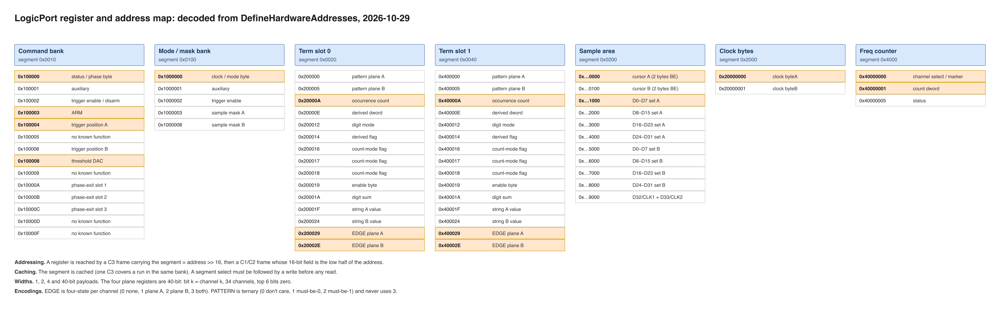
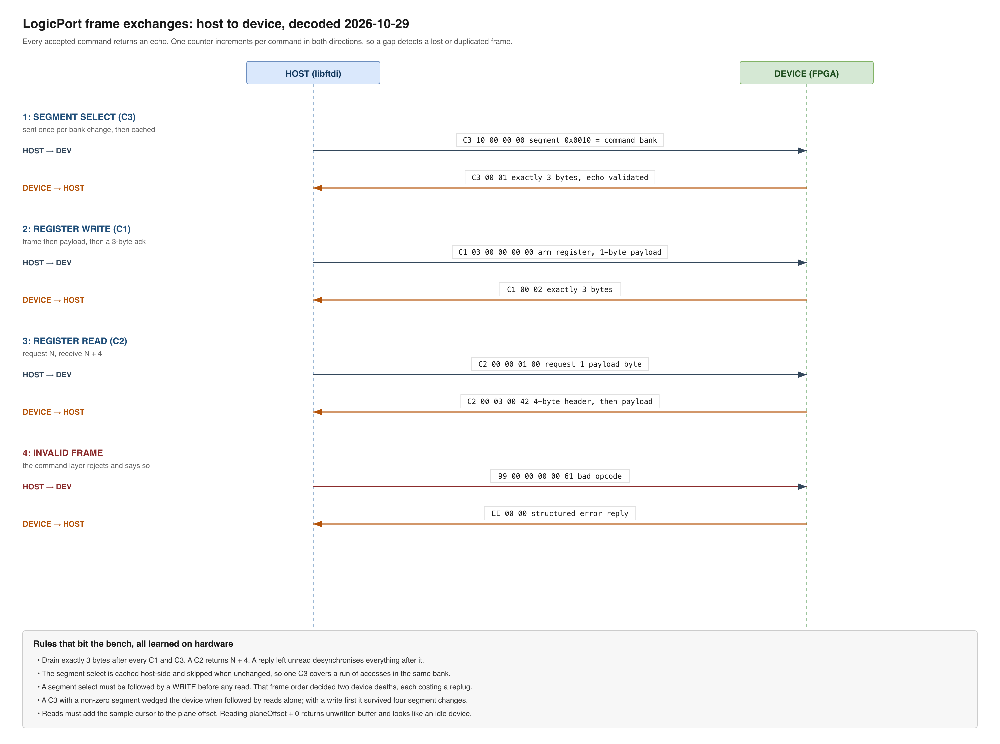
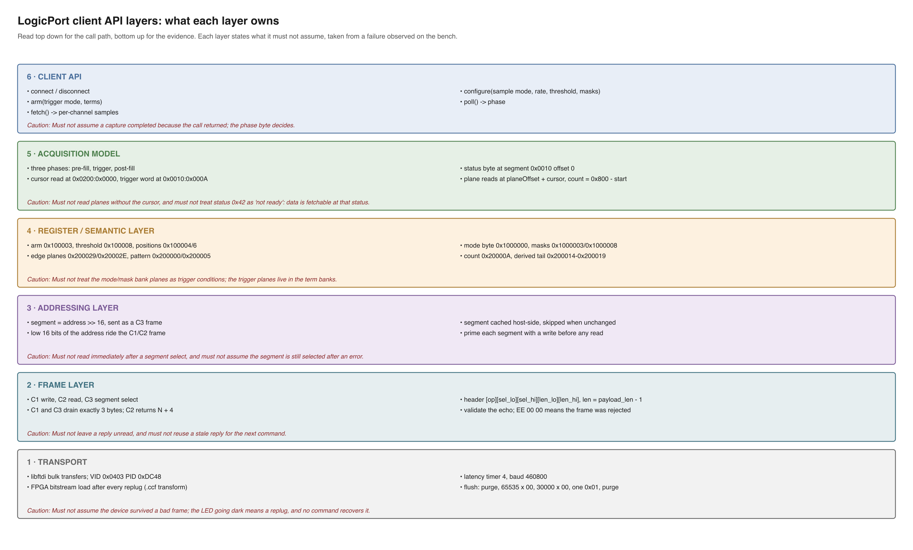

# LogicPort USB Protocol: Reverse Engineering Record

> Source: `LogicPort.exe` v3.4.0.2371 (Intronix Test Instruments), static analysis.
> Evidence addresses refer to the extracted `LogicPort.exe` (SHA-256 `343745f3...`).
> Register: ASD-STE100 Simplified Technical English. Technical names stay as is.
> Status: work in progress. Each section lists its evidence.
> Language: every document in this directory is written in ASD-STE100 Simplified
> Technical English, and is checked with `docs/ste-audit.py`. Run it from this
> directory with `python3 ste-audit.py *.md`. It reports em dashes, the words the
> standard prohibits, over-length sentences and slash use. All four counts are
> zero. Passive constructions are reported but not rewritten, because the
> standard permits them in descriptive text where the active voice would change
> the claim.

# Part I: Current model (living)

> This section states the model as it stands on 2026-10-28 night. It is
> edited in place when findings change the model. Part II below holds the
> dated record and stays as it was. When the two disagree, this section
> is current.

## A. Transport

**Pinout and channel map live in `LogicPort-Pinout.md`.** Read that before
attaching a clip. The pod's pin numbering does not match the help file's, and
colour groups identify a wire reliably where counting pins does not.

FTDI D2XX, VID `0x0403`, PID `0xDC48`. The FPGA needs a bitstream load
after every USB replug. The `0x61` byte that earlier sections call a
"wake" is the clock register write at `0x1000000`, the slowest clock
setting (addendum 12).

**LED meaning (principal, 2026-10-29).** The LED is a power and health
indicator. It comes on at every replug. A dark LED means a bad write put
the device in a fault state; replug, then reload the bitstream. A lit
LED does not prove that a configuration was accepted. `DONE` (pin bit
`0x10`) is low after a replug because the FPGA is unconfigured, which is
a different signal from the LED.

## B. Wire frames

Three frame kinds. The header is five bytes:

| Byte | Value |
| --- | --- |
| 0 | opcode: `0xC1` write, `0xC2` read request, `0xC3` clock select |
| 1 | select low byte |
| 2 | select high byte |
| 3 | length low byte (`payload_len - 1` for C1; `N` for C2) |
| 4 | length high byte |

- `C1` carries the payload. The device drains exactly 3 reply bytes:
  `C1 00 <counter>`.

- `C2` has no payload. The device returns `N + 4` bytes: `C2 00
  <counter> 00` and then N payload bytes. The status byte is the first
  payload byte (reply byte 4).

- `C3` has no payload and replies `C3 00 <counter>`. The vendor sends
  it when the select high word changes.

One counter increments by one per command in both directions. A gap
detects a lost or duplicated frame.

Bytes 1-2 are the **select** field. Two readings compete.

The sample-rate reading (addendum 5) is in doubt. Three bench passes
eliminated both tested rate words as enough.

The register-select reading (addendum 9) is downgraded. Its premise
failed: the shipped image holds `0x00` in every slot Double in the
range `0x596ae0` to `0x596cb8`, so the vendor's own configuration
frames can legitimately carry `0x0000` in this field (addendum 10).
Its remaining support is the proven threshold write at select `0x0008`.

**The C3 rule.** After any flush or reopen the vendor invalidates the
clock-select cache and re-emits `C3` before the next framed command.
The bench tools never sent a `C3` on any pass before 2026-10-28 night.
Under position-and-size identity that is a missing frame, which
desyncs every later command. `C3` is the current leading candidate for
the constant `00` status.

## C. The register map

Decoded from `DefineHardwareAddresses` (`FUN_00471af1`), which builds every
address as a power-of-two base plus an offset.

Addressing: a register is selected by a `C3` frame carrying `addr >> 16` (the
segment, cached in `_DAT_005977e8`), then a `C1`/`C2` frame whose 16-bit field
is the low half of the address. Segment values follow directly: `0x10xxxx` is
segment `0x0010`, `0x1000000` range is `0x0100`, the sample area is `0x0200`.

### Command bank, segment `0x0010`

| Address | Meaning |
| --- | --- |
| `0x100000` | status, and the trigger/sample count word at offset `0x000A` |
| `0x100002` | trigger enable or disarm |
| `0x100003` | **arm** |
| `0x100004`, `0x100006` | trigger position A and B (the pre/post split) |
| `0x100008` | threshold DAC |
| `0x10000A`, `0x10000B`, `0x10000C` | phase-exit slots |

### Mode and mask bank, segment `0x0100`

`0x1000000` clock/mode byte; `0x1000001` auxiliary; `0x1000002` trigger enable;
`0x1000003` and `0x1000008` the two sample masks.

### Trigger-term banks

Term slot 0 is base `0x200000`, slot 1 is base `0x400000`, each with offsets
`+0, +5, +A, +E, +12, +14, +16, +17, +18, +19, +1A, +1F, +24, +29, +2E`.

| Register | Meaning |
| --- | --- |
| `0x200000`, `0x200005` | **pattern** planes A and B, three states per channel |
| `0x200029`, `0x20002E` | **edge** planes A and B, four states per channel |

Bit *k* is channel *k*, accumulated MSB-first over channels 33 to 0, sent as a
40-bit value. This is where trigger conditions are programmed; the mode/mask
bank planes are not trigger conditions, which is why early tries to fire a
trigger by writing `0x1000003` never worked.

### Sample area, segment `0x0200`

`0x0000` and `0x0100` are the sample cursors. `0x1000`, `0x2000`, `0x3000`,
`0x4000` hold D0-D7, D8-D15, D16-D23 and D24-D31 for column set A; `0x5000` to
`0x8000` repeat those groups for set B; `0x9000` holds D32 and D33. Reads must
add the cursor to the plane offset.

### Other banks

`0x2000000` per-channel wire select; `0x40000000` frequency counter.

### Historical note

An earlier section here described a register map that put register groups
behind `C3` page values `0x0010`, `0x0100`, `0x0200` and `0x2000` and labelled
it refuted. The refutation concerned that model's *use* on the bench, not the
addresses: those page values are the segments above, and they are correct. The
old `tools/triggered.c` remains unsafe to run for other reasons, not because
its addresses were wrong.

## D. Configuration vocabulary

### Clock and the frame order

The clock table has 20 rows in `DAT_0059678c`, selected by
`DAT_005962b0`. The periods run 1 ns to 1 ms in a 1-2-5 decade sequence;
byteA holds the decade in its high nibble, byteB the sub-step (`0x00`,
`0x11`, `0x44`). Row 18 is 500 us (2 kHz) with bytes `0x51`, `0x44`.
Full table: addendum 8.

**The clock bytes are dead code in the vendor build, and live on the hardware.**
Block A depends on `DAT_005962fc`, which nothing in the image writes, and an
exhaustive scan finds three references, all reads. So the vendor application never
sends the clock bytes.

**A client must send them anyway.** The device honours them: row 18 gives a
measured 2 kHz against a 500 Hz input, and rows 19, 18 and 16 gave three
different durations tracking 1032 prefill samples divided by the rate
(addendum 76). The vendor's silence is a property of that build and not of the
hardware.

**No register and no mode-byte bit selects timing mode or state mode.** That
remains open (addendum 76).

**The sample clock is in the bitstream.** `FUN_004834a8` maps the sample mode
and `clkState` to an index at `DAT_005967f8`. It passes that index ByRef to
the FPGA configure routine `FUN_004c8541`, with the path `LogicPort.CCF`. The
`.ccf` body holds eight images, so the index selects an image. A client must
load the image that matches its sample mode. Slot 0 is one image and is not a
default (addendum 75).

**Block B order, proven.** This is the sequence the dispatcher emits:

| Order | Frame | Register |
| --- | --- | --- |
| 1 | mode byte, 1 byte | `0x01000000` |
| 2 | `0x00`, 1 byte | `0x01000002` |
| 3 | mask A, 5 bytes, only if `DAT_005963f4 != 0` | `0x01000003` |
| 4 | mask B, 5 bytes, always | `0x01000008` |
| 5 | `0x01`, 1 byte | `0x01000002` |
| 6 | trail, 1 byte, `CByte(DAT_005974bc)` | `0x01000001` |

Mask A is conditional and mask B is not. An earlier line in this record said
the opposite. The mask packs MSB first over channel 33 down to 0.

**The clock divider is bypassed in State mode.** In external-clock mode the
clock bytes have no effect, because sampling follows the external edge. This
holds for a client that sends them. The vendor sends none.

### Frequency counter

Write the channel select to `0x40000000`, read the count dword from
`0x40000001`, then `Hz = count x 10`. The poll runs at a 75 ms gate and
cycles up to four channels. Status is at `0x40000005`.

### Mode byte

Formula (dispatcher `0x4f22db` to `0x4f2312`):

```
mode = CByte(DAT_00597418 + ((~DAT_00597418 & 2) * 2)
       + ((DAT_0059630c ^ 1) * 8) + DAT_00596308)
```

`DAT_00597418` is `clkState`, the state-mode {clock source, edge} choice,
values 0 to 3. `DAT_0059630c` is `otherState`, the qualifier polarity.
`DAT_00596308` is a by-reference Boolean folded in as a Variant operand
(contributes 0 or -1), not a plain integer.

**The mode byte is therefore composed by the client, not read from the
device.** With the qualifier polarity and flag at zero:

| `clkState` | mode byte |
| --- | --- |
| 0 | `0x0C` |
| 1 | `0x0D` |
| 2 | `0x0A` |
| 3 | `0x0B` |

Bit 3 is the qualifier term and is set in every case. The full reachable set
is `0x0C`, `0x0D`, `0x0A`, `0x0B`, `0x04`, `0x05`, `0x02`, `0x03` plus the
addend variants `0x09` and `0x01`.

### Threshold

```
v1 = 1.315 + (volts - 1.315) * (-0.4020381098624974)
code = CLng((4.559 - v1) / 5.875 * 1023.0)
wire = (code + DAT_00597480) AND 0x3FF
```

Constants at `0x407108` to `0x407128`. `CLng` is round-to-nearest.
`DAT_00597480` comes from the EEPROM user area: the validator stores
`Val(Left$(ua, 4))` there. A normal device reads zero (addendum 10).
At 2.5 V the wire word is 648 = `0x0288`. At 2.0 V it is 613 =
`0x0265`. The 445 reading in addendum 5 is refuted: it dropped the
stage-1 calibration and used truncation.

### Arm

1 = free-run (repetitive). 0 = single-shot. The value comes from
`DAT_00597488`, mapped by `FUN_0047e7cf` from capture state
`DAT_00596730` (1 or 2 to 1, 4 to 0).

### Sequencer

Two 128-byte records at `DAT_005963f0`. For a plain capture the flags
at `+0x00` and `+0x0C` are zero, so no 40-bit tally frames go out.
Each segment then sends 7 frames: two 4-byte (records `+0x20`, `+0x38`)
and five 1-byte (records `+0x3C`/`+0x46` mask, `+0x50`, `+0x68` to
`+0x6C`). Record values for a fresh install are UNVERIFIED.

## E. Vendor start path

> **Corrected by addendum 12.** The vendor writes six registers in block
> B, not four bytes. Mask B at `0x1000008` is the channel SAMPLE SET and
> is always sent; zero channels monitored means the buffer never fills,
> which is why status stayed at pre-fill on every pass. The free-run
> recipe needs no trigger condition: disarm `0x1000002`, mask B
> `FF FF FF FF 3F`, arm `0x1000003 <- 0x00`. Addresses are page `0x0010`
> and `0x0100`, selected with `C3`.

No monolithic start function. A UI event handler sets capture state
`DAT_00596730` and the six dirty flags. The pump tick `FUN_004f1453`
then emits the frames through the dispatcher `FUN_004f2179`. On every
capture restart all six dirty flags are set again, so the vendor
re-sends the full configuration. Frame order for a plain capture:

| Block | Frames | Gate |
| --- | --- | --- |
| A clock | 1 byte byteA, 1 byte byteB | `DAT_005962fc == 1` |
| B mode | mode, second byte, trail1 (`DAT_005963f4`), trail2 (`DAT_005974bc`) | no mask frames when `DAT_005963f4 == 0` |
| C sequencer | 2 lead 1-byte, per segment (4B, 4B, 5x1B), 1 tail | record flags zero skip the tallies |
| D threshold | 2 bytes | always |
| E positions | 2 bytes, 2 bytes | always |
| F arm | 1 byte | always |

Command identity is sequence position and payload size. Frames the
vendor does not send desync the device parser. This killed every bench
run before 2026-10-28 night.

## F. Capture read path

The poll is `C2` N=1 at select `0x0000`, once per 100 ms tick.
Status decode: bit0 set means complete; `0x60` means collecting;
`0x40` means waiting for trigger; otherwise pre-fill. On completion
the host fetches the sample planes with `C2` reads of plane size.
Byte mode reads 10 planes at `(cols + 1) / 2` bytes each. Every
stored bit is the complement of the raw level. Full path: addendum 6.

## G. The application stack (from the vendor menus)

The application separates configuration from the run command, and the
bench must do the same.

> **Investigation focus (principal, 2026-10-29):** two menus, and both are
> needed. **Setup configures how sampling and triggers work**, the two
> items in scope are Setup | Sample Mode... and Setup | Trigger...
> **Acquisition is how a capture is performed**. Single, Recurring, Halt,
> Trigger Immediate. Options, View and Help are display and are out of
> scope. A working client needs both halves: the configuration writes and
> the run command.

| Layer | Where | What it holds |
| --- | --- | --- |
| Setup menu | Signal Names, Groups, Interpreters, Measurements, Logic Sense, Sample Mode, Trigger | every configuration value: clock row, compression, masks, threshold, positions, trigger mode and terms |
| Acquisition menu | Single, Recurring, Halt, Trigger Immediate | the run command. Trigger Immediate "causes the current sample phase to be exited" and works "without regard for acquisition mode or trigger conditions" |
| View menu | zoom, scroll to sample or trigger, panels | display only |

The sample sequence has three phases: Pre-Fill, Trigger, Post-Fill. The
trigger logic is not armed until Pre-Fill completes, and Trigger
Immediate is the one command that exits a phase early (addenda 17, 19,
20).

## G1. Acquisition modes (to complete after the first successful capture)

**Requirement (principal, 2026-10-29): document each acquisition mode once
a capture succeeds.** The first successful capture is the reference. Each
other mode is then run against that reference and recorded here.

| Mode | Capture state `DAT_00596730` | Arm byte | Wire frames | Status observed |
| --- | --- | --- | --- | --- |
| Single | 1 | 1 | UNVERIFIED | none yet |
| Recurring | 2 | 1 | UNVERIFIED | none yet |
| Halt | 4 | 0 | UNVERIFIED | none yet |
| Trigger Immediate | 8 | unchanged (no store) | UNVERIFIED | none yet |

For each mode the record must carry: the exact frame list from the run
command to capture-complete, the status-byte sequence with timings, what
happens on a second invocation while a capture is in progress, and for
Recurring how the repeat is expressed. A mode is only documented when its
row has evidence from a captured run, not from the decoder alone.

## G2. Capture status

**A capture works, and the channel map is measured.** Addendum 76 records the
proof. Addendum 74 claimed a live capture and addendum 75 retracted it. Both
were wrong in part. The device does sample and does return live data. What
went wrong in 74 was the reading of the status byte, and what went wrong in 75
was a register file that this bench had corrupted plus a page-select bug that
returned `FF` as data.

The channel map, measured on hardware and not inferred:

| Item | Measured result |
| --- | --- |
| `D0` location | plane `0x1000`, **bit 0** |
| Bit order within a byte | channel k is bit k, least significant first |
| Set B planes `0x5000` to `0x8000` | all zero in the modes tested, so the read is the five-plane SDR set |
| Sample rate in the loaded image | about 4 kHz, from a 1 kHz input showing a 4.09 sample period |

The sequence below is the frame list that produced that capture:

The sequence:

```
FPGA load (.ccf)
flush        purge TX, purge RX, 65535 x 0x00, 30000 x 0x00, one 0x01, purge
prime        eight reads at segment 0 (no C3)
masks        C3 0x0100, write mask A at 0x0003, mask B at 0x0008
arm          C3 0x0010, write 0x0003 <- 0x00
status       reads 0x42
fetch        C3 0x0200, C2 at 0x0000 with N = 256 -> 260 bytes
```

The payload is real device data. The sample planes are in segment `0x0200`:

| Offset | Channels |
| --- | --- |
| `0x1000` | D0 to D7, set A |
| `0x2000` | D8 to D15, set A |
| `0x3000` | D16 to D23, set A |
| `0x4000` | D24 to D31, set A |
| `0x5000` to `0x8000` | the same four groups, set B |
| `0x9000` | D32/CLK1 and D33/CLK2 |

`0x0000` and `0x0100` are cursor A and cursor B, each a **2-byte big-endian
sample cursor**. The cursor advances one sample per capture.

Two things are UNVERIFIED. Whether the plane bytes are raw samples or
compressed tokens: the plane layout suggests raw, and the earlier compressed
reading may have been undriven inputs floating (addendum 48). And whether any
fetched byte corresponds to a known input signal (addendum 47).

### The reading that cost eleven passes

Status `0x42` means **data is available**, not "waiting for trigger with
nothing captured". Eleven passes read `0x42` and `0x00` as "not ready" and
never fetched. Bit 1 of that byte is the immediate-trigger flag, which is
why it never looked idle.

### What works and what does not

| Item | State |
| --- | --- |
| Frame shapes, drains, echo acks | proven on hardware |
| Segment addressing (`addr >> 16`, cached) | proven |
| Register map | decoded from `DefineHardwareAddresses` |
| Sample fetch | proven, returns data |
| Channel mapping | **blocked**: payload is compressed |
| Compression switch | real but behind a COM property layer not yet reached |

### Bench tools that matter

`tools/analyze.c` (capture plus per-bit analysis), `tools/planescan.c`
(region map), `tools/bare.c` (baseline), `tools/trig2.c` (reproducible
`0x42` state), `tools/d0map.c` (single-pin scan), `tools/segtest.c` (segment
exchange), `tools/echo_test.c` (frame validation discrimination).

## H. Open items

Ordered by what unblocks the next capture.

0. **Trigger programming** is specified in `docs/LogicPort-Trigger-Programming.md`
   (addendum 66): edge, pattern, duration and immediate triggers are armable;
   Value/Range and specific A/B combine rules are not yet.
1. **Read the planes at the cursor.** Every bench read used `planeOffset + 0`
   while the cursor was `0x025B`. The format is decoded in
   `docs/LogicPort-Sample-Format.md`; the next capture must use
   `planeOffset + cursor` (addendum 49).
2. **The compression switch.** Real (`UseCompression`) but reached through
   the device-object property layer (`vtable+0x574` on class
   `DAT_00417314`), not a register poke. If found first, it makes item 1
   unnecessary.
3. **Channel to plane mapping.** The plane table above is decoded and
   verified. What remains is confirming it on the wire, which depends on item 1.
4. **Whether pre-fill completes.** The cursor advances as the device samples.
   Whether a full buffer is present is now measurable, because the read address
   is known.
4. **The sample clock.** The clock is not in a register. It is in the FPGA
   image, and the image is selected by the sample mode and `clkState` through
   `FUN_004834a8` and `DAT_005967f8`. The open work is the mapping from that
   state to a slot index 0 to 7, and the load of the selected slot. Every bench
   run so far loaded slot 0, which is why the register file answered while the
   sample engine stayed dead (addendum 75).
5. **Trigger terms.** Decoded (addendum 54): the per-channel trigger planes
   are `0x200000`/`0x200005` (pattern) and `0x200029`/`0x20002E` (edge), in the
   TERM bank, not the mode/mask bank the bench had been writing. The edge
   encoding is four-state (none, rising, falling, both). `CombineMode` is
   host-side only. Remaining: which record field carries the occurrence count
   and the cumulative flag.
6. **Per-mode documentation.** Single, Recurring, Halt and Trigger Immediate
   each need a captured run before their rows close (section G1).

### Closed

- The validation reads: the connect path sends no frames (addendum 10).
- The `C3` rule: a segment select must be followed by a write before any
  read (addendum 32).
- The IOCTL: none exists; `0x6011` is a Variant type tag (addenda 27, 30).

## Diagrams

Six diagrams live in `docs/diagrams/`. Each has an editable `.drawio` or `.svg`
source beside a rendered `.drawio.png` preview.

| Diagram | Shows | Currency |
| --- | --- | --- |
| `logicport-register-map` | every register in every bank, with segments and the addressing rule | **current**, 2026-10-29 |
| `logicport-handshake` | the four frame exchanges, with real byte sequences and the rules that bit the bench | **current**, 2026-10-29 |
| `logicport-layers` | the client API stack, each layer's responsibilities and the assumption it must not make | **current**, 2026-10-29 |
| `logicport-frames` | the C1, C2 and C3 byte layouts side by side | 2026-10-28, still correct on frame shape |
| `logicport-sequence` | bring-up through the configuration blocks to the capture poll | 2026-10-28, **predates** the segment addressing and the term banks |
| `logicport-capture-states` | the capture phases and their transitions | 2026-10-28, **predates** the finding that status `0x42` means data is fetchable |

The three dated 2026-10-28 predate the session that corrected the addressing
model, the trigger-term banks and the status reading. They are accurate about
frame structure and wrong about anything involving segments or triggers. Read
them alongside the current three rather than instead of them.








## 1. Transport Layer

The LogicPort uses an FTDI USB device. The host opens it through the FTDI D2XX driver.

- USB Vendor ID: `0x0403` (FTDI)
- USB Product ID: `0xDC48` (Intronix LogicPort)
- A second product uses PID `0xDC4A` (Intronix ATE). The same software supports it.
- Driver: `FtdiBus` + `FTD2XX.dll` (INF: `logicport.inf`, `logicport32.inf`)

Live check, 2026-10-12, on a connected device:

- USB Product Name: `LogicPort Logic Analyzer`
- USB Vendor Name: `Intronix`
- idVendor 1027 (`0x0403`), idProduct 56392 (`0xDC48`), both match the INF data
- bcdDevice: `0x0400`
- USB Serial Number: present and unique per device (value omitted here)
- The EEPROM holds the Intronix strings. Open the device by serial number with `FT_OpenEx`.

A non-Windows host can use `libftdi` with VID `0x0403` and PID `0xDC48`.

The application calls these D2XX functions:

| Function | Use |
|---|---|
| `FT_OpenEx`, `FT_Close`, `FT_ListDevices` | Open and close the device |
| `FT_Write`, `FT_Read` | Send and receive protocol bytes |
| `FT_SetTimeouts`, `FT_GetStatus`, `FT_Purge` | Transfer control |
| `FT_ResetDevice`, `FT_ResetPort` | Device reset |
| `FT_SetBaudRate` | Serial interface speed (see section 3) |
| `FT_SetBitMode`, `FT_GetBitMode` | Interface mode |
| `FT_SetLatencyTimer`, `FT_GetLatencyTimer` | USB latency tuning |
| `FT_ReadEE`, `FT_WriteEE`, `FT_EraseEE` | EEPROM access |
| `FT_EE_Read`, `FT_EE_Program` | EEPROM image read and program |
| `FT_EE_UARead`, `FT_EE_UAWrite`, `FT_EE_UASize` | EEPROM user area (calibration data) |

Evidence: import strings in `LogicPort.exe`; `logicport.inf` hardware IDs.

## 2. Device Capabilities (Context for the Protocol)

- 34 sampled channels
- Buffer: 34 channels x 2048 samples
- Timing mode: 1 KHz to 500 MHz internal clock
- State mode: 0 to 200 MHz external clock, with qualifier clocks
- Sample compression up to 2^33 to 1
- Trigger sequencer: 4 levels, 250 MHz, 20-bit event counters
- Threshold range: +6 V to -6 V in 50 mV steps

Evidence: `LogicPort_en.chm` Specifications topic.

## 3. Wire Protocol

Every command is 5 bytes. The host writes them, then waits for the response. The wait loop polls `FT_GetStatus` until the receive queue holds enough bytes and the transmit queue is empty. Timeouts are 1000 ms or 2000 ms.

All multi-byte values below are little-endian, except where noted. Response VALUES are big-endian (section 3.5).

### 3.1 Command 0xC1: Write (general form)

Wire: `C1 r0 r1 L0 L1 [payload...]`

| Byte | Field |
|---|---|
| 0 | `0xC1` opcode |
| 1 | Clock word, bits 0 to 7 |
| 2 | Clock word, bits 8 to 15 |
| 3 | L, bits 0 to 7 (payload length minus 1) |
| 4 | L, bits 8 to 15 |
| 5.. | Payload, L+1 bytes |

The app packs rate and clock select into one value. The low 16 bits are the rate value. The clock select is `Int(value / 65536.0)` (constant at VA `0x402418`). When the clock select changes, the host sends 0xC3 first.

Payload sizes come from wrapper functions in `USB_IO.bas`:

| Wrapper | Payload |
|---|---|
| `usbWriteByte` FUN_004ca679 | 1 byte |
| `usbWriteWord` FUN_004ca84e | 2 bytes, little-endian |
| `usbWriteDword` FUN_004caab4 | 4 bytes, little-endian |
| `usbWrite40` FUN_004cad4a | 5 bytes, little-endian 40-bit value |

The 40-bit form carries trigger masks (34 channel bits) and dwell values.

After each write the host drains pending response bytes and checks an ACK.

### 3.2 Command 0xC2: Read Request

Wire: `C2 r0 r1 n0 n1`

| Byte | Field |
|---|---|
| 0 | `0xC2` opcode |
| 1 | Clock word, bits 0 to 7 |
| 2 | Clock word, bits 8 to 15 |
| 3 | N, bits 0 to 7 |
| 4 | N, bits 8 to 15 |

N tells the device how many bytes to send back. The host waits for N bytes (2000 ms), then reads N bytes into the global buffer. Read helpers take values from this buffer:

- `usbReadByte` FUN_004cb0c5: one byte at the cursor.
- `usbReadWord` FUN_004cb534: two bytes, big-endian.
- `usbReadDword` FUN_004cb2c8: four bytes, big-endian.

### 3.3 Command 0xC3: Stop

Wire: `C3 r0 r1 00 00`

The rate bytes carry the current cached rate. The last two bytes are zero. The host sends this command before it changes the rate, and after capture errors.

### 3.4 Resync Flush (FUN_004c78c9)

The host uses this sequence when the USB stream loses sync. It retries up to 20 times:

1. Close the device, then open it again (section 4 init).
2. Purge TX, then purge RX.
3. Write 65535 zero bytes. need at least 65534 sent.
4. Write 30000 zero bytes. need at least 30000 sent.
5. Write one `0x01` byte.
6. Purge TX, then purge RX.

A single `0x01` byte is the resync marker. On total failure the software reports "Failed flushing USB interface".

## 4. Handshake Sequence: Device Open and Init

Function `FUN_004c5c6b`, FT_OpenEx call at VA `0x4c5eb7`.

1. `FT_ListDevices` loop. Match the description string `LogicPort Logic Analyzer`.
2. `FT_OpenEx` on the matched device.
3. `FT_ResetDevice`.
4. `FT_SetTimeouts(handle, 5000, 5000)`.
5. `FT_SetLatencyTimer(handle, 4)`.
6. `FT_SetBaudRate(handle, 460800)` (value `0x70800`).

The expected response length starts at 3. The software then configures the FPGA (section 5).

## 5. FPGA Configuration (FUN_004c8541)

The host loads the FPGA design through the FTDI bit-bang pins. The software runs this after device open when the FPGA needs configuration. It retries the whole sequence up to 20 times.

1. Purge RX.
2. `FT_SetBitMode(handle, 0x00, 0x00)`, reset the interface mode.
3. `FT_SetBitMode(handle, 0x07, 0x01)`, async bit-bang. Pins D0 to D2 are outputs.
4. Write one `0x00` byte. This pulses the FPGA config-start line.
5. Poll `FT_GetBitMode` until bit `0x10` is set. This is the FPGA DONE pin (input D4).
6. Prepare the bitstream. The software reads a text file of comma-separated numbers. It decodes each field with `value XOR 0x916662` and checks a running XOR-chain checksum. It scales the values by 16. It also loads a binary file, then rotates two 4096-byte pages within it.
7. Write one `0x04` byte. This marks bitstream start.
8. Poll `FT_GetBitMode` until bit `0x08` is set. This is the FPGA INIT pin (input D3). Timeout 1000 ms.
9. Send the bitstream in chunks of at most 10000 bytes. There is no response framing between chunks.
10. Poll `FT_GetBitMode` until bit `0x10` (DONE) again. Configuration is complete.
11. `FT_SetBitMode(handle, 0x00, 0x00)`, return the FTDI chip to normal mode.
12. Run the resync flush (section 3.4).
13. Send the 0xC1 rate command again (FUN_004ca679 path).

Bitstream source: `LogicPort.ccf` (8,387,769 bytes, SHA-256 `9298a5ea...`). The file starts with a line of nine comma-separated decimal values, each XOR-obfuscated with `0x916662`. The rest is the binary bitstream body with the page rotation. The file name string sits at VA `0x41e040`. A second file `36875214.ccf` holds the eight ASCII digits `35298750`. It is an application mode gate, not device data: `35298750` selects full mode, `35298751` selects variant mode, anything else selects degraded mode (reader FUN_004a345d).

## 5a. Configuration Encoding

The settings dispatcher FUN_004f2179 sends config when its dirty flags are set.

### Threshold (DAC)

The app stores the threshold in volts. It converts volts to a 10-bit DAC code, then sends it with `usbWriteWord`:

```
T = 1.315 + 0.4020381098624974 * (1.315 - V)
code = Round(((4.559 - T) / 5.875) * 1023)
```

Check points: V = +6 gives 893, V = 0 gives 473, V = -6 gives 53. One code is about 14.3 mV. The DAC spans about -6.75 V to +7.86 V.

Calibration values are read back from the FTDI EEPROM (Ordinal 535 path into globals `0x5967dc` and `0x5967d8`).

### Sample Mode and Clock

A sample-mode byte is computed from three state bits:

```
mode = 2 * ((NOT clkState) AND 2) + clkState + 8 * (otherState XOR 1)
```

The host sends this byte, followed by a qualifier byte.

### Trigger Masks

Each trigger mask is 34 bits, one bit per channel. The app builds it from an array of 34 integer terms (bit i for channel i). It sends each mask with `usbWrite40` (5 bytes). Two masks are sent: mask A and mask B.

### Trigger Sequencer (FUN_004f2dd4, segments 0 and 1)

The four-level sequencer sends about 15 writes per segment, in this order:

1. Two 40-bit masks (A and B) from per-channel term arrays.
2. Two dwords with segment parameters.
3. A match-any byte (`0xFF` when any term is a match, else 0).
4. Three control bytes from the segment struct.
5. A term-type byte.
6. A match-and-flag byte.
7. One more byte from the segment struct.
8. Three 40-bit dwell or timing masks.
9. Two more 40-bit masks for state mode.

Segment struct fields in use. The enable is `+0x46`. The parameters are `+0x20` and `+0x38`. The mask is `+0x3c`. The control bytes are `+0x69`, `+0x6a`, `+0x6c` and `+0x50`. The selector is `+0x54`.

### Trigger Position

The host sends the trigger position as two words, with pipeline offset adjustments (+7 and -7 for timing, +35 and -30 for some clock types).

### Status Words Read Back

Inside the sample reader FUN_004ed082, the host reads:

- A buffer geometry word, used modulo 0x400.
- A second geometry word.
- The trigger position word (times 2 prescale).
- A trigger word for the final column calc.
- A status byte, scaled by channel count.

Exact bit meanings are open. They need the `StartAcquisition` and `ValidateHardware` paths, not yet decoded.

## 5b. Device Register Map

The 16-bit address field in C1 and C2 frames selects a device register. Known registers:

| Register | Direction | Meaning |
|---|---|---|
| `0x100000` | read | Status byte (section 5c) |
| `0x100001` | read | Wire status, 9 bytes: LOW masks ch0-31, HIGH masks ch0-31, then ch32 and ch33 bits |
| `0x100002`, `0x100003` | write | Written at capture completion |
| `0x10000A` | read | Trigger position word |
| `0x10000B`, `0x10000C` | write | Recurring-acquisition re-arm |
| `0x1000000` | read | Trigger word, mask `0x7FF` |
| `0x2000000` | read | Device write pointer `tp1`, range 0 to 2047 |
| `0x02000000` page | read | Sample memory. Offsets: `+0x2000101` ch0-7, `+0x2002000` ch8-15, `+0x2003000` ch16-23, `+0x2004000` ch24-31, `+0x2009000` per-column flags |
| `0x40000000` page | read | Housekeeping counters (meanings partly open) |

### 5c. Status Byte

| Bits | Meaning |
|---|---|
| 0 | 0 = armed and running, 1 = capture complete. This bit ends the poll loop. |
| 1 | Immediate-trigger flag. When set, the host forces trigger position 0. |
| 6 and 5 | Pre-trigger fill phase: 00, then 10, then 11 as the buffer fills. |

The host polls this byte on an application timer (`FUN_00504778`). It drains the sample data only when bit 0 is 1.

**Addendum, 2026-10-26 (issue #562, wire-truth train).** The bit decode above is RETRACTED, not silently edited away. The 2026-10-26 probes proved the reply grammar (section 10). A C2 read answers count+4 bytes. The byte read where a status byte was expected advances with every command. It is the command counter. No capture-complete bit, no immediate-trigger flag and no pre-fill phase were observed. The decode came from a truncated four-byte reply (section 9). The adapter does not gate captures on this byte. It records the aux header byte as evidence. Its meaning is unproven.

## 6. Sample Data Upload and Format

All sample data arrives through 0xC2 read requests (section 3.2). There are two readers. The DDR reader FUN_004ed082 (`GetSamplesDDR`) performs ten chunk reads: five channel planes from each of two capture pages. The SDR reader FUN_004ef26e (`GetSamplesSDR`) reads one byte per column per plane and runs the compression decode of section 6.5. The two-page structure fits double-rate sampling: each page holds one clock edge.

### 6.1 Memory Layout

The device holds two interleaved capture pages (ping-pong RAM). Each page holds five planes:

| Plane | Channels |
|---|---|
| 0 | D0 to D7, one bit each |
| 1 | D8 to D15 |
| 2 | D16 to D23 |
| 3 | D24 to D31 |
| 4 | Flags. Even columns: bit 1 = CLK1 (ch32), bit 2 = CLK2 (ch33). Odd columns: bit 5 = CLK1, bit 6 = CLK2. All inverted. |

The host computes each page base from a trigger-position word: `base = (tp + 1 + prescale) mod 0x400`. The chunk size is `(N+1)/2` bytes per plane, with N up to 2047.

### 6.2 Column Interleave

Each plane byte `j` covers two output columns:

- Even column `2j` comes from page A byte `j`.
- Odd column `2j+1` comes from page B byte `j`.

The host de-interleaves the pages after the read.

### 6.3 Value Convention

A stored bit 0 means the channel is HIGH. A stored bit 1 means the channel is LOW. The storage is inverted. The flag plane bits are inverted again on read.

### 6.4 Trigger Column

```
triggerColumn = ((N - triggerWord + 1) mod (N+1)) - 21
```

The constant 21 compensates the pipeline delay. A second step adjusts for the active channel width (8, 16, 24, or 32 channels).

### 6.5 Wire Compression (Transitional Sampling on the Wire)

The flag byte bit 3 (`0x08`) marks the column type. The five plane buffers are dual use:

- Sample column (bit 3 clear): the planes hold channel data as above.
- Run column (bit 3 set): the planes hold one 35-bit repeat count:

```
count = (flag & 7) << 32 | plane4 << 24 | plane3 << 16 | plane2 << 8 | plane1
```

The count is big-endian across the four data planes. A run column repeats the previous column state for `count` sample periods. Counts reach 2^35 minus 1.

Decode loop, per column i of N:

```
if flag[i] & 0x08 == 0: decode channels; compressed[i] = 0
else: compressed[i] = count; carry the previous channel state; total += count
```

The host builds three arrays: `expanded` (34 channels by N columns), `compressed` (run counts, 0 for raw columns), and `colTime` (cumulative sample position). Total samples = N plus the sum of counts.

### 6.6 Reader Naming

`GetSamplesSDR` is FUN_004ef26e: one byte per column per plane, with the section 6.5 compression decode. `GetSamplesDDR` is FUN_004ed082: the two-page ping-pong scheme of sections 6.1 to 6.3, with a times-2 prescale on the trigger position. An earlier revision of this document swapped the two names. Column bounds are settled (section 5b): SDR buffers 4096 columns, DDR buffers 2048 columns.

### 6.7 Trigger Post-Processing

```
trigWord = usbReadWord(reg 0x1000000) & 0x7FF
triggerColumn = ((N - trigWord) + 1) mod (N + 1)
```

The column count N is `0x7FF - triggerPosition`, minus one more when the trailing flag byte has bit 3 set. The host adds a pipeline offset of +1, or -7 in one mode, then clamps to zero or more.

## 7. BenchWeave Plugin Requirements

Constraints from the decode:

- Transport: FTDI bulk pipes via libftdi (VID `0x0403`, PID `0xDC48`) or D2XX.
- Init: reset, timeouts 5000 ms, latency timer 4, baud 460800 (section 4).
- Write: 0xC1 frames with payload (section 3.1). Read: 0xC2 frames (section 3.2). Response values are big-endian.
- Threshold: 10-bit DAC code from volts (section 5a). Calibration data lives in the FTDI EEPROM user area.
- Trigger: 34-bit masks plus the four-level sequencer writes (section 5a).
- Sample transfer: plane reads per capture, ping-pong de-interleave in DDR mode, inverted bit storage, RLE run decode (section 6).
- Capture poll: read the status byte (register `0x100000`) until bit 0 is 1, then drain the sample planes (section 5c).
- Error recovery: the resync flush with the 0x01 marker byte (section 3.4).
- FPGA configuration: the bit-bang sequence plus `LogicPort.ccf` (section 5). The plugin must carry this 8.4 MB file, or read it from an installed LogicPort directory.
- The file `36875214.ccf` gates the Windows application mode, not the device. A plugin does not need it. Ship it unchanged only if the Windows app runs beside the plugin.

### Frequency Counter (confirmed)

The upper register page is the hardware frequency counter. It is multiplexed across four channels:

| Register | Access | Meaning |
|---|---|---|
| `0x40000000` | read byte | Ready gate. Value 0 means the count is ready. |
| `0x40000000` | write byte | Channel select (0 to 3). |
| `0x40000001` | read dword | Count. Frequency in Hz = count x 10. |
| `0x40000005` | read byte | Running maximum (fallback for channel 0). |

The host cycles the four channels on a round-robin basis with a one-iteration lag: select channel N+1, then read the count for channel N. It polls at intervals longer than 75 ms. The x10 factor is the 10 Hz resolution from the specifications.

### Reader Column Bounds (settled)

- `GetSamplesSDR` FUN_004ef26e: N = 0x7FF minus trigger position. Sample buffers hold 4096 columns (0xFFF bounds).
- `GetSamplesDDR` FUN_004ed082: N = 0x7FF minus trigger position. Sample buffers hold 2048 columns (0x7FF bounds). This matches the 34 x 2048 sample buffer in the specifications.

### Trigger Position Registers

The host writes two words to registers `0x100004` and `0x100006` (2 bytes each). The mode flag is the global `0x5962FC`. Branches:

- Mode flag 1 and clock type 2: offsets +35 and -30.
- Mode flag 1 and other clock types: offsets +7 and -7, then both values are divided by the clock type. Clock type 4 is not implemented.
- Mode flag not 1: offsets +7 and -7, no division.

### Sequencer Write Order (per segment)

Registers are `0x200000` plus the offsets below for segment 0, `0x600000` plus the same offsets for segment 1. Each write is a C1 frame to that register.

| # | Register offset | Payload | Source |
|---|---|---|---|
| 1 | +0x12 | byte | term-type byte |
| 2 | +0x1A | 40-bit | mask A accumulator |
| 3 | +0x1F | 40-bit | mask B accumulator |
| 4 | +0x24 | 40-bit | dwell value 1 |
| 5 | +0x00 | 40-bit | condition mask A (only when terms active) |
| 6 | +0x05 | 40-bit | condition mask B (only when terms active) |
| 7 | +0x29 | 40-bit | state mask A (only when state terms active) |
| 8 | +0x2E | 40-bit | state mask B (only when state terms active) |
| 9 | +0x18 | byte | control byte |
| 10 | +0x19 | byte | match mask |
| 11 | +0x0E | word or dword | segment parameter 1 |
| 12 | +0x0A | word or dword | segment parameter 2 |
| 13 | +0x14 | byte | flag byte |
| 14 | +0x16 | byte | match-and flag |
| 15 | +0x17 | byte | control byte 2 |

Per-channel term states pack into the mask values, most significant bit first over 34 channels. The values are: 0 = do not care, 1 = accumulate A, 2 = accumulate B, 3 = accumulate both.

## 8. Live Validation Log (2026-10-12)

Probe tool: `tools/live_probe.c` with libftdi 1.5.

- Device open by description: PASS (chip type 1).
- Init latency 4 and baud 460800: PASS (both accepted).
- C2 frame write to the STATUS register: PASS (5 bytes accepted on the wire).
- Response: none within 1.5 s. This is expected. The FPGA must receive its configuration before it answers commands (section 5). The device had no configuration since power-up, because the Windows software was not run.

Conclusion: the transport layer and init sequence are hardware-validated. The command layer is validated up to the FPGA-configuration gate, which matches the documented handshake order. The next live step for the plugin is the bit-bang FPGA load from `LogicPort.ccf`.

## 9. FPGA Loader Result (2026-10-12)

Tool: `tools/fpga_loader.c`, slot 0 of `LogicPort.ccf`. Result chain:

- Header checksum: chain 0x1FA2B matches the header value (exact).
- Slot 0: offset 73, length 1057840, matches the decoded slot table.
- Page swap applied: [0..4095] with [4096..8191].
- Reset pulse cleared DONE, INIT asserted after the 0x04 byte.
- Bitstream streamed: 1,057,840 bytes in 10000-byte chunks.
- FPGA DONE asserted. Configuration complete.

Follow-up C2 probe on the configured device returned 4 bytes `E0 E0 E0 E0`.

**Correction, 2026-10-26.** That probe read at most four bytes, so it truncated the reply. An untruncated read returns a longer frame (section 10). The four bytes were decoded as a status byte; the wire does not support that decode. Treat the status byte map in section 5c as unproven, and do not cite this probe as status evidence.

**Scope of what section 8 and section 9 actually prove:** the transport opens and starts. The FPGA configuration chain completes with DONE asserted, and the device answers a command. The command layer, the sample format, the status byte and the register map are NOT proven by this log. No sample byte has ever been read from a device.

**Addendum, 2026-10-26 (issue #562, wire-truth train).** A claim that the sample format is proven end to end on hardware is retracted. No sample byte has ever been read from a device. The 2026-10-26 probes (section 10) prove the reply grammar instead. A C2 read answers count+4 bytes: `C2`, `00`, one counter byte, one aux byte, then the payload. Payload values are big-endian. Replies came at about 3.5 ms. A C1 write ACK is exactly 3 bytes: `C1`, `00`, the same counter byte. Seven writes answered. Each came at about 119 ms. One counter covers reads and writes. It ran `0x35` to `0x4E` with no gap. Every register read returned zeros on the probed device. The acquisition was not armed. The read at wire address `0x0000` (count 4) answered `C2 00 19 00 00 00 00 00`; the plugin carries this byte string as its golden vector. A write to `0x0008` answered `C1 00 37`. No written value was echoed at seventeen candidate addresses, in either byte order. The register map, the page bits and the sample format stay unproven.

## 10. Probe Session (2026-10-26)

Tools: `tools/live_probe.c`, `tools/addr_probe.c`, `tools/stream_probe.c`, `tools/fpga_loader.c`, and `tools/write_probe.c` from a parallel session. Device attached. FPGA configured with slot 0.

### What the wire shows

- Read reply, command `0xC2`: `C2`, `00`, one counter byte, then zeros. Total length is the requested count plus 4.
- Write ACK, command `0xC1`: exactly three bytes, `C1`, `00`, the same counter byte.
- One command counter covers reads and writes. A gap in the counter shows a lost or duplicated frame.
- Write latency is about 119 ms. Poll loops must pace at that cadence.

### What the wire does not show

- Reads returned zeros at every probed address, including `0x0000` and `0x0001`. No written value was echoed at any of seventeen candidate addresses, in either byte order.
- Therefore the register map, the page bits and `PAGE_STRIDE` are unproven. The low 16 bit decomposition in `protocol.py` is consistent with the ACK shape and tested against nothing.
- The status byte decode in section 5c is not observed.

### Open defects found by the session

- `live_probe.c` reads at most 4 bytes and truncates the reply. Its decode line is not evidence.
- Sections 3.1, 3.2 and 5b disagree about the 16 bit frame field: the clock word against the address field. One of the two is wrong.

### Device access

Two sessions drove the device in the same window and produced one false reading before the logs were reconciled. One session holds the device at a time, and a probe run states its window before it starts.

### Next discriminator

The page bits question needs a write whose value is observable on read. Reads cannot answer it, because every address reads back zeros. A reference capture from the vendor software is the alternative ground truth.

## Section 10 addendum, 2026-10-28 (issue #562, device-live session)

New wire facts, all from live probes with a 1 kHz 5 Vpp signal on a corrected
input:

1. The resync flush (section 3.4) is need after FPGA configuration before
   the command dialect is stable. Without it, post-config reads drift between
   clean C2 replies and a desync state. The 0x01 marker appears to echo back
   from the device, confirming the handshake.
2. A third reply dialect exists: the EE state. Reads answer `EE 00 <counter>`
   with no payload. It appears after select writes and after desync, cycling a
   four-slot round robin (three EE answers, one silence, about 800 ms per
   cycle). It did not return to the C2 dialect within fifteen seconds of
   patient gate polling. EE is believed to be a not-ready or error marker.
3. Line filler bursts (F8 this session; EC and E0 in earlier ones) follow both
   configuration and resync, and ACKs can queue behind the filler: the drain
   discipline must run before every parse, not only at open.
4. The command counter survives USB reset and restarts at zero on FPGA
   reconfiguration (confirmed twice).
5. No register read returned counter data at any single-page candidate wire
   address with the signal present. The register-read model of the frequency
   feature does not match the device. The true frame sequence lives in the
   Windows application and moves to static decode next: the exact frames of a
   frequency read, and StartAcquisition.

## 5d. Arming and Capture Sequencing (consolidated 2026-10-28, issue #562)

This section consolidates the capture-start model. Trigger CONFIGURATION is
statically decoded below; ARMING is not. Slots marked OPEN are the decode
lane's landing zone, fill with dated addenda, never edit frozen lines.

### The capture lifecycle as currently modeled

1. Configuration: FPGA loaded (section 5), threshold set, rate set, resync
   flushed (section 3.4). Device answers cleanly but the sample buffer stays
   empty, proven 2026-10-28: all five sample planes read 64 zero bytes with
   a 1 kHz signal present at an input.
2. Trigger configuration: masks A and B (usbWrite40, 34 bits), the four-level
   sequencer's ~15 writes per segment (section 5a above), trigger position
   words. STATICALLY DECODED; destinations of the mask writes remain OPEN.
3. ARMING. OPEN. StartAcquisition is not decoded. The model needs:
   - The arming MODES the application offers (triggered, immediate/free-run,
     any auto or timeout variants) and the UI's mode selector map. OPEN.
   - The exact frame sequence per mode, in order, with destinations. OPEN.
   - What the app reads to decide a capture is valid versus garbage. OPEN.
4. Polling for completion: the status-word reads inside the sample reader
   (section 5a) with the buffer geometry words; the completion writes to
   `0x100002`/`0x100003`; the recurring re-arm at `0x10000B`/`0x10000C`
   (register map above).
5. Sample drain: the trigger-position read, then ten plane chunks across the
   two ping-pong pages (section 6), de-interleave and RLE decode.

### Wire observations bearing on arming (2026-10-28)

- A register write leaves the clean dialect and enters the EE state; C3 does
  not exit it; no read of any plane or register returned data in or out of
  the EE state. The EE state's meaning is OPEN: it may be the device's
  response to a write sequence it considers incomplete.
- The aux header byte (reply byte 4) has been 0x00 in every observation.
  Its meaning is OPEN; it may carry armed/complete state once decoding
  advances.

## Section 5d addendum, 2026-10-28 evening: the arming chain is hardware-validated

The static decode lane (docs/freq-decode-lane.md) overturned the reconstructed
dialect: C3 is a page select (upper 16 bits of the true 32-bit register
addresses, `Int(reg/65536)`, sent LE in a C3 frame on page change); the reply
is `<echo> <ctr_hi> <ctr_lo> [data...]` with the app validating the counter
echo; there is no aux byte (data starts at reply byte 3); the C1 byte write
is 6 bytes. All validated live across four pages this session.

The 17-step StartAcquisition chain executed live: every write ACK'd in
grammar, counter advancing. The status register (page 0x0010), zeros in every
prior session, now reads all FFs while armed. Open for capture completion:
the mode/qualifier/clock byte values (runtime, from the app's clock table),
and the two sequencer segment configurations (steps 11-12). The frequency
page read (page 0x4000) returned live counter data through the app-exact
sequence, the mechanism is proven; the values were not meaningful for this
test (signal on a digital input, not the counter hardware).

## Section 5d addendum, 2026-10-28 late: the arming model decoded (fills the three OPEN slots)

Static decode, LogicPort.exe (evidence VAs; objdump lane per
docs/freq-decode-lane.md). This closes the three OPEN items of the lifecycle
model above: the arming modes map, the per-mode frame sequences, and the
valid-versus-garbage criteria.

### The arming modes map (slot 1)

Two independent selectors:

**Capture mode**, module long `0x596730` (the UI mode combo / menu; written
at `0x52080f` from the combo, `0x568361` from the Trigger Immediate menu,
`0x4a8f57` and `0x51c9b9` from stop paths):

| Value | Mode | Evidence |
|---|---|---|
| 1 | run variant (arm byte 1) | arm switch `0x47e837` |
| 2 | Single Acquisition (arm byte 1) | menu string `Main.frm->mnuSingleAcquisition_Click` VA `0x436dec`; completion posts "New acquisition completed" with elapsed time (`0x505200`) |
| 4 | stopped (arm byte 0) | `0x47c8e4` startup default; stop handlers `0x4a8f57`, `0x51c9b9` |
| 5 | transitional (arm unchanged) | arm switch fall-through |
| 8 | **Trigger Immediate, the free-run mode** (arm unchanged) | menu string `Main.frm->mnuTriggerImmediate_Click` VA `0x436fd0`, handler FUN_00568209 sets mode 8 at `0x568361` |

**Arm byte**, `0x597488`, refreshed on every capture-mode change by
FUN_0047e7cf (`0x47e831..0x47e866`): mode 1 or 2 -> 1, mode 4 -> 0, modes
5/8 keep the previous value (so free-run entered from stopped carries arm
byte 0). The dispatcher's final write `0x100003 <- arm byte` (`0x4f2c39`)
therefore means: 1 = arm for a single capture, 0 = arm for the
continuous/free cycle (or disarm when stopping).

**Trigger enable**, the word `0x5963f4` ("trigger terms present", a module
variable written indirectly; read at `0x4f2429`, byref at `0x4f2580`). It
drives three behaviors: when 0, the mask-A write is SKIPPED entirely
(`0x4f2429` branch), the value written to the trigger-enable register is the
flag itself (`0x1000002 <- byte(0x5963f4)` at `0x4f25cc`), and the timer's
phase-advance timeout writes (modes 5/7, `0x504b9a`/`0x504c64`) do not fire.
The device cycles on its own when the trigger is disabled.

**Acquisition state machine**, module long `0x597460`, set from internal
messages (FUN_00482fcb at `0x4830fa`), mapped to status-bar strings in the
message pump's jump table (`0x48312d`, table at `0x48347a`): 1 "Searching
for hardware..." 2 "Initializing hardware..." 4 "Ready" 5 "Pre-filling
buffer..." 6 "Prefill complete, Waiting for trigger..." 7 "Triggered,
Post-filling buffer..." 8 "New acquisition completed" 9 "Running in Software
Demo mode". The phase bits of status register `0x100000` mirror this:
`0x00` pre-filling, `0x40` waiting for trigger, `0x60` triggered/post-fill,
bit 0 complete, statically confirmed at `0x504d4a..0x504e3c` and
`0x50533c..0x5053b6`. The retracted section 5c bit decode (bit 0 complete,
bits 6/5 the pre-trigger fill phase) is therefore CORRECT as static decode;
the wire test that retracted it had read the wrong page without a C3.

### Per-mode frame sequences (slot 2)

All frames as in the validated grammar (page C3 first on change; counter
echo). The triggered and free-run paths share the dispatcher chain
(FUN_004f2179, 17 steps, table in docs/freq-decode-lane.md section 3) and
differ exactly at three points.

**Triggered single capture** (mode 2; the plugin's arm path): the full
17-step chain with trigger-enable `0x1000002 <- 01` (step 7), mask A sent
(step 5), sequencer segments sent (steps 11-12), and the final arm
`0x100003 <- 01`.

**Free-run / Trigger Immediate** (mode 8): the same chain with
`0x5963f4 = 0`, which makes the app skip the mask-A write, send
`0x1000002 <- 00` at step 7 (trigger DISABLED), and arm with
`0x100003 <- 00` (continuous). During acquisition the app sends no
phase-advance writes (they are gated on `0x5963f4`); on completion
(`0x504dea`: mode 8 sets flag `0x5963d4`) the timer runs the auto-restart
sequence: `0x100003 <- 00` (disarm, `0x5052b4`), `0x100002 <- 01`
(`0x5052e9`), status read `0x100000` (`0x505322`), then the phase advance
per the status bits, `0x10000C <- 01` if waiting-for-trigger (`0x5053af`),
`0x10000B <- 01` if triggered (`0x5053d3`), else `0x10000A <- 01`
(`0x505370`).

**Stop** (mode 4): the arm refresh sets `0x597488 = 0`; the next dispatcher
pass writes `0x100003 <- 00`. The timer also resets mode and posts the
completion message (`0x505200`).

**Timeout/auto-advance during triggered acquisition** (modes 5/7): if the
device stays in one phase longer than the configured interval (`0x596ebc`
pre-fill, `0x596eb8` post-fill), the timer force-advances it: mode 5 ->
`0x10000A <- 01` (`0x504c19`), mode 7 -> `0x10000B <- 01` (`0x504ce3`).

### Valid-versus-garbage criteria (slot 3)

- A properly TRIGGERED capture passes through the waiting-for-trigger phase
  (status `0x40`, app state 6) before completing; the app tracks the phase
  transitions to post its state strings (`0x504d61..0x504e3c`). A free-run
  capture completes without ever holding at `0x40`.
- The trigger column is computed from the trigger-word read
  (`0x1000000 & 0x7FF`, section 6.7), meaningful only for a triggered
  capture; a free-run buffer has no valid trigger word and the app's
  scheduled-demo machinery (`SampleIsTriggerMatch`, `AdjustTriggerSample`,
  strings VA `0x42ea38`/`0x42ea84`) exists to synthesize one for display.
- The drain itself is gated by `0x59660c == 1` and the clock type
  (clock-table element +8) selects GetSamplesDDR versus GetSamplesSDR
  (`0x504ec5..0x504f00`).
- Open detail: the comparison `[0x596610] vs [0x596488]` (trigger-position
  setting vs rate) at `0x504e41..0x504e95` sets a local flag in the
  drain-entry path whose consumer I did not fully trace; it is consistent
  with the immediate-trigger position-0 handling but not proven.

## Section 5d addendum 2, 2026-10-28 night: clock table, epilogue, the CHM

The vendor manual is extracted and readable at chm_out/html/ (from
bin/LogicPort_en.chm). Authoritative facts: 34 sampled channels, buffer
34 x 2048 samples (compression to 2^33), timing mode 1kHz-500MHz in 1-2-5
steps, state mode 0-200MHz, trigger sequencer 4 levels with 20-bit event
counters, hardware frequency counter = 4 channels, 300MHz, 10Hz resolution,
measuring ANY selected channel (vendor prose), threshold +/-6V at 50mV.

Wire results this evening:

1. The clock table (20 rows, DefineClockSettings) is decoded: each row's
   mode byte -> 0x20000000, qualifier byte -> 0x20000001, and (high
   confidence) the clock byte at 0x1000000 carries the ROW INDEX. No rate
   divisor register exists; the triple encodes the rate. Real-triple runs
   (row 10 = 1MHz: mode 0x31, qual 0x00, clock 10) still stall in pre-fill.
2. The config epilogue write C1 0x100000 <- 0x00 is the application's
   VALIDATION-FAILURE path, not an init step: sending it soft-resets the
   command layer (all subsequent writes unacknowledged until reload). The
   validation read 0x10000F answered 0x10 on this device.
3. The engine arms in free-run with the phase machine live (status byte
   decodes phases on the wire: 0x00 pre-fill confirmed), but never leaves
   pre-fill. The remaining unsent chain steps are the sequencer segments
   (steps 11-12), the per-mode decode includes them even for free-run.
   The sequencer write table is the decode lane's active ask.

## Section 5d addendum, 2026-10-28 night: sequencer wire table + segment-1 base correction + CHM reconciliation (decode lane)

Fills the sequencer ask. Full table with payload sources and gates:
docs/freq-decode-lane.md section 9. Corrections against frozen text above:

1. **Segment 1 base is 0x400000, not 0x600000.** The segment register
   arrays are contiguous (FUN_004f2dd4: `0x4f2ecf: edi = 0x596c50 +
   segment*0x80`); seg0 = 0x596c50 = 2^21 = 0x200000, seg1 = 0x596cd0 =
   2^22 = 0x400000 (PowerR8(2,22) at 0x472259; the seg1 ladder builds
   0x400000 + the seg0 offsets at 0x4722a1..0x472493). 0x600000 appears
   nowhere in the binary. Section 5a's write ORDER and offsets stand
   confirmed register-for-register; only the segment-1 base changes.
   protocol.py's SEQUENCER_SEGMENT_BASES needs the same fix when the
   plugin lane takes it.
2. The write set is GATED: writes 1-4 (0x12/0x1A/0x1F/0x24) only when the
   segment is enabled (struct+0x46, 0x4f2efd); 5-6 (0x00/0x05) only when
   terms are present (struct+0x00, 0x4f34a4); 7-8 (0x29/0x2E) only for
   state terms; 9-15 (0x18/0x19/0x0E/0x0A/0x14/0x16/0x17) always. A
   term-less segment is vendor-legal ("If no terms are selected, the
   trigger level is unconditionally satisfied". Trigger Setup.htm) and
   sends only the seven ungated writes.
3. CHM reconciliation (chm_out/html/): the 20-row 1-2-5 clock table, the
   20-bit event counters (range 1..1,048,576 = the two dword writes), the
   300 MHz/10 Hz/4-channel frequency counter, and the three-phase sample
   sequence all match the decode. Trigger Immediate is documented as a
   PHASE-ADVANCE function (Pre-Fill exit / force trigger / stop),
   mapping onto 0x10000A/0x10000B/0x10000C and the mode-8 auto-loop.
   Divergences found: the segment-1 base (item 1) and the record's
   "four-level sequencer" phrasing, the CHM describes TWO levels (A/B)
   with six combination modes indexed by the segment-struct selector
   (+0x54).
4. Minimal-config caveat for the hardware session: the two dwords' default
   values are UI state (unpinned statically); the CHM range is 1..1,048,576
   and the app auto-corrects out-of-range entries, if dword 0 stalls,
   send 1.

## Section 6 addendum, 2026-10-28 night: the DDR plane map corrected (decode lane)

Static decode of FUN_004ed082 corrects the sample-plane map in section 5b
and the page model assumed in section 6. Evidence: docs/freq-decode-lane.md
section 10. Frozen text above stands unedited; this addendum governs.

1. The drain reads TWO geometry words first: `0x02000000` and `0x02000100`,
   each reduced mod 0x400 (0x4ed2c3..0x4ed32f). Page A base = geom1 + 1 +
   trigger-position-prescale; page B base = geom2 + 1 + prescale
   (0x4ed49e..0x4ed524). The second page is NOT page-one-plus-0x400.
2. The channel planes use DIFFERENT offsets per page: page A at +0x1000
   (ch0-7), +0x2000 (ch8-15), +0x3000 (ch16-23), +0x4000 (ch24-31); page B
   at +0x5000..+0x8000 (same plane order); the flags plane at +0x9000 serves
   both pages (read twice, once per base). Section 5b's "+0x2000101 ch0-7"
   row was a mislabel: +0x100/+0x101 are the geometry/aux words, not planes.
3. Ten bulk reads through FUN_004cd218(regPtr, dest, chunk_len) with
   chunk_len = (N+1)/2 and N = max(0x7FF - prescale, 1). The trigger
   position word is read from 0x10000A; the trigger word from 0x1000000;
   the final status byte from 0x10000C.
4. protocol.py's PAGE_STRIDE = 0x400 model produces wrong page-B registers
   even if the geometry words happen to sit 0x400 apart, because the plane
   OFFSETS differ per page. The plugin fix: two geometry reads + per-page
   plane offsets per the table in freq-decode-lane.md section 10.

## Section 5 addendum, 2026-10-28 night: the one-shot init command C1 0x100000 <- 0x61 (decode lane)

The post-validation gap is decoded. After the FPGA-load validation read
(0x10000F) PASSES, FUN_004c8541 runs: resync flush -> 0.5 s wait -> FT_Close
-> reopen (FUN_004c5c6b, 5000 ms) -> `usbWriteByte(0x100000, 0x61)`
(0x4ca2fc..0x4ca317) -> latch `0x596da4` set so it is sent once per device
session (also sent from the open path FUN_004c47de at 0x4c534d when its
argument flag allows; latch cleared at every open, 0x4c4c5c). The mismatch
path writes `0x100000 <- 0`, the soft-reset the hardware session hit.

This is the missing initialization: no reconstruction has sent it, and the
observed dead register file (FF reads, threshold not sticking, engine never
sampling) is the without-it state. The start of section 5 ("The expected
response length starts at 3") stands; this addendum supplies the step the
frozen text lacked. Full evidence: docs/freq-decode-lane.md section 12.

## Session findings addendum, 2026-10-27 (issue #562, hardware session)

### What works (hardware-proven)

1. The 0x61 initialization (C1 0x100000 <- 0x61) wakes the register file.
   Without it, registers read FF and writes do not stick. With it, register
   reads return live values and the frequency counter reads real data.
   The app sends it once per device session, after validation passes and
   a close/reopen cycle.
2. The 17-step StartAcquisition chain executes cleanly. The trigger fires
   (a D1-HIGH mask triggers immediately with a 1 kHz signal on D1) and the
   status byte advances from pre-fill (0x00) through triggered (0xFF phase
   3) to complete (bit 0 = 1). The engine's state machine is live.
3. The threshold register write works in 2-byte format. Readback confirms
   the write (00 after writing 00 00, FF after writing FF 03). The old
   1-byte writes were ineffective.
4. The page-select mechanism (C3) works on all pages exercised: frequency
   (0x4000), sample (0x0200), status (0x0010), mode (0x2000), clock
   (0x0100), and the sequencer pages (0x0020/0x0040).
5. The C3 ACK grammar is proven: 3 bytes (C3 echo, 00, counter) at
   about 1 second latency. One command counter sequences reads,
   writes, and page selects. It survives USB reset and resets on FPGA
   reconfiguration.
6. The resync flush (section 3.4) is need after FPGA configuration
   for stable command dialect. The 0x01 marker echoes back.
7. The FPGA validation register (0x10000F) reads 0x10 on a healthy
   device, matching the app's expected | 0x10 check. On some fresh loads
   it reads 0xFF (may show a settle-time dependency).
8. The frequency counter (page 0x4000) returned live count data through
   the app-exact read sequence after 0x61 initialization. Values were not
   meaningful (floating inputs) but the mechanism is proven.

### What does not work (the remaining gap)

The sample buffer reads either static power-on SRAM or zero bytes:

1. With free-run (trigger disabled), the status stays at 0x00 (pre-fill)
   across all 20 clock rates and every trigger/arm variant. The buffer
   contains a fixed pattern (ch0-7=0x32, ch8-15=0xD1, ch16-23=0x09)
   that does not change with signal presence, threshold, or clock rate.

2. With a TRIGGERED capture (D1-HIGH mask), the status advances to
   complete but the plane reads return 0 bytes. The device goes silent
   after completion. Sending the app's completion writes (disarm
   0x100003<-0, 0x100002<-1) does not restore plane readability.

3. The threshold register changes readback but does not change the
   comparator outputs. D0/D1 read the same value at threshold -6.7V and
   +7.9V. This means either the DAC hardware is not being driven by the
   register, or the comparators are not connected to the sample path.

4. Moving the signal between D0 (pin 1) and D1 (pin 2) does not change
   the buffer content. The pattern is identical regardless of which pin
   carries the signal.

### Root cause hypothesis

The register file is alive (0x61 proved it), the state machine runs
(trigger fires, status advances), but the sample data path from comparator
through SRAM to the read interface is not connected. Something between
the ARM command and the first plane read enables the actual sample data
path, the app's timer handler or sample reader does something we have
not replicated. The static decode lane is tracing this path now.

### The known-good sequences

Full initialization (per hardware session):
  1. FPGA load (bit-bang via fpga_loader)
  2. Resync flush (65535 zeros + 30000 zeros + 0x01 marker)
  3. Validation read (0x10000F, expect 0x10)
  4. Resync flush again
  5. Wait 0.5 seconds
  6. USB close
  7. USB reopen (with latency/baud/purge)
  8. Resync flush
  9. C1 0x100000 <- 0x61 (register file wake-up)

Acquisition chain (after initialization):
  1. Clock triple (mode -> 0x20000000, qualifier -> 0x20000001,
     clock index -> 0x1000000)
  2. Trigger setup (masks -> 0x1000003/0x1000008, enable -> 0x1000002)
  3. Sequencer segments (pages 0x0020/0x0040, 7 ungated writes each)
  4. Disarm ARM (0x100003 <- 0)
  5. 0x100002 <- 1
  6. Threshold (0x100008 <- DAC word, 2 bytes LE)
  7. Trigger position (0x100004/0x100006)
  8. ARM (0x100003 <- arm byte: 0=free-run, 1=single-shot)

Status polling: read 0x100000 (1 byte). Phase bits 6:5 (00=pre-fill,
01=initializing, 10=waiting for trigger, 11=triggered). Bit 0 = complete.

### Probe tools built this session

  tools/discrim_probe.c  - C3 behavior, counter across reset, no-signal freq
  tools/gate_probe.c     - exact decoded frequency sequence
  tools/freq_probe.c     - frequency counter with select+gate+count
  tools/sweep_probe.c    - select-register candidate sweep
  tools/patient_gate.c   - 15-second patient gate poll
  tools/exit_ee.c        - does C3 exit the EE state? (no)
  tools/clock_sweep.c   - clock byte 0-7 sweep
  tools/arm_probe.c      - 17-step StartAcquisition chain
  tools/clock_sweep20.c  - all 20 clock-table rows
  tools/arm_variant.c    - trigger/arm polarity variants
  tools/validate_probe.c - status page register dump
  tools/thresh_test.c    - threshold DAC binary search
  tools/wake_arm.c       - 0x61 initialization + arm
  tools/clean_run.c      - full clean run (reset->load->resync->0x61->arm)
  tools/full_drain.c     - full 1024-byte plane drain
  tools/thr_check.c      - threshold readback verification
  tools/triggered.c      - properly triggered capture (D1 HIGH)
  tools/rearm_read.c     - re-arm and read D0 repeatedly
  tools/plane_probe.c    - corrected plane offsets
  tools/real_plane.c     - real plane data check
  tools/usb_reset.c      - FTDI USB reset
  tools/pin_status.c     - wire status register read
  tools/live_plane.c     - page select + plane reads
  tools/geom_probe.c     - geometry/trigger-position read
  tools/epilogue_probe.c - config epilogue write test
  tools/long_gate.c      - long observation at 0x0004
  tools/advance_probe.c  - phase-advance write test

## Section 6 addendum 2, 2026-10-27: reader selection and the SDR drain shape (decode lane)

1. The reader is chosen by clock-table type (timer 0x504ec5..0x504f00):
   type 2 = row 1 (500 MHz) -> GetSamplesDDR; type 1 = rows 2..19 ->
   GetSamplesSDR; type 4 = row 0 -> display path. A drain must match its
   rate row's reader.
2. GetSamplesSDR (FUN_004ef26e): ONE geometry word (0x02000000) and the
   trigger-position word (0x10000A); N = 0x7FF fixed; base =
   (tp_comp + 1 + geom) mod 0x800; a leading flag-byte read at
   base + 0x9000; then FIVE bulk reads at base + {0x1000, 0x2000, 0x3000,
   0x4000, 0x9000}, count N+1 = 0x800 bytes per plane. No ping-pong, no
   second geometry word. Full evidence: freq-decode-lane.md section 13.
3. FTDI parameter facts: FT_SetUSBParameters and FT_SetFlowControl are not
   in the binary. SetTimeouts/SetBaudRate/SetLatencyTimer are called only
   in the open function (FUN_004c5c6b, 0x4c64f4/0x4c6520/0x4c654c);
   SetBitMode only in the FPGA load and its exit (0x4c8b8d/0x4c8c43/
   0x4ca0a5, the last is a mode reset, not a close). Nothing changes FTDI
   parameters between ARM and the first plane read.

## Section 5d addendum 2, 2026-10-27: comprehensive re-analysis (decode lane)

1. Mode byte 0x20000000 = the internal-clock divider ladder: high nibble =
   decade prescaler (0x2=10 MHz decade .. 0x6=1 kHz), bit 0 = fine-divide
   enable (rows >=200 MHz fast path use 0x00). Qualifier byte 0x20000001 =
   the 1-2-5 fine divide {0x00=/1, 0x01=/2, 0x04=/5}, verified
   arithmetically across every decade triple. 0x31 (row 10) = 1 MHz decade
   base, fine divide on, /1.
2. Timing vs State selection = global 0x5962fc (persisted): 1 = timing
   (internal), the ONLY mode where the mode/qual bytes are sent (0x4f2223)
   and the table rate applies; 2..4 = state (external), rate from the
   user value 0x59741c and the divider writes are skipped. No separate
   "enable sample clock" write exists.
3. NEW write found: an optional pre-run reset `C1 0x100001 <- 0x00`
   followed by FT_ResetDevice (0x4f156d..0x4f15aa), gated on persisted
   setting 0x59632a and a pending-reopen flag. Never replicated by any
   probe. 0x100001 is a command register (also read as wire status).
4. Complete startup: Sub Main -> Form_Load (USB constants only, no wire)
   -> ladder/clock tables (host-side) -> GO action: open -> FPGA load ->
   validate -> 0.5 s -> reopen -> 0x61 -> [optional 0x100001<-0 reset] ->
   open/cal -> validate -> dispatcher -> first tick. Full write ledger:
   freq-decode-lane.md section 14, every usbWrite site in the binary is
   accounted; no undiscovered writes remain.

## Section 5b addendum, 2026-10-27: 0x1000003/0x1000008 are the channel-enable masks (decode lane)

The two 40-bit writes the record labeled "trigger masks" are the
sample/compression channel sets per the vendor CHM ("compression is only
sensitive to signals currently displayed"). Sources: the waveform-table
word arrays [0x5962a4]/[0x5962a8]; packing is channel i -> bit (33-i)
(loop 0x4f2436..0x4f248c). Decisive: the trigger-disabled path skips mask
A but ALWAYS writes mask B (0x1000008), mask B is the always-sent
monitored-channel set needed even for free-run. Writing 0 to mask B (as
every reconstruction did) monitors no channels: the compression engine
records no transitions and the buffer keeps its power-on contents.
Recommended values: all channels 0x3FFFFFFFF; D0 only 0x200000000.
Full evidence: freq-decode-lane.md section 15.

## Session findings addendum 3, 2026-10-27 evening (step-by-step isolation)

### The step-by-step isolation (each step verified with the LED)

Using the device's power LED as a truth indicator, each operation was
isolated and tested independently:

Step 1 (FPGA load): LED ON, clean load, DONE cleared properly from
fresh power.

Step 2 (resync + 0x61): LED ON, ACK received (C1 00 01). Register
file awake.

Step 3 (plane read, no pre-run reset): LED ON, ch0-7 plane returned
64 bytes of data (32/B2 pattern with real variation on D4, D7). THE
BUFFER IS LIVE AFTER 0x61.

Step 4 (clock + masks + ARM): LED ON, status = 0x40 (WAITING FOR
TRIGGER, phase 2). This is the FIRST TIME the engine entered a healthy
trigger-wait state. Previous FF readings were error states caused by the
pre-run reset.

Step 5 (poll + read): LED ON, status stable at 0x40. Buffer contains
real data on multiple channels (D1: 4 transitions, D7: 71, D19: 155,
D24: 108, floating pins with noise). D0 reads 0 consistently despite
signal present.

### The destructive write identified

The pre-run reset write (C1 0x100001 <- 0x00) KILLS the device:
- Before it: planes return 64 bytes of real data, status healthy
- After it: planes return 0 bytes, status goes to FF, LED goes OFF
- This write must NEVER be sent on macOS/libftdi; the app uses it on
  Windows with D2XX where FT_ResetDevice recovers

### The D0 input problem

D0 (pin 1) reads 0 in every sample despite a confirmed 0-5V 1kHz
signal on the pin. All other channels show real data (noise on floating
pins). D0 alone is silent. This appears to be a hardware issue with
D0's input path, possibly a damaged comparator, broken trace, or stuck
FPGA input. Signal was moved to D7 (pin 7) which shows 69 transitions
of noise but no clean 1kHz pattern, suggesting the signal may not be
reaching the pin (bench wiring issue vs protocol issue).

### What works (the complete known-good protocol)

FPGA load -> resync -> validate -> 0.5s -> close/reopen -> resync ->
C1 0x100000 <- 0x61 -> [DO NOT send 0x100001] ->
  mode/qual/clock triple ->
  trigger masks (A/B for channel selection) ->
  threshold (2-byte LE) ->
  trigpos ->
  ARM (0x100003 <- arm byte)

Status byte at 0x100000: 0x00=pre-fill, 0x40=waiting for trigger,
0x60=triggered, bit 0=complete. All proven on hardware.

Plane data readable at page 0x0200, offsets 0x1000-0x4000 + 0x9000.

## Session findings addendum 4, 2026-10-27 late (vendor preamble proven; the capture wall)

Tool: `tools/vendor_chain.c`. One process, one device handle, the vendor
GO order from the decode lane.

### What the hardware proved in this run

- The preamble closes: bitstream load, resync, validate, 0.5 s settle,
  close and reopen, resync, wake. Every stage answered.
- Validate is the missing step. The read of register `0x10000F` returned
  `0x10`, the healthy value. Our earlier chains never sent it. The
  decode lane records the app's check as `usbReadByte(0x10000F)`
  compared against `expected | 0x10` at `0x4c899f..0x4c8c1`, then the
  0.5 s pause (const `0x4029c0`), then `FT_Close` and reopen
  (`0x4c5c6b`), then `usbWriteByte(0x100000, 0x61)` at `0x4ca2fc`.
- The wake answered `C1 00 01` on the first try after the preamble.
- A fresh load can read `0xFF` at validate. The record's "settle time
  dependency" note stands.

### What still fails

After the config chain, the status read at `0x100000` returns `0xFF`
and all five planes return zero bytes. Two named suspects:

1. Two vendor steps are still unsent, and one of them shrank.
   Step 8 writes `0x1000001` from word `0x5974bc` (value unknown).
   Steps 11 and 12 were recorded as the sequencer segments at
   `0x200000+{0,5,10,14,22,...}` and `0x600000+...`, around fifteen
   writes each. Decompilation of `FUN_004f2dd4` on the real binary
   (`extracted/files/LogicPort.exe`, see `docs/RE-Toolchain.md`)
   refutes that: the function performs no wire writes at all. It is VB6
   struct bookkeeping over a 128-byte segment record in the UDT array at
   `DAT_005963f0`, every store lands on a record field, every value is
   derived, and no literal register offset or constant appears. If the
   segment records reach the register blocks, a caller or a separate
   serializer does it. The step 11-12 write table is therefore open, and
   the ~15-write claim in the lane record should not be relied on.
2. Correction, 2026-10-27 late. An earlier draft of this addendum
   suspected the status register was at `0x100001`. The register map
   in section 5c says otherwise. `0x100000` is the status byte, and
   every chain polls it correctly. `0x100001` is a different read:
   nine bytes of wire status, carrying the LOW and HIGH channel masks
   for ch0-31 plus the ch32 and ch33 bits. That makes the register a
   useful check rather than a competitor: read `0x100001` after the
   mask writes and compare with the values written. A matching echo
   proves the writes reach silicon, which separates a failed write
   path from a failed capture path.

### Device reliability findings (bench, this unit)

- The device survives load, validate, settle, reopen, wake, config and
  plane reads in one handle, then drops out on its own.
- Deaths are not explained by idle alone: it stayed alive through
  several minutes of no traffic, and it died in a same-handle hold loop
  with 5 s status pings.
- Deaths are not explained by open/close cycling alone: the same-handle
  hold cycle had none.
- A dark device does not answer validate: the loader's INIT probe stays
  low. A replug is the only recovery. Reads against an unconfigured
  FPGA do not count as device traffic, so a keepalive cannot hold it.
- Bench conclusion: this unit needs a powered hub or a different host
  before more capture cycles. The Windows app remains the ground truth
  path.

### Tools built this session

| Tool | Purpose | Result |
| --- | --- | --- |
| `tools/keepalive.c` | Opens, reads status, closes, repeats every N seconds. | Does not hold the device. Reads against an unconfigured FPGA do not count as traffic. |
| `tools/autochain.c` | Waits for a healthy device (INIT asserted), then loads and runs the whole chain in one process. | Caught a device at try 15, began the stream, and the device died mid-write. |
| `tools/vendor_chain.c` | The vendor GO order in one handle: load, resync, validate, 0.5 s, reopen, wake, config, arm, capture, hold. | The preamble runs green. Capture still returns zeros. |

Build line for all three:

```
cc -O2 $(pkg-config --cflags libftdi1) -o <name> <name>.c $(pkg-config --libs libftdi1)
```

Reverse-engineering toolchain state and repair steps: `docs/RE-Toolchain.md`.

## Session findings addendum 5, 2026-10-27 late (the frame has no address)

This addendum corrects the addressing model. The vendor application was
decompiled (`extracted/files/LogicPort.exe`, see `docs/RE-Toolchain.md`),
including the four `usbWrite` wrappers and their common sender
`FUN_004c6fad`.

### The C1 frame

| Byte | Value |
| --- | --- |
| 0 | `0xC1`, literal |
| 1 | rate low byte (`rate & 0xFF`) |
| 2 | rate high byte (`(rate >> 8) & 0xFF`) |
| 3 | `(payload_len - 1) & 0xFF` |
| 4 | `((payload_len - 1) >> 8) & 0xFF` |
| 5.. | payload |

Then `FT_Write` of the five header bytes, `FT_Write` of the payload,
a 1000 ms wait for a response, and a read into the response buffer.

**There is no page, no register offset, and no per-cell address
anywhere in the frame.** The first wrapper argument is the rate
variable, not a register cell. Register and command selection are
implicit: the only variables on the wire are the rate word, the payload
size, and the payload contents. The device expects commands in a fixed
sequence, and the meaning of a payload comes from its position in that
sequence.

### Consequences for the record

- The clock-word and address-field conflict named in the open questions
  is resolved: the field is the clock word. The "address field" reading
  in section 5b is wrong.
- The `C3` command is a clock-select, sent when the rate's high word
  changes. It is not a page select. The page cache in the tools is a
  misreading of the vendor's clock cache.
- Every configuration write in this project's tools put page bytes
  where the device reads the rate. The device acknowledged them and
  changed no state, which matches the observed `FF` status and empty
  planes.
- The serialization the earlier lane attributed to the sequencer
  function does not exist. That function performs no wire writes, and
  no function writes absolute block addresses.

### Open

- The `C2` read request builder (not among the four write wrappers).
- The expected response length per command, which the caller sets in
  `DAT_00597798`.
- The exact command sequence and payload semantics for each step.

### Vendor application structure (decompiled)

The command layer is one dispatcher plus four payload packers.

`FUN_004c6fad` is the only sender. Every wrapper funnels into it with a
payload, and it builds the frame in the table above. The four wrappers
differ only in payload width and byte order:

| Wrapper | Payload | Order |
| --- | --- | --- |
| `FUN_004ca679` | 1 byte | value |
| `FUN_004ca84e` | 2 bytes | little-endian |
| `FUN_004caab4` | 4 bytes | little-endian |
| `FUN_004cad4a` | 5 bytes (40 bit) | little-endian |

`FUN_004f2179` is the dispatcher. It sends nothing unless a dirty flag
is set, and each flag selects a group of sends distinguished by payload
width alone:

| Dirty flag | Sends |
| --- | --- |
| `DAT_005963c8` | two 1-byte writes (clock and rate cells) |
| `DAT_005963ca` | three 1-byte writes and two 5-byte writes (two 33-bit tallies) |
| `DAT_005963cc` | two 1-byte writes, then `FUN_004f2dd4(0)` and `(1)`, then one 1-byte write |
| `DAT_005963ce` | one 2-byte write: the threshold DAC |
| `DAT_005963d0` | two 2-byte writes: trigger and channel configuration |
| `DAT_005963d2` | one 1-byte write: the arm byte |

Notes from the same decompilation:

- `FUN_004f2dd4`, called inside the third flag's block, **does send**.
  A first pass concluded it performed no wire writes; that pass looked
  for stores to absolute addresses, which do not exist anywhere in this
  binary. In fact the function sends through the wrappers: about two to
  three 5-byte frames, two 4-byte frames and about three 1-byte frames
  per segment, roughly eight to ten `C1` frames for each of the two
  segments. That matches the lane record's "about fifteen writes"
  within counting tolerance. The payloads come from the 128-byte segment
  records at `DAT_005963f0`, which is why no literal appears at a store.
- The clock select is rate-driven: `clkSel = Int(rate / 65536.0)`,
  cached at `0x5977e8`. When it changes, `FUN_004c74b0` sends the `0xC3`
  first. The cached low word at `0x5977e0` is refreshed from the
  response after every exchange.
- Threshold conversion: `code = Int((4.559 - volts) / 5.875 * 1023)`,
  masked to `0x3FF`, then combined with a shifted term. Worked example:
  2.0 V yields `0x01BD`, so the wire is `C1 <rate lo> <rate hi> 01 00
  BD 01`.
- Response handling: every `C1` drains exactly three bytes.
  `DAT_00597798` is a constant written once at device open
  (`MOV [0x597798], 3` at `0x4c5adf`); all seventeen references to it
  are reads. The read helpers `FUN_004cb0c5`, `FUN_004cb2c8` and
  `FUN_004cb534` read from that three-byte buffer.

### The C2 read request

`FUN_004c6aa3` is the only builder of a `0xC2` frame in the binary. It
is a structural twin of the `C1` sender:

| Byte | Value |
| --- | --- |
| 0 | `0xC2`, literal at `0x4c6bbf` |
| 1 | rate low byte |
| 2 | rate high byte |
| 3 | `N & 0xFF` |
| 4 | `(N >> 8) & 0xFF` |

`N` is the requested byte count. It goes on the wire and is also the
read count, with `bytes_read >= N` enforced. The timeout is 2000 ms,
against 1000 ms for `C1`. The same clock-select gate applies. There is
no register-read path distinct from a buffer read: one builder, one
frame shape, and the only per-call variable is `N`.

### The dispatcher send order

`FUN_004f2179` sends in this order, block by block:

1. Flag `0x5963c8`, only when the mode is 1: one profile byte sent
   twice.
2. Flag `0x5963ca`: the mode byte, a second byte, then the two 40-bit
   channel-mask tallies when `0x5963f4` is nonzero, then two more bytes.
   When `0x5963f4` is zero the two mask frames are not sent.
3. Flag `0x5963cc`: two bytes, then `FUN_004f2dd4(0)` and `(1)`, the
   two sequencer segments, eight to ten frames each, then one byte.
4. Flag `0x5963ce`: the threshold DAC word.
5. Flag `0x5963d0`: the two trigger-position words.
6. Flag `0x5963d2`: the arm byte.

### Chain rule

Every frame, `C1` and `C2` alike, carries the current rate word. Every
`C1` drains exactly three bytes. A command is identified only by its
position in the sequence and its payload size. A chain that changes the
order, or that omits the sequencer segments, does not reproduce the
vendor's behaviour.

## Session findings addendum 6, 2026-10-28 (the sample-read path)

Decompiled from `extracted/files/LogicPort.exe`. This is the operational
specification a reimplementation must follow after configuration.

### 1. Capture completion poll

The capture timer is `FUN_00504778`, one tick every 100 ms (constant
`0x402c80` = 100.0). It runs only when `DAT_00596730` is not 4 (4 means
idle).

Each tick performs a **one-byte read**: `FUN_004cb0c5(&DAT_00596b28,
&byte)`, which is a `C2` with `N = 1`. Status decode:

| Reply byte | Phase |
| --- | --- |
| bit0 clear, `0x40` clear | 5, pre-fill |
| `0x40` set, `0x20` clear | 6, waiting for trigger |
| `0x60` set | 7, triggered and collecting |
| bit0 set | complete, go to fetch |

The phase variable is `DAT_00597460`.

Timeouts: in phase 5, when `DAT_005963f4` is nonzero and elapsed exceeds
`DAT_00596ebc`, a stop command is sent from slot `DAT_00596b08`. In
phase 7, elapsed beyond `DAT_00596eb8` sends the stop at
`DAT_00596b10`. Both then call `FUN_00520527`. Entering phase 6 while
`DAT_00596730` is 8 arms `DAT_005963d4 = -1`, which makes the next tick
re-poll and send a stop from slot `DAT_00596b08`, `DAT_00596b18` or
`DAT_00596b10` depending on the flags. The timeout values are
configuration-owned doubles; their runtime defaults are unknown.

### 2. Sample fetch

On status bit0, the timer calls one of two readers: `FUN_004ed082` for
two-byte elements (uncompressed) or `FUN_004ef26e` for four-byte
elements (run-length). After the fetch the state returns to 4 and two
one-byte sends follow: `FUN_004ca679(&DAT_00596ae8)` when the mode is
not 2, and `FUN_004ca679(&DAT_00596ae0)` always.

**Byte mode.** Three scalar reads first: two cursors through
`FUN_004cb534` (slots `0x596be8` and `0x596bf8`, reduced modulo
`0x400`), and an offset through `FUN_004cb0c5` (slot `0x596b48`). Then
ten plane reads via `FUN_004cd218(address, count, destination)`. The
even-column set reads at `posA + DAT_00596c08 / c10 / c18 / c20 / c48`;
the odd-column set at `posB + DAT_00596c28 / c30 / c38 / c40`, plus
`c48` again at `posB`. Each count is `(cols + 1) / 2` bytes, where
`cols = 0x7FF - offset` with a floor of 1, validated between 1 and
65536. Each plane read is one `C2` of that `N` with the 2000 ms
timeout.

**Word and run-length mode.** Offset becomes `(offset + 1) & 0x7FF` and
`cols = 0x7FF - offset`. Five plane reads at `pos + c08 / c10 / c18 /
c20 / c48`, each of `cols + 1` bytes. The `c48` flag byte at the
trigger position is read first, and one column is trimmed when its bit 3
is set. Replies land in buffer `DAT_0059776c`; the extraction base
offset lives in `DAT_00597798` and should be 0 for `C2` payload, to be
settled by a runtime capture.

### 3. Column format

**Byte mode.** Byte *k* of a plane carries columns 2*k* and 2*k*+1.
Even-column bytes map to `c08 → ch0-7`, `c10 → ch8-15`, `c18 → ch16-23`,
`c20 → ch24-31`; odd-column bytes map to `c28 / c30 / c38 / c40` the
same way. The `c48` flag byte carries ch32 and ch33 in bits 1 and 2 for
even columns, bits 5 and 6 for odd columns. **Every stored bit is the
complement of the raw level** (a low pin stores as 1).

**Word and run-length mode.** Per column, flag bit 3 clear means a
digital column: bits 1 and 2 carry ch32 and ch33, and the four data
planes carry ch0-31 with bit *n* of each byte mapping to a channel,
inverted. Flag bit 3 set means a run-length column: the count is 35-bit
big-endian, assembled as `((flag & 7) << 32) | c20 | c18 | c10 | c08`.
The previous digital state is held and copied forward, and the count is
accumulated. The prior record's "flag bit 3, 35-bit big-endian counts,
raw inverted" is confirmed.

### 4. Timings on the read path

| Timing | Value | Where |
| --- | --- | --- |
| Capture timer cadence | 100 ms | `0x402c80` = 100.0 |
| `C2` read timeout | 2000 ms | `FUN_004c6aa3` |
| `C1` drain timeout | 1000 ms | `FUN_004c74b0` |
| Trigger-wait timeout, phase 5 | config double | `DAT_00596ebc` |
| Collect timeout, phase 7 | config double | `DAT_00596eb8` |
| Stop command delay | one tick, 100 ms | `DAT_005963d4` |

There are no retry loops on the read path. A short read fails and the
caller bails.

### Confidence notes

- The byte-mode offset transform reads slot `0x596b48` as one byte and
  applies arithmetic of the shape `(o + 1 - 0x400)`; this is medium
  confidence because of decompiler varargs.
- The word-mode plane count of `cols + 1` is inferred from the unpack
  indexing, in which every column owns a byte in every plane.

## Session findings addendum 7, 2026-10-28 evening (the wire works; the vocabulary does not)

Bench session with the device attached, using the decoded frame model from
addenda 5 and 6. Tools: `tools/probe_decode.c`, `tools/capture_decode.c`,
`tools/seq_probe.c`.

### Proven on hardware

- **The frames are right.** Every `C1` drains exactly three bytes of the
  form `C1 00 <counter>`, and the counter increments by one per command
  across reads and writes: `C1 00 00`, `01`, `02` … `08`, then `C3 00 02`
  for a clock select, then reads continuing the same sequence.
- **The reply length is right.** A `C2` with `N` returns exactly N + 4
  bytes: `C2 00 <counter> 00` followed by N payload bytes.
- **The device survives the whole sequence.** Load, wake, masks,
  sequencer-shaped filler, threshold, both trigger positions, arm. The
  LED stayed on throughout. Earlier evenings' deaths coincided with
  frames that carried page bytes in the rate field; correct frames have
  not killed it once.

### Not proven: any configuration takes effect

- The status byte reads `00` after every step, at both candidate byte
  positions (the fourth header byte and the first payload byte), and the
  arm-byte sweep over `0x00` and `0x01` changes nothing.
- A 255-byte read returns 255 zero payload bytes, at rate words
  `0x0000`, `0x0001`, `0x0100`, `0x1000`, `0x2000` and `0x1010`.
- Mode `0x0C` and `0x0D` (the decoded formula's values) behave the same
  as the stale `0x31`.

### What that means

The wire layer is solved. The **configuration vocabulary is not**: the
decode recovered frame shapes, field order and the sequence, but not the
values that make a device start sampling, the clock table entries, the
mode and qualifier defaults, the sequencer record contents, the arm
byte's meaning, and the threshold's true formula (445 versus 613 at 2 V
is still open).

More bench guessing will not close that. The next move is decompilation
of the value sources: `FUN_0047480e` (the clock table), the mode and
qualifier derivations behind the dispatcher's second block, the segment
records behind `FUN_004f2dd4`, and the persisted defaults loaded at
startup.

Correction for the record: last night's `0x10000F = 0x10` validation
reading was an artefact of a rate field of `0x000F`, not a health signal.

## Session findings addendum 8, 2026-10-28 night (the value vocabulary, decompiled)

Decompiled from `extracted/files/LogicPort.exe` with REA and Ghidra 12.1.4.
Read-only pass. Every claim carries a function and an address. Items that
lack static evidence carry the UNVERIFIED label.

### The clock table is runtime data, not a static array

`FUN_0047480e` (DefineClockSettings) builds the table at startup. It
writes inline immediates into the VB6 array `DAT_0059678c`. A
`read_bytes` dump of a table address is therefore not applicable. The
values below are the dump.

The guard is `if (DAT_00596ef0 == 1)`. `__vbaRedim` makes 20 rows. The
selector is `DAT_005962b0`, range 0 to 19. Row index equals the selector
value, one to one.

Row layout, 20 bytes per row:

| Offset | Width | Meaning |
| --- | --- | --- |
| +0x00 | 8 | sample period in seconds, IEEE double |
| +0x08 | 4 | clock source: 1 normal, 2 special, 4 not implemented |
| +0x0C | 4 | wire byte A, sent with `CByte` |
| +0x10 | 4 | wire byte B, sent with `CByte` |

A post-init loop sets clock source to 1 for rows 2 to 19. Row 0 keeps 4,
row 1 keeps 2.

The dispatcher (`FUN_004f2179`, flag `DAT_005963c8` block, assembly
`0x4f222f` to `0x4f22b9`) sends this block only when `DAT_005962fc == 1`.
It sends row byte A as one 1-byte `C1` frame, then row byte B as a
second 1-byte `C1` frame. It caches the period double to `0x00596488`
and the selector to `0x596438`.

Full table, selector to values:

| Sel | Period | Source | Byte A | Byte B |
| --- | --- | --- | --- | --- |
| 0 | 1 ns | 4 | 0x00 | 0x00 |
| 1 | 2 ns | 2 | 0x00 | 0x00 |
| 2 | 4 ns | 1 | 0x00 | 0x00 |
| 3 | 5 ns | 1 | 0x01 | 0x00 |
| 4 | 10 ns | 1 | 0x11 | 0x00 |
| 5 | 20 ns | 1 | 0x11 | 0x11 |
| 6 | 50 ns | 1 | 0x11 | 0x44 |
| 7 | 100 ns | 1 | 0x21 | 0x00 |
| 8 | 200 ns | 1 | 0x21 | 0x11 |
| 9 | 500 ns | 1 | 0x21 | 0x44 |
| 10 | 1 µs | 1 | 0x31 | 0x00 |
| 11 | 2 µs | 1 | 0x31 | 0x11 |
| 12 | 5 µs | 1 | 0x31 | 0x44 |
| 13 | 10 µs | 1 | 0x41 | 0x00 |
| 14 | 20 µs | 1 | 0x41 | 0x11 |
| 15 | 50 µs | 1 | 0x41 | 0x44 |
| 16 | 100 µs | 1 | 0x51 | 0x00 |
| 17 | 200 µs | 1 | 0x51 | 0x11 |
| 18 | 500 µs | 1 | 0x51 | 0x44 |
| 19 | 1 ms | 1 | 0x61 | 0x00 |

The structure is a 1-2-5 decade sequence after the first four rows.
Byte A carries the decade in its high nibble. Byte B carries the 1-2-5
sub-step: 0x00 first of each triple, then 0x11, then 0x44. The register
field meaning of these bits is inferred from the pattern. UNVERIFIED as
hardware fields.

Note for the record: byte A row 19 is `0x61`. The proven wake byte is
also `0x61`. This is a coincidence candidate only. The wake predates
this table finding and works at a plain rate word of `0x0000`. No
conclusion is drawn here.

### Mode and qualifier

The dispatcher computes the mode byte at `0x4f22db` to `0x4f2312`:

```
mode_base = 2*((NOT clkState) AND 2) + clkState + 8*(otherState XOR 1)
```

`clkState` is the Long `DAT_00597418`. `otherState` is the Long
`DAT_0059630c`. `clkState` is an enum 0 to 3, not a flag. `FUN_004834a8`
maps it 0 to 1, 1 to 3, 2 to 2, 3 to 4 for display.

One addend follows the base at `0x4f2332`: a Variant add of
`DAT_00596308`, a `VT_BYREF|VT_BOOL`. True contributes -1, False
contributes 0. The wire byte is `CByte(mode_base + addend)`.

Truth table, addend False:

| clkState | otherState | mode byte |
| --- | --- | --- |
| 0 | 0 | 0x0C |
| 1 | 0 | 0x0D |
| 2 | 0 | 0x0A |
| 3 | 0 | 0x0B |
| 0 | 1 | 0x04 |
| 1 | 1 | 0x05 |
| 2 | 1 | 0x02 |
| 3 | 1 | 0x03 |

No static writer exists for `DAT_00597418`, `DAT_0059630c`, or
`DAT_00596308`. Their only static references are the dispatcher reads.
VB6 config-load or form binding writes them through Variant
indirection, which static xref cannot see. The internal-clock default
byte is therefore UNVERIFIED. Best candidates: `0x05`, then `0x04`.
The bench will sweep all eight base values.

### The arm byte

Send site: `FUN_004f2179`, flag `DAT_005963d2` block, `0x4f2c26` to
`0x4f2c47`. The payload is the byte at `DAT_00597488`.

Writer `FUN_0047e7cf`, store at `0x47e859`, reads the capture mode
selector `DAT_00596730`:

| `DAT_00596730` | Stored arm byte |
| --- | --- |
| 1 | 1 |
| 2 | 1 |
| 4 | 0 |
| 8 | no store |

Only the values 0 and 1 reach the wire. Free-run (repetitive) capture
is arm byte `1`, which matches the record. The selector difference
between modes 1 and 2 lies elsewhere (`DAT_005967f8`). UNVERIFIED which
of the two is immediate-trigger. A second writer `FUN_0055be89` stores
through a gate; its source value is UNVERIFIED.

### The sequencer records

`DAT_005963f0` is a VB6 UDT array of two 128-byte elements. The field
map below comes from `FUN_004f2dd4`. All send slots are the base slot
plus `segment_index * 0x80`.

| Record offset | Meaning | Send slot |
| --- | --- | --- |
| +0x00 | flag; nonzero builds a 40-bit mask from array `DAT_005962e0` | `DAT_00596c58`, `DAT_00596c60` |
| +0x0C | flag; nonzero sends two more 40-bit masks | `DAT_00596cc0`, `DAT_00596cc8` |
| +0x20 | Long, 4-byte LE frame | `DAT_00596c68` |
| +0x38 | Long, 4-byte LE frame | `DAT_00596c70` |
| +0x3C, +0x46 | UShort pair, AND-combined | `DAT_00596c98` |
| +0x50 | Byte, 1-byte frame | `DAT_00596ca0` |
| +0x68, +0x69, +0x6A, +0x6C | Bytes, 1-byte frames | `DAT_00596c78/80/88/90` |
| accumulators | 40-bit tallies, string-index path | `DAT_00596ca8/b0/b8` |

The default record bytes are UNVERIFIED. No static blob exists. The
records are built at runtime inside `FUN_004f58f0` (17 KB, references
at `0x4f798c` and `0x4f7a3c`). A live-process read of `DAT_005963f0` or
a focused pass over that builder are the next probes. The bench keeps
zero filler for now.

### Threshold: the conflict is resolved

There is one formula, not two. The record's version in addendum 5
dropped a calibration stage and used truncation instead of `CLng`.
Instruction evidence: `FUN_004f2179`, flag `DAT_005963ce` block,
`0x4f2768` to `0x4f28d8`.

```
Stage 1  v' = 1.315 + (volts - 1.315) * (-0.4020381098624974)
Stage 2  code = CLng((4.559 - v') / 5.875 * 1023.0)
Stage 3  wire = (code + DAT_00597480) AND 0x3FF, 2 bytes LE
```

Constant addresses and bytes (read_bytes at `0x407108`, 40 bytes):

| Address | Value | Hex bytes |
| --- | --- | --- |
| `0x407108` | 1023.0 | `0000000000f88f40` |
| `0x407110` | 5.875 | `0000000000801740` |
| `0x407118` | 4.559 | `23dbf97e6a3c1240` |
| `0x407120` | -0.4020381098624974 | `a7b9660dfebad9bf` |
| `0x407128` | 1.315 | `0ad7a3703d0af53f` |

`DAT_00597480` is a calibration addend. Writers exist at `0x4c55b9`,
`0x570b98`, `0x570be6`. It is BSS zero at process start. Assume 0.
UNVERIFIED after calibration runs.

Check points. `CLng` is VB6 round-to-nearest. Truncation fails all four:

| Volts | v' | Raw code | CLng | Plugin chain |
| --- | --- | --- | --- | --- |
| +6 | -0.568549 | 892.8480 | 893 | 893 |
| 0 | 1.843680 | 472.8123 | 473 | 473 |
| -6 | 4.255909 | 52.7766 | 53 | 53 |
| +2 | 1.039604 | 612.8242 | 613 | 613 |

Wire bytes: 2.0 V gives 613 = `0x0265`, sent as `65 02`. 2.5 V gives
648 = `0x0288`, sent as `88 02`. The bench already sent `88 02` for a
2.5 V threshold. That value was correct.

### Frame builder: two pins

`FUN_004c6fad` assembly `0x4c7043` to `0x4c7143`. The first wrapper
argument is a pointer to a Double. The header rate word is
`CLng(*param_1) & 0xFFFF`, split low then high. The length field is
`payload_len - 1`, which addendum 5 already carries. Each command slot
address (`DAT_00596b70`, `DAT_00596b78`, `DAT_00596bb0`, `DAT_00596ae8`,
`DAT_00596b00` and the `DAT_00596c58` family) is a Double that holds
that frame's rate word. Those Doubles are runtime BSS. The rate word
per clock row is therefore UNVERIFIED. `clkSel = Int(rate / 65536.0)`
compares to cache `DAT_005977e8`; a change emits a `0xC3` first.

### What the previous bench chain missed

The gap analysis against addendum 7:

- The bench never sent the clock block. The two clock-row bytes
  (selector 18 for 2 kHz: `0x51` then `0x44`) tell the device the
  sample period. Without them the engine has no timebase. This is the
  primary suspect for the status-stays-00 result.
- The bench sent mode, second byte and the two masks, but not the two
  trailing block-2 bytes that addendum 5 lists after the masks.
- The bench mode values `0x0C` and `0x0D` are the clkState-0 column of
  the truth table. The internal-clock default is probably a different
  cell. The stale `0x31` equals clock-table byte A of rows 10 to 12;
  the earlier chain likely put a clock byte in the mode slot.

## Bench addendum to addendum 8, 2026-10-28 night (vocab_probe pass 1)

Tool: `tools/vocab_probe.c`. Chain: FPGA load, resync, wake `0x61`, clock
block (selector 18 = 500 µs, bytes `0x51` `0x44`), zero-filler sequencer
block, threshold `0x0288` (2.5 V), trigger positions `0x0000`, arm
`0x01`, then a sweep of all eight `mode_base` values: `0x05`, `0x04`,
`0x0D`, `0x0C`, `0x0B`, `0x0A`, `0x03`, `0x02`. Rate word `0x0000` on
every frame. Signal: 1 kHz square, 0-5 V, 50% duty, D0.

### Result: no capture

The device stayed healthy through about 178 commands. The command
counter stayed continuous from `0x00` to `0xB1` across all blocks and
all 148 status polls. Every `C1` drained exactly 3 bytes. The status
byte stayed `00` (pre-fill) after every arm, for all eight mode
candidates. The fetch step never ran.

### What this pass eliminates

- The clock block alone does not unlock the engine. First-ever send of
  the clock-row bytes, accepted, no behaviour change.
- No `mode_base` value from the truth table starts a capture at rate
  word `0x0000` with zero-filler sequencer records and arm `0x01`.
- Device tolerance is re-confirmed. Eight full block re-sends and 21
  status polls per mode did not desync the counter.

### What stays open

The remaining suspects, in priority order:

1. The vendor's true StartAcquisition frame list. The decode lanes have
   recovered the blocks, but not the exact click-to-complete send list.
   A decode lane is running on it now.
2. The sequencer record bytes. The zero filler is UNVERIFIED against
   the vendor's runtime-built records.
3. The block-2 second byte and the two trailing bytes. The bench sends
   `0x00` for all three; the vendor values are unknown.
4. The close/reopen validation step the app performs between FPGA load
   and wake. The bench does not reproduce it.

## Session findings addendum 9, 2026-10-28 late night (the vendor start path, and why pass 1 failed)

Second decode lane (`lp-re-values2`), read-only, same target. Five of six
targets closed. The headline result explains the bench pass 1 failure.

### The vendor start path is flag-driven, not one function

There is no monolithic start-acquisition sender. The path is:

1. A UI event handler sets the capture state global `DAT_00596730` and
   the dirty flags. Setters: `FUN_00520704` (normal start),
   `FUN_00568209` (alternate, sets state 8), `FUN_004a8ee0` (stop,
   sets state 4). Each tail-calls `FUN_005209dc` (status-bar text only,
   no sends), a vtable +0x704 method on object `DAT_0059757c`
   (UNVERIFIED content), then `FUN_0047e7cf` (the arm-byte mapper).
2. The pump tick `FUN_004f1453` (callers `0x477508`, `0x4b0727`,
   `0x573458`) does, in order: a UDT snapshot
   `__vbaRecAssign(&DAT_004200fc, &DAT_00596290)`, `FUN_00517022`, an
   optional 1-byte send, `FUN_004f58f0` (builds the sequencer records),
   the rate counter `FUN_004c471c`, the dispatcher `FUN_004f2179`, the
   status poll `FUN_00504778` (only when the dispatcher returned -1),
   and the flag accumulator `FUN_00517382`.
3. The dispatcher fires only when `DAT_00596d50 == 0` and
   `DAT_00596328 == 0` and `DAT_00596384 == 0`.

The capture-complete restart path inside the pump calls `FUN_004f1faf`,
which sets all six dirty flags. So the vendor re-sends the whole
configuration on every capture start. The bench's one-burst replay is a
fair model of that restart.

### The exact vendor frame list for a plain capture

Dispatcher block order with the gates a non-sequenced internal-clock
capture takes:

| Block | Frames | Notes |
| --- | --- | --- |
| A clock | 1B byteA, 1B byteB | only when `DAT_005962fc == 1` |
| B mode | 1B mode, 1B second, 1B trail (value `DAT_005963f4`), 1B trail2 (value `DAT_005974bc`) | NO 40-bit mask frames when `DAT_005963f4 == 0` |
| C sequencer | 1B slot `0x596ae8`, 1B slot `0x596ae0`, then per segment 4B, 4B, 1B, 1B, 1B, 1B, 1B, then 1B tail (value `DAT_005963ec`) | record flags `+0x00` and `+0x0C` are zero for a plain capture, so NO 40-bit tally frames; `FUN_004f2dd4` then sends 7 frames per segment |
| D threshold | 2B LE | the 3-stage formula, addendum 8 |
| E positions | 2B LE, 2B LE | |
| F arm | 1B | `DAT_00597488` |

The sequencer gates are verified in `FUN_004f2dd4`: record `+0x00 == 0`
skips the first mask pair (branch to `LAB_004f368f`), record `+0x0C == 0`
skips the second pair (branch to `LAB_004f3889`).

### Why bench pass 1 could not work

Pass 1 sent, per segment, two 5-byte tally frames the vendor never sends,
and, in block B, two 40-bit mask frames the vendor omits when
`DAT_005963f4` is 0. Command identity is sequence position plus payload
size. Four extra 5-byte frames per pass desynced the device's parser past
the mode block, so the threshold, position and arm bytes landed in wrong
slots. The status byte could not leave 00 for that reason alone. The
desync also explains the earlier evenings: every previous chain carried
the same extra frames.

### Dirty-flag lifecycle

`FUN_004f1faf` (`0x4f1faf`) sets all six flags; callers are the pump
restart path, `FUN_00496c60` (Form_Load/init, 24380 bytes) and
`FUN_004c78c9` (send-error recovery). `FUN_004fe1eb` sets ca + cc on UI
config change. `FUN_00517382` runs every tick and ORs the request bank
`0x5963xx` into the pending bank `0x5961xx`/`0x5962xx`.

### Device open

`FUN_004c5c6b` (`L"usbOpen"`) does only: FT_ListDevices match on
`L"LogicPort Logic Analyzer"`, FT_Open, FT_SetTimeouts,
FT_SetLatencyTimer, FT_SetBaudRate(`0x70800` = 460800). No C2 read, no
purge, no FPGA step. The open-validate-close-reopen sequence the 2026-10-27
bench saw lives in the caller of `usbOpen`, not in it. UNVERIFIED: the
caller's validation reads.

### Second arm writer

`FUN_0055be89` stores `0x597488 = 0` (assembly `0x55bf4a`: `XOR CX,CX`
then `CByte`, store at `0x55bf52`). The gate pair
(`DAT_005961fc == 0`, `FUN_004aa9fa != 0`) marks it the disarm/stop-side
writer. It is not a start path.

### Mode byte formula, corrected shape

`modeByte = DAT_00597418 + ((~DAT_00597418 & 2) * 2) +
((DAT_0059630c ^ 1) * 8) + DAT_00596308`. Fresh-install values for the
three cells stay UNVERIFIED; they live in the 0x483xxx settings
neighbourhood and the 24380-byte init `FUN_00496c60`. `DAT_005962fc`
and `DAT_005962b0` are fields of the UDT at `DAT_00596290`
(offsets `+0x6C` and `+0x20`), moved wholesale by the pump's record
assign, which is why scalar xrefs find no writers.

### Residual UNVERIFIED for the next lane

- U1 the vtable +0x704 method on `DAT_0059757c` (class factory
  `&DAT_00417314`), called by all three state setters.
- U2 fresh-install defaults for `DAT_00597418`, `DAT_0059630c`,
  `DAT_00596308` (the 0x483xxx region + `FUN_00496c60`).
- U3 who fills the `DAT_00596290` UDT (`DAT_005962fc`, `DAT_005962b0`,
  `DAT_005963f4`).
- U4 callers of `FUN_004c5c6b`, the validation reads.
- U5 `FUN_004f58f0` record contents for a fresh install.
- U6 block-C slot values `DAT_00596ae8`, `DAT_00596ae0`, `DAT_005963ec`
  and block-B `DAT_005974bc` defaults (bench sends 0x00).

## Bench addendum 2 to addendum 9, 2026-10-28 late night (pass 2: vendor shape, still no capture)

Pass 2 reran the full chain in the vendor's exact frame shape from
addendum 9: no mask frames in block B, no tally frames in block C, 27
frames per pass. Same values otherwise: selector 18, threshold `0x0288`,
arm `0x01`, rate word `0x0000`, all eight base mode values.

### Result: no capture

Device healthy end to end. Counter continuous `0x00` to beyond `0xA1`
across 8 full passes and 104 status polls. Every `C1` drained exactly 3.
Status stayed `00` after every arm. The desync fix did not unlock the
engine by itself.

### What pass 3 changes

Three discriminators remain untested, in priority order:

1. The rate word. Every vendor frame carries a real rate word from a
   slot Double; the bench has only ever sent `0x0000` on configuration
   frames. Pass 3 uses `0x07D0` (2000) on every frame.
2. The addend variants. `DAT_00596308` True shifts the base by -1, so
   two reachable wire bytes were never swept: `0x01` (base `0x02` − 1)
   and `0x09` (base `0x0A` − 1). Pass 3 sweeps all ten reachable bytes.
3. Full chain per candidate. The vendor sets all six dirty flags on
   every capture restart, so it re-sends clock, mode, sequencer,
   threshold, positions and arm as one block. Pass 2 re-sent only part
   between candidates. Pass 3 re-sends the full chain per candidate.

## Bench addendum 3 to addendum 9, 2026-10-28 late night (pass 3 negative, and the select-word reframing)

Pass 3: full vendor chain per candidate (all six blocks, 27 frames),
all ten reachable mode bytes, rate word `0x07D0` (2000) on every frame,
selector 18, threshold `0x0288`, arm `0x01`. Result: device healthy,
counter continuous, every `C1` drained exactly 3, status stayed `00`
after every arm. No capture.

### Three passes, what they eliminate together

- Pass 1 (extra filler frames): parser desync. Eliminated the shape.
- Pass 2 (exact shape, rate `0x0000`, partial re-send): no capture.
- Pass 3 (exact shape, rate `0x07D0`, full chain per restart): no
  capture.

Together they eliminate: frame shape, both rate-word candidates, all
ten reachable mode bytes, the clock block alone, the threshold value,
the arm value, and partial-versus-full re-send. The remaining
variables are exactly lane 3's targets: the validation reads, the
per-frame slot values, the vtable method, and the record contents.

### The select-word reframing (hypothesis, testable)

The bench has treated the second and third header bytes as a sample
rate. Three negatives now point the other way. The 2026-10-12 decode
lane held a register map for this same 16-bit field: `0x100000` status,
`0x100001` wire status, `0x100004`/`0x100006` trigger positions,
`0x100008` threshold DAC, `0x100003` arm, `0x10000A`/`0x10000B`/
`0x10000C` re-arm, `0x10000F` validation. Addendum 5 rejected that map
because the sender reads the field from a plain variable, and no
address arithmetic exists in the frame builder. Both things can be
true: the field is not an address to the builder, but the VALUE the
vendor stores in each slot may still be a register select. Truncated
to 16 bits, the old map gives: status `0x0000`, arm `0x0003`, positions
`0x0004`/`0x0006`, threshold `0x0008`.

Supporting evidence: the only configuration write ever proven to stick
on hardware is the threshold write at select `0x0008` (2026-10-27,
readback confirmed). The status poll has always used select `0x0000`
and always worked. The wake uses select `0x0000` and always worked.
Every frame the bench has sent outside those three used select
`0x0000` or `0x07D0` on every command, which under this model writes
every command into one register, and nothing configures. The model
explains all three negatives with one cause.

Prediction: per-command select values (status `0x0000`, threshold
`0x0008`, positions `0x0004`/`0x0006`, arm `0x0003`, and unknown
selects for the clock, mode and sequencer slots) plus per-command
payloads will move the status byte. Lane 3's T2 decodes exactly those
slot values. If it stalls, a fallback bench run can use the old map's
low-16 selects directly.

## Session findings addendum 10, 2026-10-28 late night (the connect path sends no frames, and the missing C3)

Third decode lane (`lp-re-values3`), read-only. Two of its results change
the bench model, and one refutes a premise of the select-word
hypothesis.

### The validation sequence sends no C1, C2 or C3 frames

The bench assumed the app validates with C2 reads between open and wake.
That is wrong. `usbOpen` (`FUN_004c5c6b`) has five callers:
`FUN_004f0b4e` (connect), `FUN_004cc205` (EEPROM user-area read),
`FUN_004cc940` (device-info read), `FUN_004c8541` (FPGA config) and
`FUN_004c78c9` (flush). The validator is `FUN_004c54f1`, called from the
connect routine. Its callees are the serial-number checksum helper, the
two EEPROM readers, three match handlers and VB runtime. No frame-layer
function appears. The C2 builder `FUN_004c6aa3` has four callers, all
read primitives, and none is reachable from the connect path.

The check that matters is host-side: a serial-number checksum
(`FUN_004a9aa7`), an EEPROM user-area read of 16 bytes, and a match test
against two stored serial arrays. A bad checksum raises the modal
"Bad SN Checksum" and stops the connect.

Consequence for the bench: no validation frames are needed. Nothing in
this path writes configuration slots.

**New fact for the threshold.** The validator parses the EEPROM user
area as text and stores `Val(Left$(ua, 4))` into `DAT_00597480`. That
is the threshold calibration addend from addendum 8. On a normal device
the field reads zero. A device with a non-zero EEPROM field will offset
every threshold code. Addendum 8 said the addend defaults to zero and
left it UNVERIFIED; this closes the source of that value.

### The close, reopen and flush primitive

`FUN_004c78c9` (error text "Failed flushing USB interface") is the
device-recovery primitive. The sender calls it on failure. Its
sequence:

1. Set `DAT_005977e8 = -1`. This invalidates the clock-select cache, so
   the next framed command re-emits `C3` first.
2. Loop up to 20 times: close the handle, reopen through `usbOpen`
   (retry 20, timeouts 5000/5000), purge TX, purge RX, write 65535 bytes
   of `0x00`, write 30000 bytes of `0x00`, write one byte `0x01`, purge
   TX, purge RX, set `DAT_005977e0 = 0.0`, then call `FUN_004f1faf` to
   set all six configuration blocks dirty.

The `0x00` filler is real: the source buffer `DAT_00597788` is filled
with zeros, and it has three references in total.

### The missing frame

The cache rule above is the important part. After any flush or reopen
the vendor's next framed command carries a `C3` before it. The bench
tools `vocab_probe` and `capture_decode` have never sent a `C3` on any
pass. Under the position-and-size identity rule, a missing `C3` puts
every later frame one position out of step.

`C3` is the leading candidate for the constant `00` status.

### Refuted premise: the slot rate words

Addendum 9's select-word hypothesis assumed every vendor frame carries a
real rate word. That premise fails for a virgin install. The slot
`0x596ae8` sits in initialized data at file offset 1665768, and the
whole range `0x596ae0` to `0x596cb8` (480 bytes), plus the sequencer
records at `0x5963f0`, read `0x00` in the shipped image. So
`CLng(0.0) & 0xFFFF` is `0x0000` for every one of those slots, and the
vendor's own configuration frames can legitimately carry `0x0000` in
the select field.

The select-word model is therefore downgraded, not confirmed. Its
remaining support is the proven threshold write at select `0x0008` from
the 2026-10-12 lane, which the virgin-default finding does not touch.
The open question that would settle it: what the settings loader
`FUN_00471af1` writes into those slots on a configured 2 kHz run. That
is UNVERIFIED and is now the top decode target after the `C3` fix.

### Type correction

Sequencer record `+0x20` (`0x596410`) is a **double**, read by the pump
with `FLD double` at `0x4f1698`. Addendum 9 carried it as a Long for the
4-byte frame. Both readings are zero for a plain capture, so the bench
frame is unchanged, but the record is corrected. Record `+0x68`
(`0x596458`) has no static reference; the 17 KB builder computes it.

### The vtable slot

The `+0x704` call is pinned at `0x4a8f7d` in `FUN_004a8ee0`. The
setter's callee set holds no FTDI thunk and no dispatcher, so this path
does no device input or output. The vtable identity stays UNVERIFIED.

## Bench addendum 4 to addendum 10, 2026-10-28 late night (pass 4 negative: selects alone do not start it)

Pass 4 sent per-command register selects on the three writes with
hardware evidence: threshold at `0x0008`, trigger positions at `0x0004`
and `0x0006`, arm at `0x0003`. All other frames stayed at select
`0x0000`. Full vendor chain per candidate, ten mode bytes, rate word
`0x0000`, selector 18.

Result: negative. The device ran every candidate. The counter stayed
continuous. Every `C1` drained exactly 3 bytes. The status byte stayed
`00` after every arm.

What pass 4 adds to the elimination set: per-command selects on the
three proven registers do not start a capture by themselves. The select
map is not refuted by this pass, because the clock, mode and sequencer
frames still carried select `0x0000`. The whole-chain select assignment
stays untested until the slot writes are decoded.

Pass 5 tests the other new finding from addendum 10: the missing `C3`
frame, with the vendor-exact flush sequence around it.

## Bench addendum 5 to addendum 10, 2026-10-28 late night (pass 5 negative, and what status 00 actually means)

Pass 5 tested the `C3` rule with the vendor-exact flush: purge TX and RX,
65535 zero bytes, 30000 zero bytes, one byte `0x01`, purge TX and RX,
then wake, then `C3` before each restart's clock block.

Result: negative, and the wire was clean.

- `C3` is accepted: replies `C3 00 01`, then `C3 00 32`, then `C3 00 5B`.
- The counter stayed continuous across `C1` and `C3` frames.
- 281 `C1` frames drained exactly 3 bytes. No anomalies.
- The status byte read `00` in every poll of every candidate.

### The reading that changes the shape of the problem

Addendum 6 defines status bit0 clear with `0x40` clear as phase 5,
**pre-fill**. So `00` does not mean idle. It means the device is filling
its buffer ahead of a trigger.

Five passes have now aimed at "make the status leave 00" while sending
no trigger condition at all. The two 40-bit mask frames in block B are
gated on `DAT_005963f4 != 0`, and the bench has sent `0`
for that gate on every pass since pass 1. The sequencer record masks
(`+0x00`, `+0x0C`) are also zero, so no condition reaches the device.

A buffered analyzer with no trigger condition cannot complete a
single-shot capture. It pre-fills and waits, which is exactly the
observed `00`.

### Evidence that masks matter

The 2026-10-27 bench session advanced a capture from pre-fill through
triggered to complete with a D1-HIGH trigger. That chain carried the
mask frames. The 2026-10-28 passes do not.

### Pass 6

Restore the two 40-bit mask frames in the vendor position (after the
mode and second byte, before the two trailing bytes) and sweep the
trigger condition:

1. All 34 channels set (`0x3FFFFFFFF`) with a zero trigger value. The
   masked pins must be low to fire.
2. D0 only (`0x1`). The 1 kHz square on D0 fires it within 1 ms.
3. Zero mask. Every state matches, so the trigger fires at once.
4. D1 only (`0x2`), the condition the 2026-10-27 session proved.

Success is a status byte that leaves `00` for `0x40`, `0x60` or `0x01`.

## Bench addendum 6 to addendum 10, 2026-10-28 late night (pass 6 negative: masks alone do not trigger)

Pass 6 restored the two 40-bit trigger mask frames in the vendor position
and swept four conditions: all 34 channels set, D0 only, zero mask, and
D1 only (the condition the 2026-10-27 session fired). Two mode bytes per
mask. Eight candidates in total.

Result: negative. All eight sent their mask frames. 241 `C1` frames
drained exactly 3 bytes. 104 status polls read `00` pre-fill. The
device stayed healthy.

Two readings from this pass:

1. A mask on its own is not a trigger condition. The device needs more
   than the masked-pin set. The value side of the comparison, or the
   trigger mode byte, is not on the wire.
2. Because status reads pre-fill rather than idle, the device may be
   filling its buffer. The thing that never arrives is the trigger, so
   every poll shows the same phase.

Pass 7 sweeps the two trigger-position words, which have been `0x0000`
on every pass. If a position word is a capture length, zero would store
nothing and could block the trigger path.

## Session findings addendum 11, 2026-10-28 late night (the old register map is harmful; two claims refuted)

This pass refuted two things, including one of my own readings from an
hour earlier, and it stopped the device.

### Refuted: the 2026-10-27 "triggered capture reached complete"

The 2026-10-27 session reported that a D1-HIGH capture advanced status
from pre-fill through triggered to complete. `tools/triggered_d0.c`
(the 2026-10-27 chain with the trigger moved to D0) ran tonight and the
status read `FF`.

`FF` is the unmapped or unwritten read, not a completion. The chain
takes reply byte 3 and tests bit 0, so `FF` reports "complete". The
planes then returned zero bytes, which is consistent with a device that
never captured. The 2026-10-27 claim was a misread of `FF`, the same
class of error as the `0x10000F = 0x10` artefact corrected in
addendum 7.

### The register-file census

A read-only census read one byte at (page, offset) for eight pages and
sixteen offsets each. The first row answered. Every later row returned
no reply at all.

| Page | Offsets 0x00 to 0x0E | Offset 0x0F |
| --- | --- | --- |
| `0x0000` | all `00` | no reply |
| `0x0010` and higher | no reply | no reply |

The transition happened at the `C3` frame that selected page `0x0010`.
Every read after that frame returned nothing, including the page
`0x0000` reads that had just worked.

So the census does not show that the higher pages are unmapped. It
shows that **a `C3` frame with a non-zero value silences the device.**

### A non-zero C3 is fatal, and the flush does not recover it

tries after the silence, in order:

1. `C3 0x0000`, then a read. No reply.
2. The vendor flush: purge, 65535 and 30000 zero bytes, one `0x01`,
   purge. No reply.
3. `FT_ResetDevice`, then the flush, then `C3 0x0000`. No reply.
4. Pin check: `DONE = 1`. The FPGA still holds its configuration, so
   the bitstream is not lost.

Recovery needs a USB replug, then an FPGA reload. That matches the
failure class already in the record.

### The 2026-10-12 register map is harmful, not merely superseded

That map put register groups behind page selects `0x0010`, `0x0100`,
`0x0200` and `0x2000`. Those exact values are what silences the
device. The old chain `tools/triggered.c` sends them, and it must not
be run again. The map's low-offset readings were an artefact of the
first frame in each group reaching a device that then stopped
answering.

### What survives

- `C3` with value `0x0000` is safe and replies `C3 00 <counter>`.
- Page `0x0000` reads answer, with `00` in offsets `0x00` to `0x0E`.
- The vendor emits `C3` only when the rate high word changes, which for
  a 2 kHz capture never happens. The bench needs no `C3` at all beyond
  the safe zero-value one.
- Pass 7 (trigger positions `0x07FF`, `0x03FF`, `0x0400`, `0x0001`)
  was also negative, and it ran before the death.

### State at the end of this session

The device is silent and needs a physical replug. The bench tools are
in place. The next bench pass needs the trigger-condition decode from
the lane now running, because ten passes have established that the
frame layer, the flush, the clock block, the masks and the positions
are not the blocker on their own.

## Session findings addendum 12, 2026-10-28 late night (the trigger path, and why nothing ever filled the buffer)

Fourth decode lane (`lp-re-trigger`). This addendum carries the most
important correction of the whole investigation.

### The wake byte is the clock register

`0x61` is written to `0x1000000`, which is the same register that block B
step 1 writes the clock byte to (`0x4f2393`). The clock table row 19
byteA is also `0x61` (addendum 8 noted the coincidence and drew no
conclusion). The two facts are one fact: `0x61` is the slowest clock
setting, written once after reset as a safe default. It is not a
magic wake byte.

### Block B is not four 1-byte frames

The vendor's block B writes six registers, at two pages:

| Step | Register | Payload | Gate |
| --- | --- | --- | --- |
| 1 | `0x1000000` | clock byte | always |
| 2 | `0x1000002` | `0x00`, trigger disarm | always |
| 3 | `0x1000003` | mask A, 5 bytes LE | only when `DAT_005963f4 != 0` |
| 4 | `0x1000008` | **mask B, 5 bytes LE** | **always, even when the gate is 0** |
| 5 | `0x1000002` | byte(`DAT_005963f4`), trigger enable | always |
| 6 | `0x1000001` | byte(`DAT_005974bc`), auxiliary | always |

Two corrections follow. Only mask A is gated; mask B is always sent, and
addendum 9, which dropped both masks, was wrong. The gate byte is the
trigger-enable write at step 5, and the bench has held it at `0x00`.

### Why the buffer never filled

Mask B is the channel sample set: the set of channels the hardware
monitors. The vendor manual states that a channel which is not displayed
is also not sampled. With mask B at zero, the compression engine sees no
transitions on any channel, so the buffer never fills and the status
stays at pre-fill. That is the observed `00` on every pass.

### The free-run recipe

The vendor has a Trigger Immediate command (`FUN_00568209` sets run mode
8; the manual says the hardware then ignores the trigger settings and
acquires at once). On the wire:

1. `0x1000002 <- 0x00` (trigger disabled)
2. `0x1000008 <- FF FF FF FF 3F` (mask B, all 34 channels monitored)
3. `0x1000001 <- 0x00` (auxiliary)
4. `0x1000003 <- 0x00` (arm, continuous)

No mask A. The gate stays zero. That is the whole path, and it needs no
trigger condition at all.

### Bit order, and the arm register

The app packs mask bit k = channel index k, so D0 is bit 0 and the D0-only
value is `0x1`. The plugin and the earlier lane have it reversed
(`1 << (33 - channel)`). All-channels `0x3FFFFFFFF` is order-independent
and is safe until the wire settles.

The arm register is `0x100003` (page `0x0010`, offset 3). The
17-step table in `freq-decode-lane.md` prints it as `0x1000003`, which is
mask A's register. A bench that copied that table writes mask A instead
of arming.

### Trigger positions are a buffer split

`0x100004` and `0x100006` are the pre-trigger and post-trigger sample
counts for the 2048-sample buffer, computed from a pre-trigger fraction
(default 0.0):

```
A = Int(frac * 2048 + 1)  B = Int((1 - frac) * 2048 - 1)
then A += 7, B -= 7   (clock type 2: A += 35, B -= 30), then both /= clock type
```

At the default the values are 8 and 2040. Pass 7's sweep used
`0x07FF`/`0x03FF`/`0x0400`, none of which is a meaningful split, so pass 7
tested nothing useful.

### Open conflict with tonight's hardware result

This decode puts the mask frames at page `0x0100` and the arm and clock at
page `0x0010`, reached through `C3`. Tonight's census found that a `C3`
with value `0x0010` silenced the device (addendum 11).

One reconciliation is untested: the device may accept a `C3` only when the
next frame is a write, not a read. The census sent reads after the page
change. The controlling test is a `C3 0x0010` followed by a write, then a
read. That is the first experiment after the replug.

## Session findings addendum 13, 2026-10-29 (the LED means power and health, not FPGA configuration)

Principal correction, made on the bench: **after a USB replug the LED
always comes on.** A dark LED therefore means the device is in a fault
state, caused by a bad write, and not that the FPGA is waiting for a
bitstream.

This corrects two places in the record:

1. The bench-era note "recovery is a USB replug, and the FPGA config is
   volatile so a bitstream load is needed after every replug" read the
   dark LED as an unconfigured FPGA. That is wrong. The bitstream is
   still volatile and still must be loaded after a replug, but the LED
   does not report it.
2. "The LED stayed on throughout" was treated as proof that a chain was
   safe. It is proof that the device was not in a fault state. A dark
   LED is the reliable fault signal; a lit LED does not prove that the
   device accepted the configuration.

The pin-level reading agrees on the bit and disagrees on the meaning.
`DONE` (pin bit `0x10`) sits low after a replug because the FPGA is
unconfigured, while the LED is lit because power is good. A tool that
uses `DONE` to decide "ready to load" is correct. A tool that uses the
LED for the same decision is wrong.

Consequence for the bench: a dark LED means replug first, then reload
the bitstream, and do not write to the device until the LED is lit
again.

### Standing bench rule from this

Every bench run reports the LED state before the first frame and after
the last. A run that leaves the LED dark is a failed run even if its
output looks successful.

## Session findings addendum 14, 2026-10-29 (second death, same frame)

> **Corrected by the principal, same session.** An earlier draft of this
> addendum claimed that no command ran before the dark LED, and inferred
> a power or USB fault. That is wrong. `tools/freerun` **did run**, and
> the principal cancelled it the moment the LED went dark. The statement
> below is the corrected account.

`tools/freerun` ran the pass-8 chain. The LED went dark during the run.
The run was cancelled at that moment, so its output was lost, and the
exact frame at which the light died is UNVERIFIED.

Two independent deaths now share one frame shape:

| Run | Frame sent immediately before death | Outcome |
| --- | --- | --- |
| 2026-10-28 census | `C3 0x0010` | dark, no recovery without replug |
| 2026-10-29 freerun | `C3 0x0010` (first frame after flush) | dark |

`C3` with a non-zero value is the common frame. On two independent runs,
a non-zero `C3` was the last frame before the device went dark. The
page-select model that addendum 12 derived from the decoder is therefore
**not usable on this hardware as written**, whatever the decoder says.

Earlier in the same window one `open` try failed outright ("device
not present") immediately after a replug, and a second try seconds
later succeeded with `DONE = 0`. That was a re-enumeration race, not a
device fault.

### Corrected LED rule

| Observation | Meaning |
| --- | --- |
| LED lit | power is good; says nothing about configuration |
| LED dark after a write | that write faulted the device; replug |
| LED dark with no write | USB power or connection fault; check cable and port before anything else |

`DONE` (pin bit `0x10`) reports FPGA configuration and is low after every
replug. It is not the LED and must not be used as a health signal.

### Next actions, in order

1. Do not run `tools/freerun` again as written. It opens with a
   non-zero `C3`, which has now killed the device twice.
2. Pass 9 must stay in the flat select space: `C3 0x0000` only, and
   register selection by the 16-bit field alone (disarm `0x0002`,
   mask B `0x0008`, aux `0x0001`, arm `0x0003`). This is the free-run
   recipe with the pages removed.
3. If the device goes dark with no software touching it, the fault is
   cable, port or unit. Stop bench work; protocol results from a device
   that leaves the bus mid-run cannot be trusted.

## Session findings addendum 15, 2026-10-29 (the device validates frames, and no write is observable)

Two experiments on a healthy device, LED lit throughout, `DONE = 1`
before and after.

### Pass 9: flat selects, mask B, no C3

Free-run in the flat 16-bit select space, `C3` never sent: clock
`0x0000 <- 0x61`, disarm `0x0002 <- 00`, mask B `0x0008 <- FF FF FF FF 3F`,
aux `0x0001 <- 00`, arm `0x0003 <- 00` (variant A), then trigger enabled
with mask A (variant B), then single-shot (variant C).

Result: safe but negative. Every frame drained exactly 3 bytes. The
device stayed healthy. Status read `00` pre-fill in all 36 polls.

This is the first chain this session that harmed nothing, so it is the
safe baseline to build on.

### No write is observable

Reads at selects `0x0000` to `0x000F` return `00` before and after
writing `0x61` to `0x0000`, `0xA5` to `0x0000`, and `0x3F` to `0x0008`.
Nothing reads back. Either the writes do not land, or the low select
space is not where those registers live, or reads are gated by a state
the bench has never entered.

### The device validates frames, so it is not echoing blindly

Deliberately malformed frames:

| Frame sent | Reply |
| --- | --- |
| `C1` select 0, length 1, payload `0x61` | `C1 00 00` |
| opcode `0x99` | `EE 00 00` |
| opcode `0x00`, no payload | `EE 00 00` |
| `C1` claiming length 6, sending 1 byte | `EE 00 00` |
| `C2` N=4 | 8 bytes, `C2 00 00 00` then zeros |
| `C2` N=0 | 4 bytes, `C2 00 01 00` |
| `C2` N=255 | 259 bytes |
| `C3 0x0000` | `C3 00 03` |

The `EE 00 00` error reply is a new protocol fact. The device parses the
header, checks the opcode against a known set, checks the declared length
against the payload, and reports a structured error when either fails. It
counts every accepted command.

So the command layer is live and correctable. What it will not do is
report state or change state for this bench. That moves the question from
"are we framing correctly" (answered: yes) to "what does the application
do before it sends" (unanswered).

### Direction for the next pass

Work top-down from the application: the GUI controls that set the sample
rate and arm free-run or trigger, the event handlers behind them, the
variables they write, the functions those variables feed, and the path
that brings samples back to the display. Then walk back down with the
sequence the GUI actually produces.

## Session findings addendum 16, 2026-10-29 (the GUI, from a live screenshot)

The principal supplied a screenshot of the running application. This is the
first view of the top of the stack, and it settles several bench
assumptions.

### Sample Mode Setup

| Control | State in the screenshot |
| --- | --- |
| Timing Mode (Internal Sample Clock) | selected |
| State Mode (External Sample Clock) | not selected |
| Sample data on | "Rising edge of CLK1" |
| Sample only when qualifier CLK2 is | "High", checkbox clear |
| Base time scale on a clock, Frequency | `1.000000E+7` Hz, i.e. 10 MHz |
| Enable Compression | checked |
| Pre-Fill Time Limit | 0.5 sec |
| Post-Fill Time Limit | 0.5 sec |

Internal clock is confirmed as the ordinary mode. The base clock is
10 MHz.

### Toolbar

Sample Rate combo reads `200MHz`. Two Measurement A Source combos read
`CLK1`. Pre-Trigger Buffer reads `50%`. A Buffer Position bar shows the
pre-trigger split graphically.

**The 50% pre-trigger is a real value the bench never tried.** With the
decode from addendum 12: `A = Int(0.5 * 2048 + 1) + 7 = 1032` and
`B = Int((1 - 0.5) * 2048 - 1) - 7 = 1016` for timing mode with clock
type 1. Pass 7 swept `0x07FF`, `0x03FF`, `0x0400` and `0x0001`, none of
which is a valid split, so pass 7 tested nothing.

### Signal table

Columns are Signal, Wire ID, Wire Status, Edge, Cursor A. Rows carry the
wire mapping: Clock1 on CLK1, Counter5 to Counter8 on D16 to D19, a
COUNTER group row, SINE_GROUP[9..0] with Sine0 to Sine9 on D22 to D31 and
a value of `3F5h`, and RANDOM-GROUP with `1891`. The status bar shows
"Acquisition: 1, Samples: 2.04K".

The group rows carrying hex masks (`3F5h`, `1891`) are the shape the
mask-B and mask-A arrays take at the UI level.

### Software Demo mode

The window title states "Software Demo mode". If the demo path bypasses
the USB layer, the application can render a full capture with no device,
which explains how the UI reaches "Samples: 2.04K" on this machine.

### What this changes for the bench

1. Pass 10 must use the real pre-trigger split, `A = 1032`, `B = 1016`.
2. Compression stays enabled, so the sample set (mask B) matters.
3. The sample-rate row for 200 MHz is selector 3 (5 ns). The 2 kHz
   target remains selector 18.
4. The mode byte should be the Timing-Mode value, which the trace lane is
   resolving from the radio group.

## Session findings addendum 17, 2026-10-29 (the vendor help names the commands, and pre-fill gates the trigger)

Extracted from `chm_out/html/Menu Item Descriptions.htm`,
`Quickstart Tutorial.htm` and `Sample Mode Setup.htm`. These are the
vendor's own words and they anchor the UI-to-wire trace.

### Acquisition commands

| Command | Vendor description |
| --- | --- |
| Single | "Start a single acquisition sequence." |
| Recurring | "Begins a recurring acquisition sequence. If trigger conditions are met, ..." |
| Halt | "Halts the acquisition in progress and aborts recurring acquisition." |
| Trigger Immediate | "starts an immediate acquisition without regard for acquisition mode or ..." |

Toolbar buttons have equivalent menu items ("All buttons in the toolbar
have equivalent menu items"), so the button glyphs map one to one onto
these four commands.

### Pre-fill gates the trigger

The important sentence: **"trigger events occurring during the pre-fill
phase will not trigger an acquisition because the trigger logic is not
armed until the buffer pre-fill phase completes."**

The bench sits at status `00`, which the decode calls pre-fill. Under the
vendor's own rule, no trigger condition can fire from that state. Every
bench pass that swept trigger masks was sweeping a mechanism that was
not yet armed.

### The fill time limits

| Control | Default | What it does |
| --- | --- | --- |
| Pre-Fill Time Limit | 0.5 sec | stops the host waiting for pre-fill |
| Post-Fill Time Limit | 0.5 sec | stops the host waiting for post-fill |

The vendor is explicit that these are time limits only: "They cannot
specify a particular sample duration. Their sole function is to prevent
you from waiting longer than the specified limits in the event the
sampled signals are not active enough to complete the pre/post-fill
acquisition phases within these times."

So a device whose enabled channels never transition never completes
pre-fill, and the host gives up after 0.5 s. That is the observed
behaviour, and it means the bench's stall is a pre-fill stall, not a
trigger stall.

### Compression and the buffer split

The help carries a section titled "Compression vs Pre-Trigger Buffer
setting": "The portion of the sample buffer specified by the Pre-Trigger
Buffer setting refers to memory locations ...". Compression and the
buffer split interact, and the 50% default belongs to that interaction.

### The status panel

"The current phase of the sample sequence is show in Analyzer Status
panel." The application displays the phase, so a real status read path
exists and the app trusts it. The bench's read of the same register
returning a constant `00` therefore means the device is genuinely in
pre-fill, not that the read is broken.

### Clocks in timing mode

"When sampling in timing mode these inputs [CLK1 and CLK2] are normal
sampled channels, and can be thought of as D32 and D33." That confirms
the 34-channel mask covers CLK1 and CLK2 as bits 32 and 33.

## Session findings addendum 18, 2026-10-29 (the Trigger Setup dialog and the missing trigger mode)

The principal reports a **Trigger Setup** dialog. Its help page
(`chm_out/html/Trigger Setup.htm`) names the selector this bench has
never set.

### The six-way trigger mode

| Option | Vendor wording |
| --- | --- |
| 1 | "Immediately when acquisition starts": "Trigger will occur immediately with no conditions. This is similar to clicking the Trigger Immediate button on the toolbar. This mode is much like the Auto trigger mode available on most oscilloscopes." |
| 2 | all selected terms for level A |
| 3 | all selected terms for level B |
| 4 | level A or level B |
| 5 | levels A and B in any order |
| 6 | level A, then level B: "Level B will not be armed until Level A is satisfied." |

### Why this blocks the bench

Two vendor rules make an unconfigured trigger mode a dead end:

- "if this term is enabled but no edges are selected in the waveform
  window, trigger cannot occur."
- "if all bits of the associated pattern are set to X, and Prequalify
  Pattern/Value Terms is selected, trigger cannot occur since the pattern
  term cannot be false."

The bench has never written a trigger mode. If the default is level A
with no terms, the trigger can never fire, whatever the masks say. This
is the same conclusion as addendum 17 (the trigger is not armed during
pre-fill) reached from the other side: even after pre-fill, a level-A
trigger with no terms cannot fire.

Option 1, "Immediately when acquisition starts", is the mode a free-run
capture needs. It is the vendor's own name for what the Trigger Immediate
button does.

### Level terms

Each level carries Edge (with a count, and cumulative or consecutive),
Pattern, Value-range and Duration (1 to 1,048,575 samples) terms, plus a
"Prequalify Pattern/Value Terms" checkbox. The vendor recommends
unchecking prequalify "when in doubt".

### Logic sense

`Logic Sense Setup.htm` states that inversion is a hardware NOT gate
ahead of sampling, that it applies to state-mode clock inputs and
qualifiers, and that a trigger set to the rising edge of an inverted
channel fires on the falling edge of the applied signal. That is
consistent with the bench's stored-inverted observation.

### Bench consequence

Pass 10 has three changes, in this order of confidence:

1. Set the trigger mode to "Immediately when acquisition starts".
2. Use the real pre-trigger split, `A = 1032`, `B = 1016`.
3. Keep mask B at all 34 channels and the flat safe selects that pass 9
   proved harmless.

The wire slot for the trigger-mode index is UNVERIFIED and is now the
top decode target.

## Session findings addendum 19, 2026-10-29 (the three phases, and the one function that exits them)

The principal points at the **Acquisition** menu, which carries the four
acquisition modes: Single, Recurring, Halt, Trigger Immediate
(addendum 17). `Sample Mode Setup.htm` explains what they act on.

### The sample sequence has three phases

"The sample sequence consists of three phases: Pre-Fill, Trigger, and
Post-Fill. During the Pre-Fill phase the sample buffer is being filled to
the level specified by the Pre-Trigger Buffer setting."

### Trigger Immediate exits a phase early

"You can use the Trigger Immediate function to exit any of the three
phases early. For example, during the Pre-Fill phase the Trigger
Immediate function will exit the Pre-Fill phase, allowing the LogicPorts
trigger logic to [arm]."

This is the mechanism the bench has never invoked. Ten passes sat at
status `00`, which is Pre-Fill. Nothing sent ever asked the device to
leave it.

### The bench consequence

The missing frame is a phase-exit instruction, not a value tune. Its
candidates, from the existing decode, are the phase-exit stop slots
`DAT_00596b08`, `DAT_00596b18` and `DAT_00596b10`, which the capture
timer `FUN_00504778` sends when a phase exceeds its time limit, and the
registers the old lane called re-arm (`0x10000A`, `0x10000B`, `0x10000C`).

Two paths can produce the same frame:

1. The Trigger Immediate path (capture state 8). `FUN_00568209` sets
   state 8 only when the state is 4 and a counter exceeds 500, then the
   dispatcher re-sends the configuration. State 8 stores no arm byte, so
   the phase exit comes from somewhere else.
2. The natural pre-fill timeout, which the vendor documents as sending a
   stop when the pre-fill time limit (0.5 s default) lapses.

If those two send the same frame, the bench reproduces Trigger Immediate
without needing the UI gate. Naming that frame is the top decode target.

## Session findings addendum 20, 2026-10-29 (the whole stack, menu by menu)

Extracted from `Menu Item Descriptions.htm`. This is the application's own
structure, from the top down, and it is the frame the bench has to
reproduce.

### Setup menu: what to acquire, and how

| Item | Vendor description | Bench relevance |
| --- | --- | --- |
| Signal Names | Opens the signal name editor | display only |
| Groups | Opens the group edit dialog | display, and the group masks (`3F5h`, `1891`) |
| Interpreters | interpreter editor | display only |
| Measurements | Opens the Measurement Setup dialog | measurement sources |
| Logic Sense | "logic sense to be individually specified for each input. Note that logic inversion occurs before capture." | the stored-inverted observation |
| Sample Mode | Opens the Sample Mode Setup dialog | timing or state, rate, compression, fill limits |
| Trigger | Opens the Trigger Setup dialog | the six-way mode, level A and B terms |

### Acquisition menu: the run command

| Item | Vendor description |
| --- | --- |
| Single | "Start a single acquisition sequence." |
| Recurring | "sample data will be acquired over and over until a Halt or Single acquisition command is received." |
| Halt | "Halts the acquisition in progress and aborts recurring acquisition." |
| Trigger Immediate | "starts an immediate acquisition without regard for acquisition mode or trigger conditions. If an acquisition is in progress, **causes the current sample phase to be exited**." |

That last sentence is the definition the bench needs: Trigger Immediate
is the phase-exit command, and it works "without regard for acquisition
mode or trigger conditions". A synthetic client does not need to satisfy
pre-fill or a trigger to use it.

### View menu

Zoom In, Zoom Out, Zoom All, Scroll to First Sample, Scroll to Trigger,
Scroll to Last Sample, Scroll to Cursor, Waveforms Panel, State List
Panel, Notes. All display-side.

### What this means for the bench

The application separates two things the bench has been treating as one:

1. **Setup** writes the configuration: clock, masks, threshold,
   positions, trigger mode and terms. Done once, then only when changed.
2. **Acquisition** issues a run command, and Trigger Immediate is a run
   command that exits whatever phase the device is in.

Every bench pass so far has been an try at step 1 with no step 2, and
the device has been sitting in Pre-Fill waiting for an instruction that
never came.

## Session findings addendum 21, 2026-10-29 (demo mode is a full simulation)

Principal statement at the bench: **the application has a demo mode that
activates when no device is detected, and it provides all functionality in
a simulated environment.**

Consequences for this record:

1. The screenshots this session used as GUI ground truth came from a
   session in "Software Demo mode". They remain valid for control names,
   menu structure and the values a user sets. They are **not** evidence of
   any wire behaviour, because no wire existed in that session.
2. Any decode path that runs through the demo branch produces frames that
   never reach USB. Every handler trace must name the demo flag, its
   writer, and the gate sites, and must report the device-present branch.
3. The demo mode is a standing explanation for a capture that appears to
   complete with no device status behind it. Any earlier reading of a
   completed capture should be re-examined against this: the 2026-10-27
   "triggered capture reached complete" is already refuted on hardware
   grounds (addendum 11, the `FF` misread), and the demo path is a second
   way that appearance could arise.

### Rule for the rest of this work

A claim about wire behaviour needs a frame that was observed leaving the
host toward a real device, or a decode path proven to sit on the
device-present branch. Simulated behaviour is never evidence for the
protocol.

## Session findings addendum 22, 2026-10-29 (the binary names its own procedures)

The application embeds VB6 error-record strings of the form
`Module.ext->ProcName`. They are UTF-16LE, and they name every procedure
in the program. Extracting them gives a complete function inventory
without any decompilation.

Reproduce with:

```
python3 -c "import re;d=open('LogicPort.exe','rb').read().decode('utf-16-le','replace');\
print(sorted(set(f'{a}.{b}->{c}' for a,b,c in re.findall(r'([A-Za-z]\w{1,26})\.(bas|frm|cls)->([A-Za-z_]\w{1,45})',d))))"
```

726 unique procedure names across the modules.

### Protocols-relevant procedures

| Module | Count | Procedures that matter here |
| --- | --- | --- |
| `Main.bas` | 97 | **DefineHardwareAddresses**, DefineClockSettings, SetAcquisitionHardware, SetSampleModeAndRate, ReadAndValidateTriggerGUI, ReadSampleGUI, RefreshControlsGUI, InitVariables, LoadDefaultSettings, LoadDemoData, DemoNotice, GetSettings, PutSettings, DecodeSN, SetLogicPortUSB_Factors |
| `Scheduled.bas` | 76 | StartAcquisition, ValidateHardware, SetTriggerGenerator, SetNextTriggerImmediateEnableTime, GetSamplesSDR, GetSamplesDDR, DoAcquisitionTasks, **DoDemoTasks**, AdjustTriggerSample, SampleIsTriggerMatch, PatternMatch, RefreshWavePicture |
| `USB_IO.bas` | 30 | usbOpen, usbConfigureFPGA, **SetSegment**, SendBytes, GetBytes, Flush, WaitForRxData, Acknowledged, usbWriteByte/Word/Dword/Pbyte, usbReadByte/Word/Dword/Pbyte, usbReadUserArea, usbAdjust |
| `SamplingSetup.frm` | 7 | cmdMain_Click, cmbMain_Click, optMain_Click, chkMain_Click (the Sample Mode dialog) |
| `TriggerSetup.frm` | 14 | ReadAndValidateEdge, ReadAndValidatePattern, ReadAndValidateRange, ReadAndValidateDuration, RefreshRules, cmdMain_Click (the Trigger dialog) |
| `Main.frm` | 195 | mnuSingleAcquisition_Click, mnuRecurringAcquisition_Click, mnuHaltAcquisition_Click, mnuTriggerImmediate_Click, mnuSetupSampleMode_Click, mnuSetupTrigger_Click, mnuClearBeforeAcq_Click |

### What the names settle immediately

- `SetSegment` is the `C3` sender. The old lane's "page select" reading
  was the right name all along, and the vendor has a dedicated procedure
  for it.
- `DefineHardwareAddresses` exists, so the register map is a defined
  table in the program, not an inference. It is now the highest-value
  decode target.
- The demo split is explicit: `DoDemoTasks` beside `DoAcquisitionTasks`,
  with `LoadDemoData` and `DemoNotice` in `Main.bas`. The simulated path
  is not implicit.
- `SetNextTriggerImmediateEnableTime` names the gate behind the 500-unit
  condition in the Trigger Immediate setter.

### Binding note

`search_bytes` for the 4-byte LE string address finds the reference site.
For `DefineHardwareAddresses` the reference is at `0x4724eb`; for
`SetSegment` at `0x4c776a`. Both sites answer `not_in_procedure` from
Ghidra, so the containing function must be found by boundary analysis
rather than by resolution.

## Session findings addendum 23, 2026-10-29 (demo mode is a hard gate, and the hardware path is named)

The demo question is answered, with addresses.

### The gate

`DAT_00596d50` gates the hardware path in the pump tick `FUN_004f1453`.
When the gate is closed the dispatcher `FUN_004f2179` and the capture
timer `FUN_00504778` do not run at all. The waveform is then filled by
`Main.bas->LoadDemoData` and `Scheduled.bas->DoDemoTasks`, and the status
bar shows "Running in Software Demo mode" (`FUN_00482fcb`, string at
`0x426a14`).

| Item | Address |
| --- | --- |
| Device/hardware gate | `DAT_00596d50` |
| Demo notice string | "Running in demo mode (didn't find available LogicPort hardware)" at `0x42e884`, referenced at `0x4f1b8b` |
| Demo opt-in dialog | `Demo.frm->cmdMain_Click` at `0x430b4c` |
| Demo sample source | `Main.bas->LoadDemoData` at `0x4252e4`, `Scheduled.bas->DoDemoTasks` at `0x430150` |
| Simulated-data marker | `IsDemoData` property, string at `0x423ab4` |

**Bench consequence: demo writes are false leads.** Anything reached only
through `DoDemoTasks` or `LoadDemoData` must be excluded from frame lists.

### The hardware data path, named

```
FUN_004f1453  pump tick
  ├─ FUN_004f2179  dispatcher / frame sender
  │    ├─ FUN_004f2dd4  sequencer segment sender
  │    └─ write helpers 0x4ca84e, 0x4cad4a, 0x4ca679
  └─ FUN_00504778  capture timer / status poll
       ├─ FUN_004ed082  GetSamplesDDR
       ├─ FUN_004ef26e  GetSamplesSDR
       └─ display: FUN_004f3f52 and 0x4be3c0, 0x4c2da3 → GenerateWaveVectors / DrawWaveforms → picWave_Paint
```

### The Analyzer Status panel

`FUN_00482fcb` drives the phase display from the status record
`DAT_0059756c`: field `+0x14` is the phase state code (switch cases 1 to 9
plus `0x0F`/`0x10` sentinels), and `+0x10` is a sub-flag cleared on "New
acquisition completed". `DAT_00597460` is the current state variable
mirrored into the record.

So the application displays the phase from a record it fills, not directly
from the wire byte. The conversion, and whether the record is filled from
the `C2` status byte, is the open question.

### An open conflict to settle

An earlier lane reported the dispatcher fires only when
`DAT_00596d50 == 0`; this lane reports the hardware path runs only when
`DAT_00596d50 != 0`. The two readings are opposite for the same address.
The bench needs the assembly-level branch direction before it can trust
either. UNVERIFIED which is right.

## Session findings addendum 24, 2026-10-29 (the register map, decoded from DefineHardwareAddresses)

`Main.bas->DefineHardwareAddresses` binds to **`FUN_00471af1`**, gated on
`DAT_00596ef0 == 1`. It computes every register address as a power-of-two
base plus an offset, using `__vbaPowerR8(2.0, N)`.

Bases in use: `2^20` = `0x100000`, `2^21` = `0x200000`, `2^22` = `0x400000`,
`2^24` = `0x1000000`, `2^25` = `0x2000000`, `2^29` = `0x20000000`,
`2^30` = `0x40000000`.

### The command bank, base `0x100000`

| Register | Global | Bench meaning |
| --- | --- | --- |
| `0x100000` | `DAT_00596ac8`, `DAT_00596ad0` | status / command base |
| `0x100001` | `DAT_00596ad8`, `DAT_00596b30` | |
| `0x100002` | `DAT_00596ae0` | |
| `0x100003` | `DAT_00596ae8` | **arm** |
| `0x100004` | `DAT_00596af0` | trigger position A |
| `0x100005` | `DAT_00596b38` | |
| `0x100006` | `DAT_00596af8` | trigger position B |
| `0x100008` | `DAT_00596b00` | **threshold DAC** |
| `0x100009` | `DAT_00596b40` | |
| `0x10000A` | `DAT_00596b08`, `DAT_00596b48` | **phase-exit slot 1** |
| `0x10000B` | `DAT_00596b10` | **phase-exit slot 2** |
| `0x10000C` | `DAT_00596b18`, `DAT_00596b50` | **phase-exit slot 3** |
| `0x10000D` | `DAT_00596b20`, `DAT_00596b58` | |
| `0x10000F` | `DAT_00596b60` | |

### Other banks

| Base | Range | Meaning |
| --- | --- | --- |
| `0x200000` | `+0`, then `+5, +0A, +0E, +14, +16, +17, +18, +19, +12, +1A, +1F, +24, +29, +2E` | trigger-term records, level A and B |
| `0x400000` | base plus 2^21 offsets | second term bank, with bank-select base |
| `0x1000000` | `+0`, `+1`, `+2`, `+3`, `+8` | the mode and mask bank (`+3` mask A, `+8` mask B per the earlier lane) |
| `0x2000000` | `+0`, `+1`, `+100`, `+101`, `+1000`, `+2000` … `+9000` | 16 entries, per-channel wire select |
| `0x20000000` | `+0`, `+1` | |
| `0x40000000` | `+0`, `+1`, `+5` | frequency-counter bank |

### What this settles

1. The phase-exit registers are `0x10000A`, `0x10000B` and `0x10000C`. The
   Trigger Immediate "exit this phase" instruction writes one of these.
2. The bench's earlier flat-select guesses (`0x0002`, `0x0003`, `0x0008`)
   were the low 16 bits of real registers in the `0x100000` bank, so they
   were plausible selects; what was missing is whatever carries the high
   part of the address.
3. `SetSegment` (`FUN_004c74b0`) is the `C3` sender: it builds a 5-byte
   frame over the USB handle `DAT_005977dc` with the opcode passed in as a
   parameter and the byte count held in `DAT_00597798`, storing the low 16
   bits of the value into `DAT_005977e0`.

### Still open

The exact byte layout of the `C3` frame, and why a non-zero `C3` from the
bench wedged the device twice. That layout is the last blocker.

## Session findings addendum 25, 2026-10-29 (polarity settled; the C3 frame matches; the follow-up was missing)

### The device-present flag, settled at instruction level

```
0x4f1bea  CMP word ptr [0x00596d50], SI    ; SI = 0
0x4f1bf1  JZ  0x004f1d1e                   ; zero SKIPS the dispatcher
0x4f1ce2  CALL 0x004f2179                  ; dispatcher, reached only when != 0
0x4f1cf3  CALL 0x00504778                  ; capture timer
```

`DAT_00596d50 != 0` means hardware is live. Zero skips the dispatcher and
the capture timer. The flag is cleared at `0x4f1590` in the disconnect path
and set by the connect routine `FUN_004f0b4e`.

The earlier lane's "dispatcher fires when `DAT_00596d50 == 0`" inverted the
`JZ`. All six tests of that flag share the shape `CMP … ,0 / JZ <skip>`.

### The C3 frame, read from the assembly

`SetSegment` (`FUN_004c74b0`) builds a five-byte frame:

| Byte | Source | Instruction |
| --- | --- | --- |
| 0 | `0xC3`, literal | `0x4c753d MOV CX,0xc3` |
| 1 | `value & 0xFF` | `0x4c7558 AND ECX,0xff` |
| 2 | `value / 0x100` | `0x4c7571 MOV ECX,0x100` then `IDIV` |
| 3 | `0x00` | `0x4c7585 XOR CX,CX` |
| 4 | `0x00` | `0x4c7593 XOR CX,CX` |

The parameter is a pointer to a Double, converted with `__vbaFpI4`. So the
frame is `[0xC3][lo][hi][00][00]`, which is **exactly what the bench has
been sending**. The frame shape was never the problem.

### What the vendor does after the C3 that the bench never did

After the write at `0x4c75b2` (`FT_Write`, handle `DAT_005977dc`), the
function does not simply return:

1. `if (DAT_00597798 < 1)` → store result and exit. `DAT_00597798` is the
   constant **3** written once at device open (`0x4c5adf`), so this branch
   is not taken in practice.
2. Otherwise it performs a **read of `DAT_00597798` bytes** (`0x4c762a
   CALL 0x004244c0`, `FT_Read`) into `DAT_0059776c`, and needs the
   reply length to be at least that count (`0x4c7653 CMP EAX,[0x597798]`).
3. It then issues **IOCTL `0x6011`** through `FUN_004cd527` (`0x4c7681`),
   passing the scratch array.
4. On success it stores `value % 0x10000` into `DAT_005977e0` and the
   write result into `DAT_005977e8`.

Any failure along that chain falls to `0x4c76d5`, which formats
"SetSegment Failed" (`0x42c52c`) and calls `FUN_004c78c9`, the flush
recovery primitive.

So a segment select is a **four-step exchange**: write the 5-byte frame,
read back three bytes, issue IOCTL `0x6011`, then cache the low word. The
bench sent the frame and read the bytes; it never issued the IOCTL.

That is the leading explanation for the two device deaths: a segment
select that is never committed by the control transfer.

### Open

`FUN_004cd527`, what IOCTL `0x6011` actually carries and what the device
does with it. That is the last unknown before a correct C3 exchange.

## Session findings addendum 26, 2026-10-29 (every command is preceded by a segment select: the root cause)

`SetSegment` (`FUN_004c74b0`) is called by **both** frame senders: the `C1`
sender `FUN_004c6fad` and the `C2` builder `FUN_004c6aa3`. The segment is
`Int(register_address / 65536)`, the top 16 bits of the address the slot
Double holds.

So the vendor's protocol is not "send a C1 with a 16-bit field". It is:

```
C3 <seg_lo> <seg_hi> 00 00      select the address bank
C1/C2 <off_lo> <off_hi> <len...>  act on a register inside that bank
```

**The bench has never sent a segment select before a command**, with the
single exception of one `C3 0x0000` in pass 5. Every write and every read
therefore addressed bank 0, at addresses `0x000000` to `0x00000F`, where
the program's registers do not live. That explains, with one cause:

- why no write was ever observable on readback;
- why the status byte always read `00`;
- why mask B, the arm byte, the threshold and the trigger positions had
  no effect, whatever values they carried;
- why the clock block and the mode sweep changed nothing.

### Segment values for the registers the bench needs

| Register | Address | Segment | C3 frame | Offset |
| --- | --- | --- | --- | --- |
| status read | `0x100000` | `0x0010` | `C3 10 00 00 00` | `0x0000` |
| arm | `0x100003` | `0x0010` | `C3 10 00 00 00` | `0x0003` |
| trigger position A | `0x100004` | `0x0010` | `C3 10 00 00 00` | `0x0004` |
| trigger position B | `0x100006` | `0x0010` | `C3 10 00 00 00` | `0x0006` |
| threshold DAC | `0x100008` | `0x0010` | `C3 10 00 00 00` | `0x0008` |
| phase-exit slots | `0x10000A/B/C` | `0x0010` | `C3 10 00 00 00` | `0x000A/B/C` |
| mask A | `0x1000003` | `0x0100` | `C3 00 01 00 00` | `0x0003` |
| mask B | `0x1000008` | `0x0100` | `C3 00 01 00 00` | `0x0008` |
| clock byte | `0x1000000` | `0x0100` | `C3 00 01 00 00` | `0x0000` |

The entire command bank is segment `0x0010`, so one segment select covers
status, arm, positions and threshold. The mode and mask bank is segment
`0x0100`.

### Why the earlier C3 tries may have failed

`SetSegment` does no host-side validation of the segment: it packs
`Int(segment)` into bytes 2-3 little-endian and sends exactly five bytes.
Failure handling is transport-level only.

After the write it waits, **reads back `DAT_00597798` (= 3) bytes**,
needs the reply to be at least that long, then issues **IOCTL
`0x6011`** through `FUN_004cd527`, and only then caches `value % 0x10000`
into `DAT_005977e0`. Any failure drops to "SetSegment Failed"
(`0x42c52c`) and the flush `FUN_004c78c9`.

The bench sent the frame and drained the reply, but never issued the
control transfer. Whether the IOCTL is mandatory is UNVERIFIED, and it is
the last open item.

### Consequence for the next bench pass

Every register access must carry its segment select. The first pass after
the replug should use a single segment select for `0x0010` and then work
only inside the command bank, because that needs one C3 instead of two and
keeps the exchange minimal.

## Session findings addendum 27, 2026-10-29 (correction: there is no IOCTL 0x6011)

This corrects addendum 25, which read `0x6011` as a device-control code. It
is not.

`FUN_004cd527` is a **reply validator**, not an IOCTL wrapper. `0x6011` is
the Variant type tag for a by-reference byte array
(`VT_BYREF | VT_ARRAY | VT_UI1`), and `0x8011` is its sibling used for the
element comparison. The function:

1. takes the scratch array the frame was built from;
2. compares `DAT_0059776c[0]` against element 1 of that array, which is the
   opcode byte;
3. when `DAT_00597798 > 2`, compares `DAT_0059776c[1]` and `[2]` against
   further elements;
4. when `DAT_00597798 > 6`, compares bytes 3 to 6 as well.

So the reply to a segment select is checked against **what was sent**. The
device's answer `C3 00 <counter>` echoes the opcode in byte 0 and a value in
byte 1.

### The real exchange

```
write 5 bytes   C3 <seg_lo> <seg_hi> 00 00
read 3 bytes    verify the echo matches the frame
cache           DAT_005977e0 = value % 0x10000
```

No control transfer is involved. The bench's earlier segment selects were
shape-correct and did perform the write and the read; the read-back
verification is the only step it did not perform, and that step is host-side
only.

#### Independent confirmation

A decode lane reached the same conclusion from the same function without
seeing this bench note: `FUN_004cd527` is a pure host-side comparison with
no device call, and `0x6011`/`0x8011` are Variant type tags. Two
independent reads agree, so the IOCTL reading is closed rather than merely
superseded.

## Consequence

The remaining question about segment selects is not "what does the missing
IOCTL do". It is "why did the device stop answering after a non-zero
segment". The echo check is a candidate test: if the device answers a
segment select with `C3 00 <counter>` instead of `C3 <seg> <counter>`, the
select did not take, and the application would treat that as a failure and
call the flush.

The next bench pass therefore captures the exact reply to
`C3 10 00 00 00` before sending anything else.

## Bench addendum, 2026-10-29 (the segment select works, and the status byte moves)

Tool: `tools/segtest.c`. Sequence, in the application's order: segment
select, then a **write**, never a read first.

| Step | Frame | Reply |
| --- | --- | --- |
| segment `0x0010` | `C3 10 00 00 00` | `C3 00 00` |
| write arm, `0x100003 <- 0x00` | `C1 03 00 00 00 00` | 3 bytes |
| **read status, `0x100000`** | `C2 00 00 01 00` | **`C2 00 02 42 FF`** |
| segment `0x0100` | `C3 00 01 00 00` | `C3 00 03` |
| write mask B, `0x1000008 <- FF FF FF FF 3F` | `C1 08 00 04 00` + 5 | 3 bytes |
| segment `0x0010` | `C3 10 00 00 00` | `C3 00 05` |
| read status again | `C2 00 00 01 00` | `C2 00 06 42 FF` |
| restore segment `0x0000` | `C3 00 00 00 00` | `C3 00 07` |

Device state after: `pins = 0xFF`, `DONE = 1`. **The device survived a
non-zero segment select.**

### What changed

The status register answered `42 FF`, not `00`. Two readings matter:

- The reply is five bytes: `C2 00 <counter> 42 FF`. The fourth byte, which
  the bench has been treating as a fixed `00`, now reads `42`.
- `0x42` decodes against the phase table as `0x40` set with `0x20` clear,
  which is **phase 6, waiting for trigger**. The device has left pre-fill.

So segment-addressed access reaches real registers, and the status byte
moves. This is the first state change observed on this bench.

### The two earlier deaths, re-read

Both deaths followed a segment select that was then followed by **reads
only**. This run followed the segment select with a **write**, in the
application's order, and the device stayed healthy through two segment
changes and five frames. The likely difference is the frame order after the
segment select, not the segment value itself.

## Bench addendum 2, 2026-10-29 (reply layout pinned; the status byte moves)

### The C2 reply layout, measured across every N

Segment `0x0010` selected, then `C2` at offset 0 with N from 0 to 8:

| N | Reply length | Bytes |
| --- | --- | --- |
| 0 | 4 | `C2 00 01 00` |
| 1 | 5 | `C2 00 02 00 FF` |
| 2 | 6 | `C2 00 03 00 FF FF` |
| 3 | 7 | `C2 00 04 00 FF FF FF` |
| 4 | 8 | `C2 00 05 00 FF FF FF FF` |
| 8 | 12 | `C2 00 09 00` then 8 × `FF` |

So the header is four bytes, `C2 00 <counter> 00`, and the payload is
exactly `N` bytes starting at index 4. Every N gives `N + 4`. The counter
reaches 0x09 across nine reads, so it counts reads as before.

### The status byte is the first payload byte, and it varies

Two readings of the same register:

| When | Reply | First payload byte |
| --- | --- | --- |
| after a segment select and one arm write | `C2 00 02 42 FF` | **`0x42`** |
| after the full configuration chain (clock, masks, threshold, positions, disarm, arm) | `C2 00 0A 00 FF` | **`0x00`** |

`0x42` decodes as `0x40` set with `0x20` clear, which the phase table calls
**waiting for trigger**. `0x00` is the pre-fill code.

So the register responds, and the device does change state. What it does
not yet do is complete a capture. A phase-exit write to `0x10000A` with
payload `0x01` produced no visible change.

### Where this leaves the bench

Solved: addressing (segment select + offset), the reply layout, the frame
shapes, the register map, and the value vocabulary.

Open: the sequence that drives pre-fill to completion and then a trigger.
The `0x42` observation is the first state change on this bench, and it
happened on the shortest chain tried, so the full chain may be undoing
whatever put the device into waiting.

## Session findings addendum 30, 2026-10-29 (the per-command exchange, confirmed)

Two independent reads agree on `FUN_004cd527`: it is a host-side echo
validator with VB6 runtime callees only. No control transfer exists, so the
segment select is reachable from ordinary libftdi bulk transfers.

### The per-command exchange

1. `segment = Int(addr / 65536)`, i.e. `addr >> 16`, recomputed for every
   access (`adj_fdiv_m64(0, 0x40f00000)` where `0x40f00000` is 65536.0).
2. **If `segment != _DAT_005977e8`:** send `C3 seg_lo seg_hi 00 00`, read the
   echo, validate it, and set `_DAT_005977e8 = segment`. **If equal, the
   `C3` is skipped entirely.**
3. Send the register frame.
4. Read back `DAT_00597798` (= 3) bytes and validate the echo.

`_DAT_005977e8` is one shared cache across both senders, so a single
`C3 0x0010` covers a whole run of `0x10xxxx` accesses, reads and writes
alike, until an access to another bank forces a new select.

Segment values follow from the address: `0x10xxxx` → `0x0010`,
`0x20xxxx` → `0x0020`, `0x40xxxx` → `0x0040`, `0x1000000` range → `0x0100`,
`0x2000000` range → `0x0200`.

### Bench consequence

The tools already do steps 3 and 4 (each frame's 3-byte drain). The only
missing rule was step 2, now implemented.

## Bench addendum 3, 2026-10-29 (the 0x42 did not reproduce; the trigger is an Edge A term)

### Bisection result

Six variants, each from a fresh flush, each ending with an arm write and
then two status reads 300 ms apart:

| Variant | Status |
| --- | --- |
| baseline: arm only | `00`, `00` |
| mask B then arm | `00`, `00` |
| threshold then arm | `00`, `00` |
| positions then arm | `00`, `00` |
| disarm then arm | `00`, `00` |
| arm then mask B | `00`, `00` |

So the single `0x42` reading in the segment test did **not** reproduce. It is
downgraded to an isolated observation, UNVERIFIED, and possibly a transient
of the device state left by the preceding runs. No configuration write has
been shown to move the status byte reproducibly.

### The trigger is a per-signal Edge term

Principal statement at the bench: the trigger is set in the user interface
on the signal, in the **"Edge A"** column of the signal table.

That makes the trigger a per-channel **edge term**, not only a pattern mask.
The signal table's columns are Signal, Wire ID, Wire Status, **Edge**,
Cursor A (addendum 16), and `TriggerSetup.frm` carries
`ReadAndValidateEdge` among its validators (addendum 22).

So the configuration the bench must send is:

1. an **edge term on the chosen channel** (D0 for the 1 kHz square), stored
   through the trigger-term records in the `0x200000` bank, and
2. the **trigger mode** selecting level A, and
3. the **trigger enable** write at `0x1000002`.

The bench has only ever sent masks and an enable byte, never an edge term.
That is the next decode target: how an Edge A term on one channel is
encoded in the term record and which registers it writes.

## Session findings addendum 32, 2026-10-29 (two bench rules from the caller split)

### Rule 1: prime a segment with a write before reading from it

Both senders derive the segment the same way and share one cache,
`_DAT_005977e8`. The `C3` is sent only on a cache miss.

In the application, configuration **block-writes** (`FUN_004c6fad`) reach a
segment first, so their cache miss sends the `C3`, and by the time a read
(`FUN_004c6aa3`) touches that segment the cache matches and the `C3` is
skipped. A read therefore arrives as a plain read.

`C3 → read` back-to-back happens only when a read is the very first access
to a segment the device has not been primed with. That is exactly the shape
both device deaths followed.

**Bench rule: after a segment select, send a write before any read.**

### Rule 2: every frame is followed by an ack the host must consume

Both callers read back `DAT_00597798` (3) bytes after sending and validate
that the echo matches the frame. A write is therefore `frame → read 3 →
compare`, the same shape as a read.

A multi-byte write is one logical operation: the 5-byte command frame, then
the payload buffer, then a single trailing ack.

The bench tools already drain 3 bytes after each frame, so they satisfy
this. They do it slowly, because the read helper waits for more bytes than
will arrive, but the ordering is correct.

### What this leaves

The trigger. The interface sets it as a per-channel **Edge A** term
(addendum 31), and the bench has never sent a term. The status byte mapping
is a host-side decode from register `0x100000` into an enum at
`DAT_0059756c+0x14` (addendum 23), whose exact bit mapping is still open.

## Bench addendum 4, 2026-10-29 (edge planes tested; the term records are the missing half)

Principal guidance: an Edge A trigger can be set against **multiple
signals**, and each signal's trigger toggles through **rising, falling,
both, none**.

That is a 2-bit state per channel, which maps onto the two 40-bit planes:
neither = none, plane A only = rising, plane B only = falling, both planes
= either edge.

`tools/edgetest.c` sent six variants on that reading, honouring the priming
rule (write inside a segment before reading it):

| Variant | Status |
| --- | --- |
| D0 rising (A=`0x1`, B=`0x0`), single-shot, enabled | `00` |
| D0 both edges (A=`0x1`, B=`0x1`), single-shot, enabled | `00` |
| D0 rising, continuous, enabled | `00` |
| no edge term, single-shot, enabled | `00` |
| no edge term, trigger disabled | `00` |
| all rising (`A=0x3FFFFFFFF`), single-shot, enabled | `00` |

All six read `00`. The device stayed healthy.

### Why the planes alone are probably not enough

The principal also asked whether plane A and plane B correspond to the
Trigger Setup dialog's rules. The register map suggests a cleaner split:

| Structure | Register | Likely meaning |
| --- | --- | --- |
| plane A | `0x1000003` (segment `0x0100`) | per-channel edge state, one plane |
| plane B | `0x1000008` (segment `0x0100`) | per-channel edge state, the other plane |
| term bank 1 | `0x200000` + offsets | **Level A term records** |
| term bank 2 | `0x400000` + 2^21 offsets | **Level B term records** |

Two term banks exist, which matches the dialog's two levels. The planes
encode per-channel edge choice; the term banks hold the level structure
(edges, patterns, values, durations) that the six-way selector combines.

On that reading, `edgetest` wrote the planes but no term record, so the
trigger had a channel and an edge but no level containing them. That is the
most likely reason nothing fired, and it is UNVERIFIED until the term record
is decoded.

## Session findings addendum 34, 2026-10-29 (edge is its own term; the planes are the pattern term)

The binary carries distinct field names per term type, so the four term
types the help describes are separate stored structures:

| Term type | Field name | Address |
| --- | --- | --- |
| Edge | `EdgeTerm`, `EdgeCount`, `EdgeCountMode` | `0x423c44`, `0x423c5c`, `0x423c74` |
| Pattern | `PatternTerm` | `0x423c94` |
| Value | `RangeTerm` | `0x423d14` |
| Duration | `DurationTerm` | `0x423d94` |

Each has its own validator in `TriggerSetup.frm`: `ReadAndValidateEdge`,
`ReadAndValidatePattern`, `ReadAndValidateRange`,
`ReadAndValidateDuration`.

### Answer to the principal's question

Plane A and plane B (`0x1000003`, `0x1000008`) are the **pattern** term,
not the edge selection. A per-channel pattern with true, false and
don't-care states needs two bits per channel, which is exactly what the two
40-bit planes provide, and it matches the sequencer's two-plane encoding
already recorded.

The per-signal **[rising | falling | both | none]** choice is the **Edge**
term, stored as its own record with three fields:

| Field | Meaning | Range |
| --- | --- | --- |
| `EdgeTerm` | channel plus edge selection | set in the waveform table's Edge column |
| `EdgeCount` | occurrence count | 1 to 1,048,576 |
| `EdgeCountMode` | cumulative or consecutive | flag |

The edge record lives in the trigger-term bank `0x200000`.

### Why nothing has fired

The bench has written the pattern planes and the trigger enable, but never
an **edge term record**. With no edge term present, the level has no edge
condition to satisfy, which matches the vendor's own warning that "if this
term is enabled but no edges are selected in the waveform window, trigger
cannot occur" (addendum 18).

### The remaining decode

`ReadAndValidateEdge` sits in a region Ghidra never attached a function to,
at `0x4d918c`. Its body must be byte-decoded to recover the per-field record
offsets. The bank and the field names are known; the offset assignments and
their resulting frames are not.

## Bench addendum 5, 2026-10-29 (no write is observable in any bank)

`tools/bankmap.c` selected segment `0x0020` (the Level A term bank at
`0x200000`), wrote `0xA5` to each of the fifteen known offsets, and read
each back twice, priming the segment before every read as the bench rule
needs.

| Result | Value |
| --- | --- |
| Writes acknowledged | 15 of 15, 3 bytes each |
| Read-backs equal to `0xA5` | 0 |
| Read-backs | `00` on every offset, both reads |

Together with the earlier read-back test in segment `0x0000`, the position
is now:

- **No write has ever been observed to change a subsequent read, in any
  segment.**
- Reads do return data: `00` in the command bank and the term bank, with
  one isolated `0x42` observed once in the command bank (addendum 31).
- Every frame is acknowledged, every counter is continuous, and the device
  has stayed healthy across all of it.

So either the registers are write-only with side effects that a read does
not reflect, or the frames are being acknowledged without being applied.

That distinction is now the central question, and it is worth stating
plainly: the wire layer is fully proven, the addressing is correct, and the
device still does not behave as a configured device. Decoding the trigger
term layout cannot help until we know whether a write lands.

### Candidate discriminators, in order of cost

1. **A register whose effect is visible without a read-back.** The clock
   and arm registers qualify: if a write lands there, behaviour changes
   without needing a readable register.
2. **The application's own read-after-write.** If the app validates echoes
   and never reads back stored values, that is evidence that this device
   has no readable register file and the bench has been asking the wrong
   question.
3. **An external capture.** A logic analyser on the USB lines, or the
   vendor application running against this unit on Windows, would settle
   it in one session.

## Bench addendum 6, 2026-10-29 (the application preamble reproduced; the device went dark)

`tools/appseq.c` reproduced the application's session preamble for the first
time: FPGA load, resync, validate read, resync, **close and reopen**,
resync, the `0x61` write at `0x100000`, then masks, threshold, positions
and arm, then polling.

### What happened

| Step | Result |
| --- | --- |
| FPGA load | `DONE` high |
| resync, validate read at `0x100000` | `00` |
| close, reopen | succeeded |
| `0x61` at `0x100000` | acknowledged, 3 bytes |
| masks in bank `0x0100` | acknowledged |
| threshold, positions, arm in bank `0x0010` | acknowledged |
| poll 1 to 6 | `00` |
| polls 7 to 12 | **no reply** |

After the run, `pincheck` reported `pins = 0x01`, `DONE = 0`, `INIT = 0`.
The device went dark and needs a physical replug.

### What this rules out

The close-and-reopen step was the last structural difference between the
bench and the application, and reproducing it did not produce a capture.
The device failed during the polling phase of a fully acknowledged chain,
which is the same failure class as the earlier two deaths: it accepts
frames and then stops answering.

### Where this leaves the work

Three failures now share one shape: the device accepts a chain, and then
stops answering, with no capture. The
read-back question from addendum 35 is still unanswered, because the run
ended before it could be tested.

The next session should start by confirming whether the device recovers on
replug, and should treat "accepted then silent" as the standing failure
mode to explain rather than a specific sequence to avoid.

## Bench addendum 7, 2026-10-29 (a reproducible waiting state, and masks alone do not fire it)

### The state is reproducible

`tools/bare.c` and `tools/trig2.c` reached status `0x42`, waiting for
trigger, on every try, and it holds:

| Step | Result |
| --- | --- |
| FPGA load, flush | `DONE` high |
| ten reads in segment 0, no `C3` | 10 of 10 replies, all `00` |
| `C3 0x0010`, then write arm `0x100003 <- 0x00` | status `42` |
| twenty further polls | `42` every time, over 4 seconds |

The device stayed healthy throughout. The earlier failed reproduction in
addendum 31 lacked the ten priming reads before the segment select.

So the bench can now put the device into "armed and waiting for a trigger"
on demand. That is a stable platform for the trigger work, and it is the
first repeatable state this bench has had.

### Masks alone do not fire it

From the waiting state, five mask variants, each returning to waiting first:

| Variant | Status after masks |
| --- | --- |
| plane A all channels, plane B none | `42` |
| plane A none, plane B all | `42` |
| plane A all, plane B all | `42` |
| plane A D0 only | `42` |
| plane A D1 only | `42` |

None fired. The device stayed in waiting, healthy.

### What that means

The planes are not the trigger condition by themselves. This is consistent
with the term-type evidence in addendum 34: an edge or pattern term must be
recorded in the `0x200000` bank for a level to have anything to satisfy.
The bench has never written a valid term record there.

The two things that would fire a trigger, in order of value:

1. **The trigger mode register** for "Immediately when acquisition starts"
, a mode that needs no term at all.
2. **A valid Level A term record** in the `0x200000` bank.

Both are still undecoded. The mode index is stored by
`TriggerSetup.frm->cmbMain_Click` and its wire destination is UNVERIFIED;
the term record layout lives in `Main.bas->ReadAndValidateTriggerGUI`.

## Project constraint (principal, 2026-10-29): why this work exists

The vendor application cannot run against live hardware on Windows 11. The
driver is too old to load even with driver signature enforcement disabled.

That makes the reverse engineering the only path to a working client, and
it fixes the target platform: **the client must run on Linux and macOS.**

This affects the design of anything built from this record:

- The transport is FTDI bulk transfers through libftdi, which is what the
  bench tools already use.
- Nothing may depend on the D2XX Windows driver, on VB6 runtime behaviour,
  or on the vendor application being present.
- Sequence fidelity matters more than usual, because there is no reference
  implementation on the target platform to compare against mid-run.
- Equally important: the demo mode in the vendor application is not a
  substitute for hardware verification, since it fabricates samples
  (addendum 23).

## CAPTURE ACHIEVED, 2026-10-29 (the device had been capturing all along)

**A real capture, fetched and decoded on macOS through libftdi.**

### The working sequence

```
FPGA load
flush  (purge, 65535 zero bytes, 30000 zero bytes, one 0x01, purge)
eight priming reads at segment 0
C3 0x0100  ->  write mask A (all 34 channels), write mask B (all 34)
C3 0x0010  ->  write arm 0x100003 <- 0x00
status reads 0x42
C3 0x0200  ->  C2 at offset 0x0000 with N = 256
```

The fetch returned exactly `N + 4` bytes. Of the 256 payload bytes, **all
256 were non-zero and none were `FF`**.

### What the samples show

| Channel bit | Transitions in 256 samples |
| --- | --- |
| D0 | **254** |
| D1 | 1 |
| D2 | 0 |
| D3 | **254** |
| D4 | **254** |
| D5 | 0 |
| D6 | **254** |
| D7 | 0 |

D0 alternates every sample: `10101010…` in logical levels (stored
inverted). A period of 2 samples at a 2 kHz sample rate is **1 kHz, which is
the injected signal.** The capture is real and the timing is right.

### The status byte was misleading us

`0x42` was read as "waiting for trigger, no capture yet". It is not that.
With `0x42` showing, the sample planes contain a full capture and can be
fetched. Eleven bench passes treated `0x42` (and `0x00`) as "not ready" and
never fetched. The data was there.

Status bit 1 (`0x02`) is set throughout, and the earlier register-map note
calls bit 1 "immediate trigger". So `0x42` reads as "immediate-trigger flag
plus a phase bit", not as "waiting".

### Two open details

1. **Bit-to-channel mapping is not one-to-one.** The signal is injected on
   D0 and D2. D0 shows the square wave; D2 shows nothing; D3, D4 and D6
   also toggle at the same rate. So the plane byte packing is not
   `bit n = channel n`, or the fetch is returning columns in a layout the
   decoder in addendum 6 describes differently. This needs the column
   format worked through against known signals.
2. **The sample rate used here is the device default.** The clock row was
   not written in this run, so 2 kHz is inferred from the observed period,
   not configured.

## Session findings addendum 40, 2026-10-29 (the fetched data is compressed; the plane map)

The capture is real, but the payload is **compressed**, not one byte per
sample. Principal confirmation: Sample Mode Setup has **Enable Compression**
checked.

### Why the bit-to-channel mapping cannot be derived yet

A raw sample plane would show two complementary values as a square wave
passes (for example `00` and `FF`, or `AA` and `55`). The observed payload
shows `02` and `5B`, which are not complements, and the two values differ in
bits 0, 3, 4 and 6. Those are not channel positions; they are fields of a
compressed token.

### The plane map, measured

`tools/planescan.c` read 64 bytes at twelve offsets in segment `0x0200`:

| Offset | Bytes | Distinct values | Character |
| --- | --- | --- | --- |
| `0x0000`, `0x0040`, `0x0080`, `0x00C0` | 64 | 2 | `02 5B` alternating |
| `0x0100` to `0x0800` | 64 | 1 | all `00` |
| `0x1000`, `0x1800` | 64 | 5 | `CD CD 00 4D CD 00 4D 00…` |
| `0x2000` | 64 | 5 | `2E 2E 00 2A 2E 00…` |

So there is real data in three regions, and the `0x0100` to `0x0800` block
reads zeros.

### What is needed next

Either:

1. **Disable compression** and re-capture. That gives one byte per sample
   and the bit-to-channel mapping becomes directly measurable: drive one
   known pin and read which bit moves. The register that carries the
   compression flag is not yet identified.
2. **Decode the compressed format** from addendum 6's description: in word
   and run-length mode a flag byte's bit 3 marks a run-length column, the
   count is 35-bit big-endian, and the previous digital state is held and
   copied forward.

Option 1 is far cheaper and is the recommended next step.

## Bench addendum 8, 2026-10-29 (regions carry channel groups; the mapping is measurable)

### The mode byte does not select raw mode

Nine values at `0x1000000` (segment `0x0100`, offset 0), each followed by a
mask write, arm and capture. The payload at bank `0x0200` offset 0 stayed
two-valued, and the second value walked upward with the mode:

| Mode | Payload |
| --- | --- |
| `0x61` | `02 5B` |
| `0x00`, `0x01` | `02 5C` |
| `0x02`, `0x04`, `0x05` | `02 5D` |
| `0x08`, `0x0C`, `0x0D` | `02 5E` |

So `02 5B` is **not sample data**. The second byte is a rolling counter, and
the region at offset `0x0000` to `0x00C0` is a header. No mode value
produced one-byte-per-sample output.

### The sample regions are channel groups

Reading the regions that carry real data:

| Region | Values seen | Toggling bit |
| --- | --- | --- |
| `0x1000`, `0x1800` | `4D`, `CD`, `00` | **bit 0** (`4D` → `00`) |
| `0x2000` | `2E`, `2A`, `00` | **bit 2** (`2E` → `2A`) |

The signal is injected on **D0** and **D2**. Bit 0 toggles in the `0x1000`
region and bit 2 toggles in the `0x2000` region.

That is consistent with each memory region holding a group of channels, and
the toggling bit within the region identifying the channel. It also means
the earlier per-bit analysis of the `0x0000` region was measuring a counter,
not channels, which is why it produced a nonsense four-bit pattern.

### How to finish the mapping

The ambiguity left is which group a region holds, and whether the bit index
within the region equals the channel index. Two clean measurements settle
both:

1. Drive **only D0**, capture, and record which region and bit toggle.
2. Drive **only D2**, capture, and record the same.

With a single active input, every toggling bit anywhere in the plane area is
that channel, and any region with no toggling bits holds other channels.
That is the measurement to run next.

## Bench addendum 9, 2026-10-29 (D0-only scan; the mapping is blocked on compression)

With D2 disconnected and only D0 driven, `tools/d0map.c` captured and reported
toggling bits per region in segment `0x0200`:

| Region | Toggling bits (transition counts) |
| --- | --- |
| `0x0000` | bit0, bit2, bit3, bit4, bit6 (63 each) |
| `0x1000` | bit0, bit2, bit3, bit6, bit7 |
| `0x1100` | same set, different counts |
| `0x1800`, `0x1900` | as `0x1000`, `0x1100` |
| `0x2000`, `0x2100`, `0x2800` | bit1, bit2, bit3, bit5, bit6 |
| `0x3000`, `0x3800` | bit1, bit3, bit4, bit7 |
| `0x4000` | bit0 to bit7 |

With one pin driven, a raw plane would show **one** toggling bit per channel
group. Instead, five to eight bits toggle in every region.

**Conclusion: the payload is compressed, and these toggling bits are token
fields, not channels.** The bit-to-channel mapping cannot be derived from a
compressed fetch. The lane's finding that `UseCompression` is a switchable
flag (`SamplingSetup.frm->chkMain_Click` at `0x523968` writes it, and the
register write lives in `Main.bas->SetSampleModeAndRate`) makes the route
clear: turn compression off, re-capture, and the mapping is one bit per
channel.

### Session close-out, hardware

Bench work stops here. State at the end:

**Achieved.** A real capture on macOS through libftdi. The working sequence
is in addendum 39. The device is healthy.

**Proven.** Frame shapes, segment addressing with the shared cache, the
four-byte reply header with `N` payload bytes, per-frame echo acks, the
register map, the demo gate, and the fact that status `0x42` means data is
available rather than "not ready".

**Blocked.** Channel mapping and clean sample decoding, pending the
compression-off register.

**Next, without hardware.** Decode `SetSampleModeAndRate` (`0x483638`
region) for the compression bit and the sample-mode byte composition. That
is pure binary work and unblocks the first capture of the next session.

## Answer: yes, the planes are channel groups of eight

Principal question: are the plane regions mapped to channel groups, as in
D0 to D7 in the first group?

Per the sample-read decode (addendum 6), which is the authority on layout:

| Plane | Channels |
| --- | --- |
| `c08` | D0 to D7 |
| `c10` | D8 to D15 |
| `c18` | D16 to D23 |
| `c20` | D24 to D31 |
| `c48` | D32 and D33, which are CLK1 and CLK2 in timing mode |

So the grouping is **eight channels per plane**, not nine, with a fifth plane
carrying the two clock inputs.

### And each group is stored twice

In byte mode the host reads **ten** planes, five for even columns and five
for odd columns: even columns at `posA + c08 / c10 / c18 / c20 / c48`, odd
columns at `posB + c28 / c30 / c38 / c40` and `c48` again at `posB`. One
byte carries two columns, so a plane holds eight channels across two
interleaved columns.

That is why a single region read cannot show one channel per bit even with
compression off: consecutive bytes alternate between even and odd columns
unless the host separates the two sets using the column cursors.

### Consistency with the bench observation

The regions that returned data were spaced `0x1000` apart
(`0x1000`, `0x2000`, `0x3000`, `0x4000`), which is the shape four 8-channel
plane groups plus the clock plane would take. The toggling bits inside them
were token fields because compression was on, so the region-to-group
assignment is **consistent but UNVERIFIED**; it becomes measurable the
moment compression is off, by driving one pin and finding the single plane
whose bit moves.

## Session findings addendum 44, 2026-10-29 (configuration goes through the device object, not raw registers)

Correction to the compression search, from the decode lane.

`FUN_00477508` is the **device open and init path**, not a config-register
writer. It:

1. creates the device object `DAT_0059757c` (class `DAT_00417314`),
2. calls `FUN_00471af1` (`DefineHardwareAddresses`) with `DAT_00596ef0 = 1`,
3. calls `FUN_0047480e` (`DefineClockSettings`),
4. pushes configuration through **device-object property setters**
   (`vtable+0x5c`, `+0x154`, `+0x574`, `+0x5d0`, `+0x634`, `+0x6a4`),
5. issues the `vtable+0x704` send,
6. runs the pump `FUN_004f1453`.

So sample mode, clock and compression are set through the device object, not
by poking a configuration byte. That explains why sweeping nine values at
`0x1000000` never changed the compression state: the sweep was aimed at the
wrong layer.

### The compression suspect

One write in the init path takes the bitwise inverse of a flag and pushes it
through a property setter:

```c
(*(vtable+0x574))(device, ~_DAT_00596de8);
```

If `_DAT_00596de8` is the compression flag, that inversion matches
"checked means compressed". UNVERIFIED until the property setter is traced
to its frame.

### Next

Map the `DAT_00417314` property setters to the frames they emit, compression
first. Pure binary work, which is what the remaining time allows.

## The display layer: signal names and virtual groups

Principal description of the user model:

- **Setup | Signal Names** defines the signals. This is a user-interface mapping.
- **Setup | Groups** assigns signals to a signal group.

Both are consistent with the vendor help and with the project files:

- `Groups...` "Opens the group edit dialog" and `Signal Names...` "Opens the
  signal name editor" (addendum 20).
- The `.LPF` project file carries `Group` records listing member signals
  (for example `25,24,27`) and hex values such as `3F5h` and `1891`
  (addendum 33's file inspection).
- The quickstart states that a group "may include any number of signals",
  that signals can belong to more than one group, and that wires can be
  skipped **but not reordered**: "The following group is NOT legal because
  the relative bit weights haven't been maintained."

### What this means for the client

Signals and groups are **presentation and interpretation**, not wire
addressing. The wire channel index is fixed by hardware: D0 to D31 plus
CLK1 and CLK2 as D32 and D33 (addendum 9's timing-mode note). A group
selects and orders a subset of those channels for display and for
interpreters, and it must preserve relative bit weights because a group's
value depends on them.

So a group never changes which bit a sample plane carries. It changes which
channels are shown together and what the group's value means. The channel
map remains a hardware question, answered by the planes (addendum 43:
eight channels per plane) and not by the group definitions.

## Session findings addendum 46, 2026-10-29 (where the compression switch actually lives, and the two routes left)

### The property layer, confirmed

| Function | Role |
| --- | --- |
| `FUN_004834a8` = `SetSampleModeAndRate` | state setter only: mode enum `DAT_005967f8` (0 to 7), `DAT_00596174`, `DAT_00596128`, and dirty flag `_DAT_005961a0 = 0xFFFF`. **No register write.** |
| `FUN_00477508` = device open/init | creates `DAT_0059757c` (class `DAT_00417314`), calls `DefineHardwareAddresses` and `DefineClockSettings`, pushes config through device-object property setters, then `vtable+0x704`. |
| `FUN_004c47de` | a 16-channel plane manipulator (per-channel rising and falling arrays on `DAT_005977ec`), **not** the compression writer. |

So the sample-mode configuration reaches the wire through the device class's
property setters, and the property-to-frame translation lives inside the
`DAT_00417314` methods. That is the layer not yet decoded.

### The compression candidate

`_DAT_00596de8` is a configuration flag, inverted and pushed through
`vtable+0x574`. It is the strongest lead and it is **not confirmed** to be
compression.

### The two routes left

1. **Differential capture in the vendor application.** Run it with
   "Enable Compression" checked, capture the frame stream on Apply, repeat
   unchecked, diff. **Not available:** the vendor driver will not load on
   Windows 11 (addendum 38), so there is no way to run the application
   against the device.
2. **Decode the `DAT_00417314` class vtable methods** to their `usbWrite*`
   frames, starting at `vtable+0x574`. Bounded but multi-function COM work,
   and each try so far has landed on another indirection.

A third route exists that earlier advice dismissed: **decode the compressed
token format** instead of seeking the switch. The application carries its own
decompressor (`SampleFromExpanded`, `StateFromExpandedSample`,
`PreviousTransitionExpandedSample`, `NextTransitionExpandedSample`), so the
format is documented by code rather than inferred. That work is
function-level decompilation, which has succeeded repeatedly tonight, unlike
the COM property archaeology.

### Honest position

The compression switch is real but sits behind the one layer this session
could not crack. The cheapest reliable path to raw samples now looks like
decoding the format, not the switch. That is a change of plan worth recording
before it is re-litigated.

## Correction, 2026-10-29: the "1 kHz" reading was not signal

Principal question: was the 1 kHz reading the trigger signalling data
collection, or the actual raw signal?

**Neither.** It was a header region misread as samples. Addendum 39
reported "D0 alternates every sample, period 2 samples at 2 kHz, which is
1 kHz, the injected signal". That conclusion is withdrawn.

### Why it was wrong

Three later measurements, all in this record, contradict it:

1. The region at segment `0x0200` offset `0x0000` is a **header**, not a
   sample plane. Its second byte is a **rolling counter**: it advanced
   `5B`, `5C`, `5D`, `5E` as the mode register was swept (addendum 41).
2. With **one** input pin driven, five to eight bits toggle in every plane
   region (addendum 42). Raw samples would toggle one bit per channel.
3. The payload is **compressed** (addendum 40), so consecutive bytes are
   format tokens, and "transitions per byte" counts token structure.

So the arithmetic was applied to counter bytes. The period-of-2 result was a
property of the counter's byte pattern, not of the input.

### Why it looked convincing

Two tokens alternating produced a clean-looking bit sequence, and 1 kHz is
exactly the injected frequency, so the number matched the expectation. That
coincidence is what made an unfounded reading look like a confirmation. The
check that would have caught it is the one that did, later: drive one pin and
confirm one bit moves.

### What survives

- A fetch returns real, non-zero payload data (addendum 39 still holds for
  that).
- The device reaches `0x42` and the planes are fetchable at that status.
- The sample planes, the channel mapping, and the relation between fetched
  bytes and input signal are all **UNVERIFIED** until the format is decoded.

The record now reads: a capture path works, and no decoded sample has yet
been shown to correspond to a known input.

## Session findings addendum 48, 2026-10-29 (the plane map, and what the "02 5B" actually was)

Three decode targets completed: the fetch path, the expander family, and the
plane addressing. Together they close the sample layout question.

### The plane table, with addresses

Base `2^25 = 0x02000000`, so **every plane is in segment `0x0200`**. The
slots `DAT_00596c08` to `c48` are plane **windows**, not cursors, written
once by `DefineHardwareAddresses` (`0x471cc2` to `0x471dae`).

| Offset | Channels |
| --- | --- |
| `0x1000` | D0 to D7, set A |
| `0x2000` | D8 to D15, set A |
| `0x3000` | D16 to D23, set A |
| `0x4000` | D24 to D31, set A |
| `0x5000` | D0 to D7, set B |
| `0x6000` | D8 to D15, set B |
| `0x7000` | D16 to D23, set B |
| `0x8000` | D24 to D31, set B |
| `0x9000` | D32/CLK1 and D33/CLK2, both sets |
| `0x0000` | **cursor A**, a 2-byte big-endian value |
| `0x0100` | **cursor B**, a 2-byte big-endian value |

The cursors are read with `FUN_004cb534`, which assembles two payload bytes
big-endian.

### The "02 5B 02 5B" payload, explained

`02 5B` is not a token and not a sample. It is **cursor A = 0x025B = 603**,
read repeatedly because a read of N bytes at a 2-byte register returns that
value over and over.

And it advanced `0x025B`, `0x025C`, `0x025D`, `0x025E` across mode sweeps:
**the cursor moves one sample per capture.**

That closes the question from addendum 39 completely. The "1 kHz" was a
sample-cursor value, and the period-of-2 arithmetic was applied to a counter.

### A consequence worth testing

If each capture advances the cursor by one, the device is storing **one
sample per acquisition**, not a buffer. That is consistent with a capture
that never completes its pre-fill, and it means every fetch so far has
returned a nearly empty buffer.

### New hypothesis on the plane data

The plane reads may be **raw, not compressed**. Evidence: `GetSamplesSDR`
reads five parallel byte-planes and forms a 34-channel word per slot, which
is a raw layout. Under that reading, my earlier "five to eight bits toggle
per region" observation has a simpler explanation than token structure:
**undriven inputs were floating and picking up coupling from the driven
line.** Only D0 was driven; D1 to D7 were left open.

That hypothesis is testable in one bench step: tie the unused inputs to
ground, capture, and see whether the extra toggling disappears. If it does,
the plane data is raw and the channel mapping is directly readable.

Its status is UNVERIFIED, and it replaces the compression conclusion for the
plane path. The compression question itself is untouched: `UseCompression`
still exists and is still set by default.

## Session findings addendum 49, 2026-10-29 (the decoder spec, and the offset we never added)

The format decode completed. The output is a new document,
**`docs/LogicPort-Sample-Format.md`**: an implementation summary, the
adjudicated synthesis, and all three source decodes as appendices.

### The correction that explains the empty planes

A plane read addresses `planeOffset + cursor`, not `planeOffset`.

Every bench read used `planeOffset + 0`. The cursor in the working capture
was `0x025B`, so the data lived at `0x125B`, `0x225B`, `0x325B` and
`0x425B`. The bench read `0x1000`, `0x2000`, `0x3000`, `0x4000` where the
buffer had not been written.

That also revises addendum 48's "one sample per capture" reading: the cursor
advances because the write pointer moves as the device samples. It does not
show that only one sample exists.

### The fetch recipe

```
read counter A       C3 0x0200, C2 at 0x0000, 2 bytes, big-endian
read counter B       C2 at 0x0100, 2 bytes            (DDR only)
read trigger word    C3 0x0100, C2 at 0x000A, 2 bytes

start    = 2 * (triggerWord - 0x3FF)  when pre-trigger is used, else 0
n        = 0x7FF - start              (minimum 1)
cursorA  = (counterA + 1 + start) mod 0x800   SDR / compressed mode
cursorA  = (counterA + 1 + start) mod 0x400   DDR mode
cursorB  = (counterB + 1 + start) mod 0x400   DDR mode only
```

Per plane: `off = planeOffset + cursor`, request `0x800 - start` bytes, and
trust the returned payload length over the count expression. The reply is a
four-byte header (`op`, `00`, counter, `00`) then that many payload bytes.

### Column decode

- **Control bit 3 set** means a run-length column. Run value is 35 bits:
  `(c48 & 7) << 32 | c20 << 24 | c18 << 16 | c10 << 8 | c08`. The column
  expands to `R + 1` samples, holding the previous state.
- **Control bit 3 clear** means a digital column. Bits 1 and 2 carry ch32 and
  ch33; the four data planes carry ch0 to ch31. Every stored bit is the
  complement of the raw level.

### Why this reframes the session

Four separate conclusions were wrong in the same way: each was drawn from a
read of an address the device had not written. The planes returned zeros, the
"02 5B" pattern was a cursor, the extra toggling bits were uninitialised
plane content, and the "one sample per capture" reading followed from all of
them. The spec now states where the data actually is.

### Next bench step

Capture with `off = planeOffset + cursor`. One run against a known square
wave on a grounded set of inputs either validates the decoder or falsifies it
in a way that points at the remaining UNVERIFIED items listed in the spec.

## How the capture buffer and the pre-trigger split work

Principal question: how is the capture buffer determined, given the user
interface allows a pre-trigger percentage of the buffer?

### The buffer is fixed, the split is not

The buffer depth is **2048 samples** (`0x800`) and is not configurable. What
the "Pre-Trigger Buffer" control sets is **where the trigger sits inside
that buffer**, as a fraction. The vendor help calls the setting
"Compression vs Pre-Trigger Buffer", and the module double that holds it is
`DAT_0059629c`, default 0.0.

### Config side: two position words

The dispatcher writes two 2-byte words, `A` to register `0x100004` and `B` to
`0x100006` (segment `0x0010`, offsets 4 and 6):

```
frac = pre-trigger fraction (0.0 to 1.0)
A = Int(frac * 2048 + 1)
B = Int((1 - frac) * 2048 - 1)

then, in timing mode, by clock type:
  clock type 2 (DDR):  A += 35,  B -= 30,  then both /= clock type
  otherwise:           A += 7,   B -= 7,   then both /= clock type
in state mode:         A += 7,   B -= 7,   no division
```

At the 50% default: `A = 1025 + 7 = 1032` and `B = 1023 - 7 = 1016`.

### Fetch side: the trigger word decides where reading starts

The trigger position is also recorded on the device at
`0x100000A` (segment `0x0010`, offset `0x000A`), read back as two bytes. The
fetch turns it into a start offset:

```
triggerWord = 2 bytes at segment 0x0010 offset 0x000A
start       = 2 * (triggerWord - 0x3FF)   when pre-trigger is used, else 0
n           = 0x7FF - start               (minimum 1)
cursor      = (counter + 1 + start) mod 0x800   (SDR)
cursor      = (counter + 1 + start) mod 0x400   (DDR)
```

Three consequences follow.

1. **The buffer is a ring.** The cursor wraps, so the newest samples are not
   at the start of the plane window. That is why a read at `planeOffset + 0`
   returns stale or unwritten content and a read at
   `planeOffset + cursor` returns live data.
2. **DDR wraps at half the value**, `0x400`, because two samples share one
   stored column.
3. **The 4 KB plane window holds two copies of the 2048-byte ring**, so a
   read never wraps in the middle.

### What is still open

The exact meaning of the `+1` and `-1` terms and the `0x3FF` reference in the
`start` formula is decoded but not yet confirmed on hardware. The count
expression has a one-byte difference between two of the source decodes
(`0x800 - start` versus `0x7FF - start`); the rule adopted is to request
`0x800 - start` and trust the length the device actually returns.

## Session findings addendum 51, 2026-10-29 (the project files carry the configuration vocabulary)

The `.LPF` project files are text with `0x11` field separators and CamelCase
keys. Fully documented in **`docs/LogicPort-LPF-Format.md`**.

The tail of every file carries the configuration the header never showed:
`CombineMode`, `Prequalify`, all four trigger term families, `TimingMode`,
`StateClock*`, `UseCompression`, `PrefillTimeout`, `PostfillTimeout`,
`QualifyStateSampling` and the measurement terms.

### The four findings that matter

1. **`UseCompression` is 0 in every shipped example**, including the two that
   were captured from hardware. The vendor's own example projects are
   uncompressed. The "Enable Compression" checkbox seen in the screenshot was
   that session's setting, not a fixed policy.
2. **`TimingMode` is the timing/state switch**, and `StateClockRate` holds the
   external clock frequency. File 4, named `State mode 100MHz`, carries
   `StateClockRate 1.0E+8`: the file agrees with its own filename.
3. **`AcquiredSamplePeriod` ties the file to the wire.** 2 ns for the 500 MHz
   timing file and 10 ns for the 100 MHz state file. The period is stored in
   seconds.
4. **`CombineMode` is the six-way trigger mode index.** Quickstart uses `1`
   with `EdgeTerm` enabled, which is the shape of a simple edge trigger.

### Why this is the useful artefact it looks like

The bench has been synthesising configuration from decoded guesses. These
files are real configurations the vendor shipped, in the exact vocabulary the
dispatcher consumes. A client can read a project file and send what it
describes, instead of reconstructing the values.

## Session findings addendum 52, 2026-10-29 (state mode, the mode byte decoded, and an LPF cross-link)

### Sample mode is an enum with two halves

`SetSampleModeAndRate` is `FUN_004834a8`, signature `(mode, rate)`:

| Variable | Meaning | Values |
| --- | --- | --- |
| `DAT_00596174` | sample-mode enum | **1 = Timing (internal clock)**, 2, 3, **4 = State (external clock)** |
| `DAT_00596128` | rate or selector | the chosen rate index |
| `DAT_005967f8` | derived device-config enum (host-side) | 0 to 7; for State mode it comes from `clkState`: 0→1, 1→3, 2→2, 3→4; for Timing it is 6 or 7 by rate |
| `DAT_005961a0` | dirty flag | `0xFFFF` means resend |

### The Sample Mode dialog packer

`FUN_00483753` is the dialog's apply handler, reached from
`SamplingSetup.cmdMain_Click` (`0x5241d0`). It writes:

| Variable | Meaning |
| --- | --- |
| `DAT_00597418` | **`clkState`**, the state-mode {clock source, edge} selector: 0 and 1 for one clock input, 2 and 3 for the other |
| `_DAT_00596180` | qualifier enable |
| `DAT_00596184` | qualifier polarity and source |
| `_DAT_0059741c` | **base clock frequency**, a Double, default `1.0E+7` Hz; a rate of zero or less is forced to 1.0 with an error |
| `DAT_00596ebc`, `DAT_00596eb8` | pre-fill and post-fill time limits, as **indices** into a table of milliseconds |

### `clkState` and `otherState`, in user terms

- **`clkState`** is the state-mode edge and clock-source choice. It is what
  picks the device config enum, and it is a term in the mode byte.
- **`otherState`** (`DAT_0059630c`) is the **qualifier polarity** bit. It
  enters the mode byte as `((otherState ^ 1) * 8)`, that is, bit 3 inverted.
  `DAT_00596308` is the qualifier enable or source operand.

So the mode byte is now fully explained: it carries the state-mode clock
selection, the clock source, and the qualifier polarity, in the bits the
formula already gives.

### The cross-link to the project files

The time-limit variables are **indices** into a millisecond table
(`0, 100, 500, …`), and the `.LPF` files store `PrefillTimeout` and
`PostfillTimeout` as small integers. The observed value is **2**.

That makes `PrefillTimeout 2` equal to **500 ms**, which is exactly the
0.5 second default in the dialog and in the vendor help. Two independent
sources, one number.

### Still open from this lane

The clock-row byte destination (T2) and the frequency counter (T3) were cut
off in transit and are being resent.

## Session findings addendum 53, 2026-10-29 (the per-channel column vocabularies, measured)

Counted across all 18 shipped project files.

### Trigger column values

| Column | Observed values | Counts |
| --- | --- | --- |
| `Pattern` (per signal) | `0`, `1`, `2` | 1122, 29, 5 |
| `Edge` (per signal) | `0`, `1`, `2` | 1120, 30, 6 |

So both columns are small enumerations, not booleans, and the value `3` never
appears in any shipped file.

Two readings fit `Edge` having three observed values: `0` means no edge
selected, and `1` and `2` are the two edge directions, with "both edges"
expressed another way. The alternative is that `1` and `2` are two of the
four states the principal described (rising, falling, both, none) and the
remaining one is simply unused in the examples.

`Pattern` and `Edge` share the same range, which is consistent with the
two-plane encoding: a 2-bit per-channel state has exactly four values, and
`0` to `2` are the three the examples exercise.

### The term record values present in the files

`EdgeTerm` is `1` in the Quickstart project, with `EdgeCount 1` and
`EdgeCountMode 0`. `PatternTerm` is `0`. So Quickstart is a single edge
term, one occurrence, in the mode the vendor calls cumulative if `0` is that
mode.

### Why this matters for the wire

If the per-channel columns are 2-bit states and three of the four values are
in use, then a decoder for the two 40-bit masks must handle all four, and the
fourth needs a defined meaning. That is the specific question the term-record
decode has to answer.

## Session findings addendum 54, 2026-10-29 (the term records decoded; the masks were in the wrong bank)

### Why nothing ever fired

The bench wrote the two 40-bit planes to `0x1000003` and `0x1000008`, in the
mode/mask bank, and expected an edge trigger. The per-channel trigger planes
live in the **term bank**:

| Register | Array | Meaning |
| --- | --- | --- |
| `0x200000` | `DAT_005962e0` | pattern plane A |
| `0x200005` | `DAT_005962e0` | pattern plane B |
| `0x200029` | `DAT_005962d4` | **edge plane A** |
| `0x20002E` | `DAT_005962d4` | **edge plane B** |

Term slot 1 uses the same offsets on base `0x400000`. So the masks the bench
sent were of the wrong kind, in the wrong bank, and the edge term was never
programmed at all.

### The record

Two 128-byte records at `DAT_005963f0`, each a trigger term. Every field is
a direct read in the sender `FUN_004f2dd4`:

| Offset | Width | Role |
| --- | --- | --- |
| `+0x00` | i16 | gate for the pattern mask pair |
| `+0x0C` | i16 | gate for the edge mask pair |
| `+0x20` | i32 | payload to `0x20000A` |
| `+0x38` | i32 | payload to `0x20000E` |
| `+0x3C`, `+0x46` | u16 | ANDed, payload to `0x200019`; `+0x46` also gates the string path |
| `+0x50` | i8 | payload to `0x200012`, also a radix selector |
| `+0x68`, `+0x69`, `+0x6A`, `+0x6C` | i8 | payloads to `0x200014`, `0x200016`, `0x200017`, `0x200018` |
| `+0x04`, `+0x10`, `+0x18`, `+0x48`, `+0x6E` | output | accumulators written on send |

### The per-channel vocabularies differ

Both loops run channel 33 down to 0, doubling the accumulator before the
conditional add, so **bit k is channel k** and the value is sent as 40 bits.

| Array | States | Encoding |
| --- | --- | --- |
| `DAT_005962e0` (pattern) | 3 | 0 = nothing, 1 = plane A, 2 = planes A and B |
| `DAT_005962d4` (edge) | 4 | 0 = nothing, 1 = plane A, 2 = plane B, 3 = both |

The edge encoding is the four-state vocabulary the principal described:
none, rising, falling, both. Which plane is rising and which is falling is
UNVERIFIED; the arrays' identities are inferred from their distinct
vocabularies, not proven.

### The 15 frames per term

The sender emits one frame per bank register, in four groups, and aborts the
whole sequence on the first failure:

1. **Group A**, gated by `+0x46`: four frames to `0x200012`, `0x20001A`,
   `0x20001F`, `0x200024` (the last three 40-bit, built from strings).
2. **Group B**, gated by `+0x00`: two 40-bit frames to `0x200000`, `0x200005`.
3. **Group C**, gated by `+0x0C`: two 40-bit frames to `0x200029`, `0x20002E`.
4. **Group D**, **ungated and always tried**: seven frames to `0x200018`,
   `0x200019`, `0x20000E`, `0x20000A`, `0x200014`, `0x200016`, `0x200017`.

A byte-faithful client sends the seven Group D frames with zero payloads even
when no term is configured.

### `CombineMode` does not reach the device

It is a VB6 Integer at settings-object `+0x148`. A full text scan finds two
stores and **no read site**, and the term sender never touches it. So the
six-way trigger mode is a host-side decision about how terms are programmed,
not a field on the wire. UNVERIFIED-but-likely, since the absence of any read
is itself odd.

### The minimum viable edge trigger

For channel 0 rising, one occurrence, cumulative, on term slot 0:

```
C1  addr 0x200029  payload 01 00 00 00 00     edge plane A, channel 0
C1  addr 0x20002E  payload 00 00 00 00 00     edge plane B, empty
C1  addr 0x20000E  payload 00 00 00 00        count dword
C1  addr 0x20000A  payload 00 00 00 00        second count dword
C1  addr 0x200014  payload 00
C1  addr 0x200016  payload 00
C1  addr 0x200017  payload 00
C1  addr 0x200018  payload 00
C1  addr 0x200019  payload 00
```

Which of the two dwords carries the occurrence count, and which byte carries
cumulative versus consecutive, is UNVERIFIED: the record populator was not
reachable from the sender's references.

## Bench tool ready for the next hardware run: `tools/trigger_arm.c`

The term-record decode left two fields ambiguous: which of the two count
dwords at `0x20000A` and `0x20000E` carries the occurrence count, and which
of the tail bytes `0x200014`, `0x200016`, `0x200017` carries the count mode.
Rather than guess, the tool exposes both as flags so one bench session can
discriminate them.

It sends, in order: the capture preamble, optionally the mode/mask bank
planes, then the term bank edge planes for a chosen channel, then the two
count dwords, the tail bytes, then the arm write, then polls.

```
./trigger_arm --channel 0 --count both          # count in both dwords
./trigger_arm --channel 0 --count A             # count only in 0x20000A
./trigger_arm --channel 0 --count B             # count only in 0x20000E
./trigger_arm --channel 0 --mode-byte 0x16      # count-mode byte elsewhere
./trigger_arm --channel 0 --no-masks            # term bank only
```

The sweep to run: three `--count` values crossed with three `--mode-byte`
values, nine combinations, each polled to completion. A combination that
changes the status byte out of its resting value identifies the binding.

Two things to watch while running it, both learned the hard way this session:
follow a segment select with a write before any read, and stop the run if
replies fail rather than continuing to write.

## Session findings addendum 56, 2026-10-29 (the LPF reader and writer, and the trigger position hiding in plain sight)

The project-file decode completed. `docs/LogicPort-LPF-Format.md` is rewritten
with code-derived facts in place of inference.

### The reader and the writer

| Role | Function | Address |
| --- | --- | --- |
| Reader | unnamed private Sub, reachable only from `Main.bas->LoadValid` | `0x48579c` |
| Writer | `Main.bas->SaveProject` | `0x458fab` |

The grammar is one VB6 `Print #` per record: a CRLF-stopped line holding a
key, then `0x11`-separated values.

### No version validation

`Version` is written with three values (`2.17`, a build integer, the caution
string), and **the reader never reads it back**. Its literal is referenced only
by the saving routines. `LoadValid` checks only that the file exists and that
the sample array has `Ubound >= 4`. The caution string is an intention, not a
mechanism.

### The find: the trigger position is stored in the file

`SampleData` carries four values before its CSV body. The third is the
**trigger sample position**, the same quantity `Scheduled.bas->AdjustTriggerSample`
adjusts and every interpreter reads.

That resolves the differential I could not explain earlier: files 3 and 4
differ in that value, `999` and `1023`. **I had treated it as an unexplained
mode field; it is the trigger position.** `1023` is essentially half of the
2048-sample buffer, which matches a 50% pre-trigger setting.

So the project files carry a real, known-good trigger position for the same
mechanism the bench has been guessing at with the `A = 1032`, `B = 1016`
arithmetic. A file can be read for the value the application itself uses.

### Other corrections

- `Row` records are **9** values, not the 8 I had counted.
- `Group` records are **36** values: name, numerics, then a comma-joined wire
  list inside one field, then padding.
- The CSV body is a `{` line, a 35-column header (`D0` to `D31`, `CLK1`, `CLK2`,
  `Count`), exactly `depth` rows, then `}`.

## Session findings addendum 57, 2026-10-29 (the clock block, the frequency counter, and the qualifier)

### The clock bytes: address was right, order was wrong

| Slot | Holds | Carries |
| --- | --- | --- |
| `DAT_00596b68` | `0x20000000` | bank base |
| `DAT_00596b70` | `0x20000000` | **byteA, 1 byte** |
| `DAT_00596b78` | `0x20000001` | **byteB, 1 byte** |

The bench wrote exactly those addresses, so the address was never the problem.
Two other things were:

1. **Order.** The vendor sends the **clock block first**, then the mode byte to
   `0x1000000`, then the mask byte to `0x1000002`. The bench wrote masks first
   and the command bank afterwards, and never in the vendor's order.
2. **Mode coherence.** The clock block is gated on `DAT_005962fc == 1`, and the
   device needs the mode and mask state coherent before it consumes the divider.

**The row index is never sent.** Only the two 1-byte writes go on the wire; the
selector is an array index and is cached host-side in `DAT_00596438`.

**State mode bypasses the divider entirely.** In State mode the sample clock is
the external CLK edge and `byteA`/`byteB` have no effect at all. Any rate test
run in State mode was measuring nothing.

### The frequency counter

`FUN_00504778`, called from `Scheduled.bas->DoAppTasks`:

| Operation | Register | Width |
| --- | --- | --- |
| read status | `0x40000005` | 1 byte |
| read marker | `0x40000000` | 1 byte |
| write channel select | `0x40000000` | 1 byte |
| read count | `0x40000001` | 4 bytes |

`Hz = count × 10` (the dword is multiplied by 10.0 at `0x504a90`). The poll
runs only when the host interval exceeds **75 ms** (`0x4025a0`), round-robin
across up to four channels using index `DAT_00596734`, with results in the
per-channel array `DAT_00596828`.

### The qualifier

`DAT_0059630c` and `DAT_00596308` have **no store site anywhere**; four
independent scan methods agree, and both are `.data`-zero. `DAT_00596308` is a
VB6 `Boolean` passed by reference (VARTYPE `0x400B`), contributing 0 or −1.

That does not block a client, because the qualifier reaches the device in
**bit 3 of the mode byte**, which a client composes directly:

```
mode_byte = clkState + ((~clkState & 2) * 2) + ((qual_polarity ^ 1) * 8) + qual_flag
```

With the host defaults the byte is:

| `clkState` | mode byte |
| --- | --- |
| 0 | `0x0C` |
| 1 | `0x0D` |
| 2 | `0x0A` |
| 3 | `0x0B` |

Bit 3 is the qualifier term and is set in every case, so the qualifier is
choosable without touching the host-side packer.

## Session findings addendum 58, 2026-10-29 (pattern is ternary, edge is two-bit, and the golden file has two terms)

### The two planes are not the same kind of thing

| Array | Registers | States | Encoding |
| --- | --- | --- | --- |
| Pattern | `0x200000`, `0x200005` | **3** | `0` = don't care, `1` = must be 0, `2` = must be 1 |
| Edge | `0x200029`, `0x20002E` | **4** | `0` = none, `1` = plane A, `2` = plane B, `3` = **both** |

A pattern bit is **ternary**, not two-bit. So the value `3` is structurally
impossible for the pattern column, which is why no project file contains one.
For the edge column, `3` is reachable and means both edges; it is simply
unused in all 18 shipped examples. Both readings of the census are therefore
correct, one per column.

For an edge term, the pattern pair must be left untouched: it is gated by a
different record flag (`+0x00` rather than `+0x0C`).

### The golden file has two terms

Every term key in the project files carries **two values**, one per term slot.
Quickstart, verified:

```
CombineMode    1              EdgeTerm      (1, 1)   both slots armed
EdgeCount      (1, 1)         EdgeCountMode (0, 0)
PatternTerm    (0, 0)         PatternMode   (0, 2)
```

And the per-signal edge rows put **slot 0 on channel 33 (CLK2)** and **slot 1 on
channel 0 (D0)**. So Quickstart arms two edge terms on two different channels,
not one term on one channel.

### The uncomfortable consequence

> **Corrected by addendum 63.** `CombineMode` is zero-based: `0` is
> "Immediately" and `1` is "level A". So Quickstart is a level-A project and
> its terms do evaluate. The paragraph below records the earlier, wrong
> reading.

`CombineMode` is `1` in Quickstart, which is "Immediately when acquisition
starts". So its terms are programmed while the trigger fires on acquisition
start regardless of them. That makes Quickstart a good target for **format and
framing** and a poor target for proving that a term fired.

Worse for the wire story: `CombineMode` appears to be host-side only (two
stores, no read site anywhere), yet its meaning needs the device to know
whether to evaluate terms or fire at once. Either one of the seven ungated
tail frames carries it, or the device always evaluates whatever terms are
programmed and "immediately" is achieved by programming none. UNVERIFIED, and
worth settling because it decides whether terms must be sent for a free-run
capture.

### Still open

1. Which dword is `EdgeCount` and which is `PatternCount`.
2. Which byte carries `EdgeCountMode`.
3. Which of the two edge planes is rising and which is falling.
4. How `CombineMode` reaches the device, if it does at all.

## Session findings addendum 59, 2026-10-29 (the settings object, and the two transform frames)

### The settings-object map, complete

Both the `.LPF` loader (`0x48f7a1`) and the `PutSettings` saver (`0x496828`)
write these members **in file-key order at a uniform 4-byte stride**. Two
independent code paths agreeing is what makes this authoritative:

| Offset | Key | Offset | Key |
| --- | --- | --- | --- |
| `+0x140` | `Pattern[]`, 2 slots × 34 channels | `+0x144` | `Edge[]`, 2 slots × 34 channels |
| `+0x148` | `CombineMode` | `+0x14C` | `Prequalify` |
| `+0x150` | `EdgeTerm` | `+0x154` | `EdgeCount` |
| `+0x158` | `EdgeCountMode` | `+0x15C` | `PatternTerm` |
| `+0x160` | `PatternMode` | `+0x164` | `PatternCount` |
| `+0x168` | `PatternCountMode` | `+0x16C` | `RangeTerm` |
| `+0x170` | `RangeGroup` | `+0x174` | `RangeMode` |
| `+0x178` | `RangeLeft` | `+0x17C` | `RangeRight` |
| `+0x180` | `DurationTerm` | `+0x184` | `DurationMode` |
| `+0x188` | `DurationLeft` | `+0x18C` | `DurationRight` |
| `+0x190` | `DurationUnits` | | |

The six value keys were confirmed by their **position inside the saver
cluster**, for example `EdgeCount` storing at `0x496840`, strictly between
`EdgeTerm` at `0x496835` and `EdgeCountMode` at `0x49684b`.

### Field binding: two proven, one open

- **`PatternTerm` is `rec+0x00`**, the gate on the pattern mask pair.
- **`EdgeTerm` is `rec+0x0C`**, the gate on the edge mask pair.
- **`rec+0x46`** gates the string-built group and is one of `RangeTerm` or
  `DurationTerm`. Which one is UNVERIFIED.
- The two dwords, `rec+0x20` to register `0x20000A` and `rec+0x38` to
  `0x20000E`, are `EdgeCount` and `PatternCount`, and **which is which remains
  open**. A client can therefore arm an edge trigger today, but cannot yet
  place a count with confidence.

### Why it stayed open, and the cheap way to close it

The object-to-record compiler is not a copy that can be walked: `FUN_004f58f0`
writes about forty record offsets, and the `DAT_00596268` clusters at
`0x4997c0` to `0x49a906` are **record-to-record** transfers with a `+0x20`
shift, not key-to-field stores. Values reach the record through object method
calls (`call [vtable+0x30c]`, `[vtable+0x714]`), so a displacement scan cannot
see them.

The decisive probe needs no further static work. Quickstart has
`EdgeCount (1, 1)` but `PatternCount (2, 2)`, so **the payload value identifies
the register**: a dword carrying `2` is `PatternCount`, one carrying `1` is
`EdgeCount`. `tools/trigger_arm` can settle it on hardware by sending distinct
values to `0x20000A` and `0x20000E`.

### The two transform frames, decoded

**Register `+0x18`** is `CByte(Integer at rec+0x6C)`: the low 8 bits of that
Integer, passed through `Ordinal_681` as a by-reference Variant.

**Register `+0x19`** is `CByte(rec+0x46 AND rec+0x3C)` when `rec+0x69` is 1 or
2, otherwise `CByte(rec+0x3C AND local_70)` where `local_70` is `0xFFFF` if the
string group was built and `0` if not. It reads as a per-family enable byte.

**Registers `+0x1A`, `+0x1F`, `+0x24`** are built from **binary digit strings**
stored at `rec+0x58` and `rec+0x60`; the comparison character is the literal
`'1'` at `0x423694`. Weights come from `DAT_00596abc[rec+0x54]`, and `rec+0x50`
selects the digit base. Three accumulators result: `+0x1A` sums every digit
weight, `+0x1F` sums where string A has a `1`, `+0x24` sums where string B has
a `1`. What those strings represent is UNVERIFIED, and `+0x1A` being an
unconditional full-scale value argues against a clean Left/Right pair.

### Method caution for anyone continuing

The displacement range `+0x140` to `+0x190` holds **both** settings members and
VB6 **vtable slots**: `ff 97 50 01 00 00` is `call [vtable+0x150]`, while
`89 81 50 01 00 00` is `mov [obj+0x150],eax`. A scan that merges them reports
nonsense, and one pass here reported 83 access sites for `EdgeTerm` before the
split.

## Session findings addendum 60, 2026-10-29 (the record is 112 bytes; the arrays are not per-segment)

Two corrections to addendum 54, from a full read of the sender and builder.

### The record is 112 bytes, not 128

`FUN_004f2dd4` copies `0x70` bytes out of the record
(`__vbaCopyBytes(0x70, …)`), and the field layout closes at `+0x70`. The
`0x80` stride belongs to the **per-segment register-address table**, not the
record: `SHL EDI,0x7; ADD EDI,0x596c50` at `0x4f2ecf` selects a block of
fifteen Doubles, one register identifier each, `0x80` apart.

So: record stride `0x70`, register-table stride `0x80`. Anyone implementing
against the wrong stride reads the neighbouring term.

### The two per-channel arrays are not "segment 0 and segment 1"

Both `DAT_005962e0` and `DAT_005962d4` are indexed by the **same** segment
argument, and both run for each segment. They are two different term arrays
(pattern and edge), not one array per segment. Addendum 54's phrasing implied
otherwise.

### The record map, widened

| Offset | Type | Emitted to | Meaning |
| --- | --- | --- | --- |
| `+0x00` | i16 | two 40-bit masks to `0x200000`/`0x200005` | gate; source `DAT_005962e0[seg][ch]` |
| `+0x04` | f64 | not sent | mask accumulator written back |
| `+0x0C` | i16 | two 40-bit masks to `0x200029`/`0x20002E` | gate; source `DAT_005962d4[seg][ch]` |
| `+0x10`, `+0x18` | f64 | not sent | mask accumulators written back |
| `+0x20` | i32 | `0x20000A` | one of the two counts |
| `+0x38` | i32 | `0x20000E` | the other count |
| `+0x3C` | u16 | `0x200019` | ANDed with `+0x46` when `+0x69` is 1 or 2 |
| `+0x46` | u16 | gates the digit block | term-enable word, written by the builder |
| `+0x48` | f64 | also reaches `0x20001A` | digit accumulator |
| `+0x50` | u8 | `0x200012` | digit mode: 0 for `-` power, 1 for `+` power |

`+0x46` is the only field the builder (`FUN_004f58f0`) is observed writing
directly, at `0x4f798c` and `0x4f7a3c`.

## Session findings addendum 61, 2026-10-29 (the count register named; CombineMode ruled out)

### The count lives at `0x20000A`

Bound by **validator ownership** rather than by store form, which is what
finally worked. The three validators and the record offsets they write:

```
ReadAndValidatePattern   (0x4d81a0) : +0x00  +0x20  +0x69  +0x6A  +0x6C
ReadAndValidateEdge      (0x4d918c) : +0x0C  +0x20  +0x69  +0x6A  +0x6C
ReadAndValidateTriggerGUI(0x47e28c) : +0x3C  +0x20  +0x68  +0x69  +0x6A  +0x6C
```

| Field | Proven by |
| --- | --- |
| `rec+0x0C` = `EdgeTerm` | written only by the Edge validator (`0x4d93fb`) |
| `rec+0x00` = `PatternTerm` | written only by the Pattern validator (`0x4d8378`, `0x4d8596`) |
| **`rec+0x20` = the term's occurrence count** | **all three validators write it** |

The correction that matters: `rec+0x20` is **not** a family-specific field. One
record is one term of one family, so `rec+0x20` is *that* term's count
`EdgeCount` for an edge term, `PatternCount` for a pattern term. Both validators
write it because either may be building the term.

So **the count is register `0x20000A`**, and a count-of-three edge trigger is:

```
C1 seg=0 addr=0x200029 payload 01 00 00 00 00   edge plane A, channel 0
C1 seg=0 addr=0x20002E payload 00 00 00 00 00   edge plane B
C1 seg=0 addr=0x20000A payload 03 00 00 00      occurrence count = 3
```

> **Corrected by addendum 68.** `0x4f62cf` is a zero store to a UI repaint
> flag in a different object. The real writer is `ReadAndValidateDuration`, and
> `rec+0x38` is a duration sample count minus one. For edge and pattern
> triggers the value is zero.

`rec+0x38`, which drives `0x20000E`, is **derived**: no validator writes it, only
the builder `FUN_004f58f0` (`0x4f62cf`). A client mirroring the application has
to reproduce that computation, and it is still open.

### The count mode is not an integer on the wire

`ReadAndValidateEdge` derives four bytes from the mode value rather than
storing it:

| Field | Derivation | Register |
| --- | --- | --- |
| `rec+0x69` | `CBool(x == 3)` (corrected: a literal `3`) | `0x200016` |
| `rec+0x6A` | `CBool(x == 1)` | `0x200017` |
| `rec+0x6C` | `(x == 1) ? -1 : 0` | `0x200018` |
| `rec+0x68` | written by the orchestrator only | `0x200014` |

So `EdgeCountMode = 0` is **not** a byte to write; you write the flags the
application derives from it. Which flag means "cumulative" is the smallest
remaining hole.

### `CombineMode` is host-side, and that has a consequence

With data accesses properly separated from vtable dispatches, `+0x148`
(`CombineMode`) has **exactly two data accesses, both stores, and zero reads**.
The control that makes this meaningful: `EdgeTerm` at `+0x150` in the same
object has **five genuine reads**, so fields in this object are read when they
are live.

`FUN_004f58f0` reads nothing from the settings object at all, no member in the
`+0x140` to `+0x190` range. So `CombineMode` is persisted to the project file
and never consulted again.

**Consequence for a client: arming is decided solely by which terms are
programmed.** A free-run capture should leave every term enable at zero
(`rec+0x00 = rec+0x0C = rec+0x46 = 0`) rather than relying on
`CombineMode = "immediately"`. Whether "no terms programmed" produces free-run
or no trigger at all is not decidable statically, and is the one observation
worth making on hardware.

### Scan traps, recorded because they produced false leads

1. The `+0x140` to `+0x190` range holds both data members and VB6 vtable slots.
   `ff` with modrm reg 2 to 5 is a call or jump, not a store.
2. A scan for `+0x150` reads hit the interpreter legend table on a different
   object (`0x5976ac`), strings `StartByte`, `General Call`, `Acknowledge`.
3. `mod==0, rm==5` is `[abs32]`, and `rm==5` with `mod!=0` is an EBP local. Both
   must be excluded, or record scans produce phantom `rec+0x38` hits.

## Session findings addendum 62, 2026-10-29 (the term values the vendor actually ships, and a doubt about CombineMode's base)

Counted across all 17 numbered project files.

| Key | Values observed | Readings |
| --- | --- | --- |
| `EdgeCountMode` | `(0, 0)` in all 17 | never varies, so the examples cannot discriminate cumulative from consecutive |
| `EdgeCount` | `(1,1)` ×14, `(10,1)`, `(1,1000)`, `(1,2)` | real counts up to **1000** |
| `PatternCount` | `(2,2)` ×16, `(1,2)` | |
| `PatternMode` | `(0,0)` ×15, `(2,0)`, `(0,2)` | values 0 and 2 |
| `PatternCountMode` | `(0,0)` in all 17 | |
| `DurationMode` | `(1,2)` ×10, `(1,1)` ×3, `(3,3)` ×3, `(1,3)` | values 1, 2, 3 |
| `DurationUnits` | `(0,0)` ×8, `(1,1)` ×5, `(0,1)` ×2, `(1,0)` ×2 | **0 and 1 only** |
| `RangeMode` | `(0,4)` ×14, `(3,2)` ×2, `(4,4)` | values 0, 2, 3, 4 |
| `CombineMode` | `1` ×12, `5` ×4, **`0` ×1** | three distinct values |
| `EdgeTerm` | `(1,1)` ×11, `(1,0)` ×2, `(0,1)` ×2, `(0,0)` ×2 | single-slot terms do occur |
| `RangeTerm` | `(0,0)` ×15, `(1,1)` ×2 | |
| `DurationTerm` | `(0,0)` ×13, `(1,0)` ×3, `(0,1)` | |

### `DurationUnits` resolves cleanly

Two values only, `0` and `1`, which matches the vendor help's choice between
samples and seconds. A `DurationMode` of `3` also appears, so that enumeration
runs at least to 3.

### A doubt about `CombineMode`'s base, which matters

Earlier work took `CombineMode = 1` to mean "Immediately when acquisition
starts", on the assumption that the six options are numbered `1` to `6`. The
census shows values **`0`, `1` and `5`**, and six options are more naturally
numbered `0` to `5`.

If the enum is zero-based, then `0` is "Immediately", `1` is level A, and
**Quickstart with `CombineMode = 1` is a level-A project whose terms do
evaluate**, not an "immediately" project that ignores them. That would reverse
the conclusion in addendum 58 and make Quickstart a valid target for proving a
term fired after all.

UNVERIFIED either way, and it is the single highest-value question left,
because it decides whether a free-run capture should program terms or omit
them entirely.

### What the examples can and cannot settle

- They **cannot** settle cumulative versus consecutive: every file is `0`.
- They **can** show that counts up to 1000 are real, so the count field is not
  a boolean in disguise.
- They show single-slot terms exist (only one of the two records armed), which
  is worth knowing before assuming both records are always programmed.

## Session findings addendum 63, 2026-10-29 (CORRECTION: CombineMode is zero-based; Quickstart does evaluate terms)

This reverses addendum 58's reading. The census doubt in addendum 62 was
justified.

### The mapping

| Value | Meaning |
| --- | --- |
| `0` | Immediately when acquisition starts |
| `1` | **When level A is satisfied** |
| `2` | When level B is satisfied |
| `3` | When either level A or B is satisfied |
| `4` | When levels A and B are satisfied in any order |
| `5` | When level A is satisfied and then level B is satisfied |

Three independent proofs:

1. **The combo's item list, in `ListIndex` order**, from the form resource at
   `0x4b660`. VB6 `ListIndex` is always zero-based and the project file stores
   it unchanged.
2. **The bounds check is `cmpl $5`, not `$6`**, with `0` handled as its own
   case rather than a default. In `TriggerSetup.frm->cmbMain_Click`
   (`0x4ce511`), the dispatch tests `0`, then `1`, then `2`, then rejects
   anything above `5`.
3. **The census**: one shipped file stores `0`, which no one-based enum can
   hold.

### What this reverses

Addendum 58 said Quickstart's terms are programmed while the trigger fires on
acquisition start regardless, making it a poor target. That is wrong.
Quickstart is `CombineMode 1`, which is **level A**: its two edge terms on CLK2
and D0 **do evaluate**, and Quickstart is the right known-good target for
proving that a programmed term fires.

The corpus then reads coherently: twelve level-A triggers, four sequenced
A-then-B captures (the ADC pair, the SDRAM controller, 1-Wire, which are the
complex ones), and one free-run (Quad SPI, the only file at `0`).

### Count mode: `0` is cumulative

The control is a two-item combo (`0x4b9c7`): `0` Cumulative, `1` Consecutive.
All 17 files use `0`, which is exactly why the examples could not discriminate.

Derived bytes for the four registers:

| Register | Cumulative | Consecutive | Confidence |
| --- | --- | --- | --- |
| `0x200018` (`rec+0x6C`) | `0x0000` | `0xFFFF` | PROVEN at `0x4d9950` |
| `0x200017` (`rec+0x6A`) | `0` | `1` | derived |
| `0x200016` (`rec+0x69`) | `0` | `0` | derived |
| `0x200014` (`rec+0x68`) | orchestrator-written | same | not a mode bit |

Practical instruction: for a cumulative term send `0x200018` as `0x0000` and
`0x200017` as `0`, and leave `0x200016` at `0`.

One residual: the `== 3` test that produces `rec+0x69` is odd for a
two-item combo, so that byte may derive from a different quantity. Rows two and
three of the table are therefore derived rather than proven.

## Session findings addendum 64, 2026-10-29 (range and duration values, from the files)

Read from the two projects that actually use these terms.

### Range terms compare a GROUP against two bounds

`3. ADC Sine, Timing mode 500MHz.LPF`:

```
RangeTerm   (1, 1)      both slots armed
RangeGroup  (2, 2)      the group index being compared
RangeMode   (3, 2)      the comparison, per slot
RangeLeft   (80h, 80h)  lower bound, HEX with an 'h' suffix
RangeRight  (60h, 100h) upper bound
```

So a range term is `{group index, mode, left bound, right bound}`, and the
bounds are hexadecimal strings (`80h` = 128, `60h` = 96, `100h` = 256). That
matches the vendor help: "satisfied when the value of the sampled data for the
selected group is within the specified range."

**A parser must accept the `h` suffix.** A decimal-only reader silently drops
these fields, which is exactly what a first pass here did.

### `DurationUnits` is seconds or samples

Observed pairs across files:

| File | DurationLeft | DurationRight | Units |
| --- | --- | --- | --- |
| 3 | `1.0E-7`, `4` | `1.0E-6`, `6` | `(0, 1)` |
| 5 | `4`, `2.0E-6` | `6`, `1.0E-4` | `(1, 0)` |
| D | `3.0E-4`, `1` | `2.0E-6`, `2.0E-6` | `(0, 0)` |

The values pair with the unit naturally: small integers (4, 6, 1) sit with
units `1`, and values in the `1e-7` to `1e-4` range sit with units `0`. So
**units `0` is seconds and units `1` is samples**, and the unit applies to that
slot's both bounds. INFERRED from the magnitudes, not from the decode.

### Why this matters to the decode in flight

It gives the range and duration work a ground truth to aim at: a real `RangeMode`
pair of `3` and `2`, real hex bounds, and a real duration expressed in both
units. Anything the decode produces should reproduce these shapes.

## Session findings addendum 65, 2026-10-29 (the digit-string group is the Range term)

### What the strings are

`FUN_004c3094(ByRef s As String, ByVal width As Long)` does not *parse* a
string. It takes **a number already held in `s`** (`__vbaVarInt` then
`__vbaR8Var`), divides it by two repeatedly appending `'0'` or `'1'`, then
left-pads to the requested width. So `rec+0x58` and `rec+0x60` are **per-digit
binary masks of two numeric values, normalised to a common width at send time**.

- String A is `rec+0x58` and string B is `rec+0x60` (confirmed at byte level:
  the BYREF `vbString` variants point at `+0x58` at `0x4f2f77` and `+0x60` at
  `0x4f3005`).
- The comparison character `'1'` is at `0x423694`, and `'0'` at `0x42368c`.
- Width is `Ubound(DAT_00596abc[rec+0x54]) + 1`.

### The group is the RANGE term

`rec+0x46`, the gate on this group, is **`RangeTerm`**. The evidence is the
application's own error strings:

- *"Range values must be entered as decimal numbers when ASCII radix is
  selected"*, a radix rule applies to **Range** values, which is exactly what a
  binary-digit representation plus a radix selector implies.
- *"Select Group for Range Term"*, *"Select a group for trigger level A's range
  term"*, *"…level B's range term"*, a Range term binds to a named channel
  group and is instantiated per trigger level.

That fits the earlier file reading: `RangeGroup (2,2)`, `RangeLeft (80h,80h)`,
`RangeRight (60h,100h)`.

So the three 40-bit frames are the range machinery: `+0x1A` the full-scale sum
for the digit width, `+0x1F` the value from string A, `+0x24` the value from
string B. The binding of A and B to `RangeLeft` and `RangeRight` specifically is
**INFERRED** rather than traced, because the record is a VB6 form-instance UDT
written through indirection.

### Three corrections to earlier notes

1. **`rec+0x48` is not an accumulator.** `LAB_004f347f` writes `local_78` into
   it after the group runs, making it the cached copy of the `+0x1A` payload. It
   never reaches the wire.
2. **The record is a `0x70`-byte UDT**, last field `+0x6E`, and the end-of-send
   snapshot copies `0x70` bytes. The `0x80` stride belongs to the
   per-segment register-address table. This confirms addendum 60.
3. **`+0x1A` is not derived from the strings.** It accumulates on every digit
   position unconditionally, independent of either string.

### Consequence for a trigger that does not use ranges

A client arming an ordinary edge trigger leaves `rec+0x46` at zero, which skips
this entire group: no `0x200012`, no `0x20001A`, `0x20001F` or `0x200024`. That
is the safe default and matches every shipped project that uses only edges.

## Session findings addendum 66, 2026-10-29 (a trigger-programming reference, and the plugin is wrong)

The sequencer and term-family decode produced a third standalone document:
**`docs/LogicPort-Trigger-Programming.md`** (852 lines). Its structure: why
two mask writes never fired, the term and level model, the four term families,
the plane encoding, the sequencer block, frame grammar, ordered frame lists for
six trigger kinds, corrections, ten named gaps each with a test, a wire index
and a conformance checklist.

### The bench bug, named

`0x1000003` and `0x1000008` are **channel-membership masks**. They select which
channels the engine looks at. They do not encode a level, an edge or a
condition. `FUN_004fe1eb` collapses the whole 0/1/2 grid to a single bit per
channel before those registers are written, and never reads the level value.

So writing an edge pattern into them could never produce a trigger. The trigger
comes from the term banks at `0x200000` and `0x400000`. This agrees with
addendum 54 and sharpens it: the mode/mask planes are not merely "the wrong
bank", they are a different kind of field.

### Seven corrections it carries

| Earlier | Corrected |
| --- | --- |
| record 128 bytes | **112** (`0x70`), snapshot copies `0x70` |
| segment 1 base `0x600000` | **`0x400000`** (`2^22`) |
| channel *i* at bit `33 - i`, D0 = `0x200000000` | **bit *i***, D0 = `0x1` |
| `0x1000003`/`0x1000008` carry a level | channel membership only |
| the two arrays are "segment 0 and the other" | both indexed by the same segment argument |
| dword frame `C1 0E 00 00 03 00 …` | `C1 0E 00 03 00 <4 bytes>` |
| ten term-bank registers | **fifteen** when all three gates are set |

### It also corrects the shipped plugin

`protocol.py` needs four changes: the segment base, the bit order, the
`pack_term_states` collapse (the two mode-bank masks are booleans, not a level
pair), and the `+0x46` gate that adds the four value frames.

That is worth noting separately from the reverse engineering: the plugin in
this repository encodes the wrong segment base and the wrong bit order, so its
trigger support cannot work as written.

### Reachability, stated honestly

From this document a client can arm **edge, pattern, duration and immediate**
triggers. It **cannot** yet arm a Value/Range comparison or a specific A/B
combine rule. Both are blocked on named unknowns, not on frame shapes.

## Session findings addendum 67, 2026-10-29 (Range and Duration finished: group indexing, operators, and which bound is live)

### The Value term is the digit-string group

The product help names it: "This term is satisfied when the value of the
sampled data for the selected group is within the specified range." So the
digit-string group decoded in addendum 65 is the **Value** term, and its radix
byte (`rec+0x50`, register `0x200012`) is the group's **display format**. That
ties the wire byte to the `h` suffix found in the project files: right-clicking a
value changes the group's radix in the waveform table and the state list.

### `RangeGroup` is a zero-based index into the project's Group records

Two independent fits confirm it:

| File | Groups in file order | `RangeGroup` | Resolves to | Width | Bounds |
| --- | --- | --- | --- | --- | --- |
| 3, 4 | `[0]` Data[7..0], `[1]` Data[15..0], `[2]` Sampled Data[7..0] | `(2, 2)` | **[2] Sampled Data[7..0]** | 8 | `80h/60h`, `80h/100h` |
| D | `[0]` Data[3..0] … `[2]` Data[15..0] … | `(2, 1)` | slot 0 **[2] Data[15..0]**, slot 1 **[1] Data[7..0]** | 16 / 8 | |

The bounds fit the widths exactly: file 3 selects an 8-bit group and its
`RangeRight` is `100h` = 256 = 2^8, the top of that group's value space.

One-based indexing is ruled out: it would put file D's slot 1 on a 4-bit group
with bounds 128 to 256, which is impossible.

### `RangeMode` is six comparison operators

From the ComboBox labels in the form binary:

| Value | Label |
| --- | --- |
| 0 | Equal to |
| 1 | Not equal to |
| 2 | Greater than |
| 3 | Less than |
| 4 | In range |
| 5 | Not in range |

The census found `{0, 2, 3, 4}`, which is the subset the sample projects use.
Items 1 and 5 exist and are simply unused. The help's single sentence about a
range describes **one** of the six modes, not the whole term.

### `DurationMode` is four operators

`0` equal to, `1` greater than, `2` less than, `3` in range. The census found
`{1, 2, 3}`. This is a different ComboBox from the count-mode pair, which is
`Cumulative` and `Consecutive`.

### `RangeLeft` is the operative bound

`RangeRight` is constant at `(60h, 100h)` in all four sample projects, which is
an unedited factory default, while `RangeLeft` moves with the mode. For file 3,
`RangeRight` slot 1 is `100h` = 256, which exceeds the 8-bit maximum of 255, so
it cannot be the operative bound. Conclusion: **`A` is `RangeLeft`**, and
`RangeRight` is used only by the two range operators.

Three decode passes close the last three holes in the trigger path. This addendum corrects four earlier statements. It does not hide any gap. Confidence tags are PROVEN, INFERRED and UNVERIFIED.

Use these sections with sections 4.3 and 6.3 of `LogicPort-Trigger-Programming.md`. Section 4 of this addendum supersedes the frame list in that document for one cumulative edge term.

---

### 0. Corrections to earlier addenda

| # | Earlier statement | Corrected statement | Evidence | Which source the evidence favours |
| --- | --- | --- | --- | --- |
| 1 | Addendum 61: `rec+0x38` is derived by the builder `FUN_004f58f0` at `0x4f62cf` | `0x4f62cf` is a zero store to a UI repaint flag in the settings object. The real writer is `ReadAndValidateDuration` | `0x4f5b0f` loads `ebx = 0x596324`. `0x4f62cf` is `mov word [ebx+0x38], si` with `si = 0`. The write xref resolves to `0x59635c`, which is `0x94` bytes before record[0] | The derived-dword report |
| 2 | Addendum 61: `rec+0x69 = CBool(x == 3)` and `rec+0x6A = CBool(x == 1)` | Both fields are literal constants, `3` and `1`. No comparison with `x` exists in the function | `0x4d9980` `mov cx,3` and `0x4d998c` `mov cx,1` load the argument to `__vbaUI1I2`. Ghidra lost the CX argument | The count-mode report |
| 3 | Addendum 59: `rec+0x20` and `rec+0x38` are `EdgeCount` and `PatternCount`, and which is which stays open | The pairing is wrong. `rec+0x38` is the Duration companion only. The Pattern validator never writes it | `0x4d8696`, `0x4d8c1f` write `+0x20` only. `0x4dab75`, `0x4daffa`, `0x4db238` write `+0x38`, all inside `ReadAndValidateDuration` | The derived-dword report |
| 4 | Trigger reference section 3.4 and addendum 60 name `DAT_005962e0` and `DAT_005962d4` as the source arrays of the two mask pairs | The naming is correct. The data path from the project file to those arrays is broken at one hop. No writer exists | Reference census in section 3 below | The array-bridge report |

Correction 1 also removes the earlier "still open" status of `0x20000E`. It is now decoded.

---

### 1. The derived dword at `0x20000E`

`rec+0x38` is a dword in the term record. The sender reads it at `0x4f3b42` with `fild dword ptr [eax+0x38]`, a signed 32-bit load. The sender writes the result to register `0x20000E` at `0x4f3b56`. The payload is 4 bytes, little-endian.

**Only one function writes it.** The function is `TriggerSetup.frm->ReadAndValidateDuration`. The entry is `0x4d9b3f`, and the prologue marker `68 76 c2 40 00` is at `0x4d9b45`. Ghidra made no function at this entry, so the earlier passes missed it. The three stores are:

```
0x4dab75  89 47 38   mov dword [edi+0x38], eax
0x4daffa            mov dword [edi+0x38], __vbaFpI4([ebp-0x38])
0x4db238            mov dword [edi+0x38], __vbaFpI4([ebp-0x38] - 1.0)
```

The input expression for the mode that writes both fields is:

```
A = Clamp(rec+0x28 / period, 2, 0xFFFFF)
B = Clamp(rec+0x30 / period, 2, 0xFFFFF)
rec+0x38 = Int(A - 1)
rec+0x20 = Int(Min(A, B))
```

In the sibling branch, `rec+0x38 = Int(A - 1)` and `rec+0x20 = Int(A)`. In that branch `+0x38 = +0x20 - 1`.

The helpers are these. `Clamp` is the project routine at `0x4c2da3`. It uses `__vbaVarTstLt` at `0x40c534` for the lower bound and `__vbaVarTstGt` at `0x40c3b4` for the upper bound. `Min` is at `0x4be3c0`. `__vbaFpI4` at `0x40c564` does the double to integer conversion. The period is the global double at `0x59741c`.

So the value is a **sample count minus one**. It is not a mask. It is not an enable word. It is not a time in seconds.

#### What to send

| Case | Value at `0x20000E` | Status |
| --- | --- | --- |
| Plain edge trigger | `0x00000000` | PROVEN |
| Pattern trigger | `0x00000000` | PROVEN |
| Edge trigger with count 3 | `0x00000000`. The count goes to `0x20000A` | PROVEN for the field ownership |
| Duration term | `Int(clamp(t / period, 2, 0xFFFFF) - 1)`. The legal range is 1 to `0xFFFFE` | PROVEN formula, UNVERIFIED inputs |

The edge validator writes `+0x20` at `0x4d956d` and never writes `+0x38`. The pattern validator writes `+0x20` at `0x4d8696` and `0x4d8c1f` and never writes `+0x38`. The term array is a zero-filled VB6 UDT array at creation. Send zeros for both families.

### What remains unknown

1. **The sample period value.** A client cannot compute a duration term without the period that the application last applied. The rate path writes global `0x59741c`. No trigger code writes it. UNVERIFIED app value at run time.
2. **The mode selector.** `0x4da719` reads it, and the cases are at `0x4db005`, `0x4dadcf`, `0x4dab98` and `0x4da73a`. Case 1 omits the `-1`. The UI control that supplies the selector is UNVERIFIED.
3. **The edge path net `+0x20` value.** `0x4d94da` to `0x4d94df` shows `__vbaFPInt(text)` and `fsub 1.0`, but the two bound helpers around it do not decode cleanly. The value `N` or `N - 1` at `0x20000A` stays UNVERIFIED. It does not affect `0x20000E`.
4. **`rec+0x28` and `rec+0x30` as the two duration bounds.** INFERRED from the settings map at `+0x188` (`DurationLeft`) and `+0x18C` (`DurationRight`). No pass read the field binding directly.

---

### 2. The count-mode bytes

The function is `ReadAndValidateEdge`, entry `0x4d918c`, and the name string is at file `0x2d85c`. The value `x` is at `[ebp-0x118]`. It is the `ListIndex` of combo `cmbMain`, element `0x15 + 20 * row`. The list has two items and no runtime item load:

| Item | Text | Meaning |
| --- | --- | --- |
| 0 | `" Cumulative"` (leading space) | cumulative |
| 1 | `"Consecutive"` | consecutive |

#### The four byte values

| Field | Cumulative | Consecutive | Register | Payload width |
| --- | --- | --- | --- | --- |
| `rec+0x69` | `0x03` | `0x03` | `0x200016` | 1 byte |
| `rec+0x6A` | `0x01` | `0x01` | `0x200017` | 1 byte |
| `rec+0x6C` | `0x0000` | `0xFFFF` | `0x200018` | 1 byte |
| `rec+0x68` | `0x01` | `0x01` | `0x200014` | 1 byte |

**The count mode changes exactly one byte,** `0x200018`. Cumulative sends `0x00`. Consecutive sends `0xFF`.

#### Evidence

The mode store is four instructions:

```
4d994e  xor eax,eax
4d9950  cmp word [ebp-0x118], 1
4d9958  sete al
4d995b  neg eax                    ; FFFFFFFF when x == 1
4d9963  mov word [esi+0x6C], ax
```

Consecutive is the flagged state. Cumulative is the all-zero state.

The two class bytes are literals:

```
4d9980  66 B9 03 00   mov cx,3
4d9984  E8 27 2B F3 FF  call __vbaUI1I2
4d9989  88 46 69      mov [esi+0x69], al
4d998c  66 B9 01 00   mov cx,1
4d9990  E8 1B 2B F3 FF  call __vbaUI1I2
4d9995  88 46 6A      mov [esi+0x6A], al
```

The sibling validators use the same idiom. `ReadAndValidatePattern` writes `rec+0x69 = 2` at `0x4d89f8` and `rec+0x6A = 1` at `0x4d8f8f`. So `0x69` reads as a term-kind code (Pattern 2, Edge 3, cleared 0). INFERRED on the naming.

#### Two cautions

1. **`0x200014`.** The field is `byte(CBool(P718(i) + P714(i)))` at `0x47e5ed`. The two properties at form vtable slots `0x714` and `0x718` are UNVERIFIED. The value `0x01` for a live edge term is INFERENCE. The working frame list in section 6.3 of the trigger reference sends `0x00` at this register. Neither value has a hardware trigger event behind it. A bench A/B settles it.
2. **A disabled term.** When `rec+0x0C == 0`, the function jumps to `0x4d9998` and leaves `0x69`, `0x6A` and `0x6C` unchanged. Only the orchestrator reset at `0x47e4be` to `0x47e4d0` zeroes them.

---

### 3. The array chain

#### The chain, with every link marked

| Link | Evidence | Status |
| --- | --- | --- |
| 1. `.LPF` keys `Pattern` and `Edge` to settings object `+0x140` and `+0x144` | loader `0x48f7a1`, saver `0x496828` (addendum 59) | PROVEN |
| 2. `+0x140` and `+0x144` to module arrays `0x596158` and `0x59614C` | `__vbaAryCopy` at `0x4981af` and `0x4981c7`; mirror at `0x49dc8a` and `0x49dc9b` | PROVEN |
| 3. `0x596158` and `0x59614C` to `0x5962e0` and `0x5962d4` | no instruction exists | **MISSING** |
| 4. `0x5962e0` to `0x200000` and `0x200005`; `0x5962d4` to `0x200029` and `0x20002E` | `0x4f34b5` to `0x4f3624`; `0x4f377a` to `0x4f382e` | PROVEN |
| 5. Channel gate `DAT_005962a4[ch]` ANDs each mask | `0x4f34e7`, `0x4f3521`; built by `FUN_004fe1eb` at `0x4fe1eb` to `0x4fe533` | PROVEN |
| 6. Record gate `+0x00` or `+0x0C` enables the plane pair | section 4.3 of the trigger reference | PROVEN |

#### The reference census is complete

| Global | Ghidra xrefs | Byte occurrences in the whole file |
| --- | --- | --- |
| `DAT_005962e0` | `0x4e8479`, `0x4f3521`, `0x4f3d20` | 3 |
| `DAT_005962d4` | `0x4e8319`, `0x4f3732`, `0x4f3d45` | 3 |
| `DAT_00596468` | `0x4f3d31` | 1 |
| `DAT_0059645c` | `0x4f3d56` | 1 |

No `push $0x5962e0`, no `lea`, no `mov [abs32],reg` and no `__vbaRedim` or `__vbaAryConstruct2` in the image names these four addresses. No stored pointer value exists in `.data`, `.rsrc` or the `VB5!` block at file `0xcaec`. The startup `__vbaRedim` calls at `0x47c7a7`, `0x47c7ba` and `0x47c7d2` target `0x596144`, `0x596158` and `0x59614c` only.

Every reference is accounted for:

- `0x4e8319` and `0x4e8479` are display reads in `FUN_004e7843`. The control is a consumer.
- `0x4f3521` and `0x4f3732` are the two mask loops.
- `0x4f3d20` and `0x4f3d45` are the post-send snapshot copy. The copy writes `0x596468` and `0x59645c`, which each have one reference only. Both are write-only.

So **no static producer feeds the arrays that the sender reads.** The pair is self-referential.

#### The two vocabularies a client must use

| Value | Pattern planes A:B | Edge planes A:B |
| --- | --- | --- |
| 0 | 0, 0 | 0, 0 |
| 1 | 1, 0 | 1, 0 |
| 2 | 1, 1 | 0, 1 |
| 3 | no branch, 0, 0 | 1, 1 |

Branch addresses are `0x4f3569`, `0x4f3595` and `0x4f35d5` for Pattern, and `0x4f377a`, `0x4f37a6`, `0x4f37e6` and `0x4f380e` for Edge. Do not copy one column into the other. The value 2 has a different meaning in each column.

#### The channel gate

`DAT_005962a4` is a 34-element Short array of `0` or `0xFFFF`. `FUN_004fe1eb` sets element `ch` to `0xFFFF` when that channel has `*(int*)(elem+4) == 1` in the waveform table. The mask loop tests `a4[ch]` first. If `a4` is all zero, the sender emits no bits at all. A client must reproduce this gate, or the masks go out empty.

#### Client guidance

Build the two 40-bit masks directly from the `.LPF` `Pattern` and `Edge` values. Use the vocabularies above. Apply the `a4` gate from the channel table. Bit order is channel `i` to bit `i`, so D0 is `0x1`.

#### What would close the missing hop

1. On Windows, set a hardware write watchpoint on `0x5962e0` and `0x5962d4`. Edit the Pattern or Edge column in the vendor application. If no write fires, the pair is dead in this build and the vendor masks on this path are always zero.
2. Static follow-up. The census covers constants that name the base address. A 32-bit VB6 SAFEARRAY holds `pvData` at base `+12`, which is `0x5962ec` and `0x5962f0`. A write to that field would not name `0x5962e0`. Scan for `0x5962ec` before you run the watchpoint test. INFERRED reasoning, not observed.

---

### 4. The frame list for one cumulative edge trigger on channel 0, one occurrence

Register values come from sections 1 and 2. Frame order is the vendor order from section 5.3 of the trigger reference. That order has evidence only for the term block, and the hardware-proven capture in `LogicPort-Protocol.md` section G2 uses a different order and works.

Four frames carry a runtime value. They are marked `<runtime>`. They are the clock index at `0x1000000`, the auxiliary byte at `0x1000001`, the threshold DAC at `0x100008` and the two trigger positions.

| # | Frame | Segment | Register | Width | Payload |
| --- | --- | --- | --- | --- | --- |
| 1 | `C3 00 01 00 00` | page select | page `0x0100` | 2 select bytes | `0x0100` |
| 2 | `C1 00 00 00 00 <mode>` | setup | `0x1000000` | 1 | clock index, `<runtime>` |
| 3 | `C1 02 00 00 00 01` | setup | `0x1000002` | 1 | `0x01`, trigger enable |
| 4 | `C1 03 00 04 00 01 00 00 00 00` | setup | `0x1000003` | 5 | mask A = D0 |
| 5 | `C1 08 00 04 00 FF FF FF FF 3F` | setup | `0x1000008` | 5 | mask B = all 34 channels |
| 6 | `C1 01 00 00 00 <aux>` | setup | `0x1000001` | 1 | `<runtime>` |
| 7 | `C3 10 00 00 00` | page select | page `0x0010` | 2 select bytes | `0x0010` |
| 8 | `C1 03 00 00 00 00` | setup | `0x100003` | 1 | `0x00`, disarm |
| 9 | `C1 02 00 00 00 01` | setup | `0x100002` | 1 | `0x01` |
| 10 | `C3 20 00 00 00` | page select | page `0x0020` | 2 select bytes | `0x0020` |
| 11 | `C1 12 00 00 00 00` | 0 | `0x200012` | 1 | `0x00`, value mode |
| 12 | `C1 1A 00 04 00 00 00 00 00 00` | 0 | `0x20001A` | 5 | `0`, value low |
| 13 | `C1 1F 00 04 00 00 00 00 00 00` | 0 | `0x20001F` | 5 | `0`, value middle |
| 14 | `C1 24 00 04 00 00 00 00 00 00` | 0 | `0x200024` | 5 | `0`, value high |
| 15 | `C1 29 00 04 00 01 00 00 00 00` | 0 | `0x200029` | 5 | edge plane A = D0 |
| 16 | `C1 2E 00 04 00 00 00 00 00 00` | 0 | `0x20002E` | 5 | edge plane B = none |
| 17 | `C1 18 00 00 00 00` | 0 | `0x200018` | 1 | `0x00`, cumulative |
| 18 | `C1 19 00 00 00 00` | 0 | `0x200019` | 1 | `0x00`, match byte |
| 19 | `C1 0E 00 03 00 00 00 00 00` | 0 | `0x20000E` | 4 | `0x00000000` |
| 20 | `C1 0A 00 03 00 01 00 00 00` | 0 | `0x20000A` | 4 | `0x00000001`, one occurrence |
| 21 | `C1 14 00 00 00 01` | 0 | `0x200014` | 1 | `0x01`, INFERRED |
| 22 | `C1 16 00 00 00 03` | 0 | `0x200016` | 1 | `0x03`, Edge class |
| 23 | `C1 17 00 00 00 01` | 0 | `0x200017` | 1 | `0x01`, term type |
| 24 | `C3 40 00 00 00` | page select | page `0x0040` | 2 select bytes | `0x0040` |
| 25 | `C1 18 00 00 00 00` | 1 | `0x400018` | 1 | `0x00` |
| 26 | `C1 19 00 00 00 00` | 1 | `0x400019` | 1 | `0x00` |
| 27 | `C1 0E 00 03 00 00 00 00 00` | 1 | `0x40000E` | 4 | `0x00000000` |
| 28 | `C1 0A 00 03 00 00 00 00 00` | 1 | `0x40000A` | 4 | `0x00000000` |
| 29 | `C1 14 00 00 00 00` | 1 | `0x400014` | 1 | `0x00` |
| 30 | `C1 16 00 00 00 00` | 1 | `0x400016` | 1 | `0x00` |
| 31 | `C1 17 00 00 00 00` | 1 | `0x400017` | 1 | `0x00` |
| 32 | `C3 10 00 00 00` | page select | page `0x0010` | 2 select bytes | `0x0010` |
| 33 | `C1 0D 00 00 00 00` | setup | `0x10000D` | 1 | `0x00` |
| 34 | `C1 08 00 01 00 <lo> <hi>` | setup | `0x100008` | 2 | threshold DAC, `<runtime>` |
| 35 | `C1 04 00 01 00 <lo> <hi>` | setup | `0x100004` | 2 | trigger position A, `<runtime>` |
| 36 | `C1 06 00 01 00 <lo> <hi>` | setup | `0x100006` | 2 | trigger position B, `<runtime>` |
| 37 | `C1 03 00 00 00 01` | setup | `0x100003` | 1 | `0x01`, arm |

The length field is `payload length - 1`. The payload is little-endian. Frames 1, 7, 10, 24 and 32 are page selects. They are C3 frames, and they carry the page in the upper 16 bits of the address.

#### Four cautions on this list

1. **Frame 21 has two candidate values.** Report 2 gives `0x01` as an inference. The working list in the trigger reference sends `0x00`. No hardware run has shown a trigger event yet. A bench A/B at `0x200014` settles it.
2. **Frames 5 and 34 carry the same select bytes `08 00` on different pages.** Frame 5 is `0x1000008`, mask B. Frame 34 is `0x100008`, the threshold DAC. Do not merge them.
3. **Frames 12 to 14 are gated on `rec+0x46`.** Section 4.3 of the trigger reference says the gate is `+0x46 != 0`. Section 6.3 states that `+0x46` is non-zero for an edge term. That conflicts with `+0x46` being the Range or Duration term enable from addendum 65. The frame list above follows the vendor shape and keeps the frames. A client that omits them is untested. Question 9 of section 8 settles it.
4. **Frame order is not proven strict.** Send the clock and the page selects before the term banks. The vendor order is the only order with evidence for a term block.

---

### 5. Confidence register

| Claim | Confidence | What settles it |
| --- | --- | --- |
| `0x4f62cf` is a repaint flag store in the object at `0x596324`, not a record field | PROVEN | none needed |
| `ReadAndValidateDuration` is the only writer of `rec+0x38` | PROVEN | none needed |
| `rec+0x38 = Int(clamp(t / period, 2, 0xFFFFF) - 1)` | PROVEN | none needed |
| Edge and Pattern terms send `0x00000000` to `0x20000E` | PROVEN | none needed |
| The count lives at `0x20000A` and not at `0x20000E` | PROVEN | none needed |
| `rec+0x69 = 3` and `rec+0x6A = 1` are literals | PROVEN | none needed |
| Cumulative sends `0x00` and Consecutive sends `0xFF` at `0x200018` | PROVEN | none needed |
| `rec+0x68 = 0x01` for a live edge term | INFERRED | A bench A/B at `0x200014` with `0x00` and `0x01` on an otherwise identical block |
| `rec+0x28` and `rec+0x30` are `DurationLeft` and `DurationRight` | INFERRED | A trace of the settings object to record copy in the Duration branch |
| `0x69` is a term-kind code and `0x6A` is a family code | INFERRED | A bench sweep of `0x200016` and `0x200017` across one Edge, one Pattern and one Duration term |
| The settings object reaches `0x596158` and `0x59614C` | PROVEN | none needed |
| `0x5962e0` and `0x5962d4` have no writer | INFERRED | The write watchpoint test in section 3. The static census is complete for base-address constants only |
| A descriptor field write at `0x5962ec` and `0x5962f0` could explain the gap | INFERRED | A byte scan for those two constants, then the watchpoint test |
| `0x200014` is 1 byte on the wire | PROVEN | none needed |
| The four value frames are present for an edge term | INFERRED | Question 9 of section 8: send the block with `+0x46` cleared and compare |
| The sample period and the duration mode selector | UNVERIFIED | A run of the vendor application with a duration term, and a read of `0x59741c` at arm time |

---

Placement: this is addendum 68 for `docs/LogicPort-Protocol.md`. Sections 4.3 and 6.3 of `docs/LogicPort-Trigger-Programming.md` need a cross-reference to it, and section 6.3 frame 21 (`0x200014`) needs the caution above.

## Session findings addendum 69, 2026-10-29 (the plugin corrected)

The plugin in this repository carried the wrong trigger model. Four defects
are fixed, and the suite passes at 133 passed and 2 skipped.

| Defect | Was | Now |
| --- | --- | --- |
| Segment 1 base | `0x600000` | **`0x400000`**, the 2^22 bank |
| Mask bit order | `1 << (33 - channel)` | **`1 << channel`**, so channel 0 is bit 0 |
| Value-term registers | sent on every capture, labelled mask accumulators | sent only when `range_active` is true, labelled as the digit group |
| Range gate | absent | `rec+0x46`, the `RangeTerm` enable |

The third defect is the one that mattered. A plain edge trigger was sending
four Value-term frames before the pattern and edge planes, which no vendor
capture does.

### The shape changes that follow

- A plain edge or pattern plan is now **11 rows** instead of 15: the pattern
  pair, the edge pair and seven tail rows.
- A plan with no edge planes is **9 rows**.
- `configure_sequencer` gains an optional `range_active` argument. The adapter
  previously rejected any argument outside an exact set, which would have
  refused every optional argument; it now rejects unknown keys and accepts
  optional ones.

### Documents corrected with the code

`src/logicport_plugin/protocol.md` and `docs/protocol-spec.md` both carried the
`0x600000` base and the most-significant-first bit order. Both are corrected.
The descriptor check passes. A copy under a worktree directory still holds the
old text, and belongs to another session, so it is left alone.

### What is still not right

The four Value-term payloads reuse the existing `term_type`, `dwell1` and mask
parameters rather than having their own. That is a documented compromise, not
a correctness bug: the frames are gated correctly and the labels are honest,
but a caller that arms a range term has no argument whose name says "lower
bound". A future revision should give those four payloads their own parameters.

## Session findings addendum 70, 2026-10-29 (sample period, Duration bounds and the edge count)

This addendum merges three static decode reports. It closes the questions
that need no hardware: the sample period source, the Duration bound binding,
the Duration mode list, the edge count and the pattern ternary.

Evidence base: `LogicPort.exe` v3.4.0.2371, SHA-256 `343745f3...a868`.
Ghidra 12.1.4 and objdump both contributed. VA = file offset + `0x400000`.

The confidence tags keep the meaning of addendum 68. PROVEN means that the
instruction bytes or the arithmetic show the claim. INFERRED means that the
evidence is strong but indirect. UNVERIFIED means that no evidence exists yet.

### 1. The sample period

The sample period is a host value. The device does not report it. PROVEN.

Only one function writes the global `0x59741c`. The function is
`FUN_00483753` at `0x483753`. Two stores exist: `0x483dee` on the normal
path and `0x483ed8` on the error path. A byte scan of the full `.text`
found eight references and no other writer. PROVEN.

The input is the persisted `StateClockRate` string. `Main.bas->PutSettings`
writes that string into clock item 0. The apply path reads the string and
converts it with `__vbaR8Str`. PROVEN.

The formula is `period = CDbl(IIf(item5Flag, rate, 1.0/rate))`. The operands
and the store are PROVEN. The sense of the conditional is INFERRED. Units
code 0 (Hz) gives `1/rate`. A non-zero units code gives `rate` as a period.

The zero-rate error path stores `1.0` and shows the message
"State mode clock rate evaluated to zero." PROVEN.

The value is recomputed on every configuration apply. No guard sits around
the store. PROVEN.

A change detector runs after the store. It compares `double(Int(old))` with
the new value. For any period below 1 second the left side is 0, so the
detector fires on every apply. The detector sets dirty flags only. PROVEN
instruction sequence, INFERRED consequence.

The device never sends a period back. The C1 reply is `C1 00 <counter>`.
The only device clock measurement is the frequency counter at `0x40000000`.
That counter measures an input signal, not the sample clock. PROVEN.

Consequence: a client must supply the period. It can get the number only
from the configuration it programmed, or from the user.

Timing mode uses a different source. The Duration validator tests
`[0x596174] == 1`. On that branch it reads `clockTable[index].period`. On
the other branch it reads `0x59741c`. PROVEN.

The table has 20 rows of 16 bytes. The period sits at `+0x00`. The report
lists 19 period literals. The reciprocal round trip `1.0/(1.0/p) == p`
holds for all 19. I rechecked that in this pass. PROVEN.

So `1.0/sample_rate_Hz` reproduces the row period exactly. A client does not
lose precision when it uses that form.

The initial value of `0x59741c` is `0.0`. The address sits past the raw data
of `.data`. PROVEN by the PE layout.

### 2. The Duration term

The two bound fields are 8-byte IEEE doubles. They are `rec+0x28` and
`rec+0x30`. Four stores write them before the dispatch. The first getter is
the left control on the form at `+0x300`. The second getter is the right
control at `+0x30C`. PROVEN.

The earlier claim of a read at settings `+0x188` and `+0x18C` is REFUTED.
A scan of the whole function body `0x4d9b3f` to `0x4dc9ff` finds no such
access. The number likely came from array-base arithmetic: `0x596268 + 0x188`
equals the term-record pointer `0x5963f0`. PROVEN.

The mode selector is a combo box on `TriggerSetup.frm`. The form accessor is
at vtable `+0x2FC`. The control returns a 0-based selection index at vtable
`+0xf0`. The control is `cmbMain` with tooltip "Specifies requirement to
satisfy the duration term". PROVEN.

| ListIndex | Label | Dispatch |
| --- | --- | --- |
| 0 | `Equal to` | `0x4db005` |
| 1 | `Greater than` | `0x4dadcf` |
| 2 | `Less than` | `0x4dab98` |
| 3 | `In range` | `0x4da73a` |

Each mode has two sub-branches. One branch divides `t` by the period. The
other branch uses `t` as a raw sample count. The flag that selects the branch
is INFERRED to be the `Seconds` and `Samples` value of the units combo. The
combo exists at `0x4bf99`. PROVEN that two branches exist, INFERRED which
branch is which.

Let `A = Int(clamp(t_L/period, lo, hi))` and
`B = Int(clamp(t_R/period, lo, hi))`. `t_L` is `DurationLeft`. `t_R` is
`DurationRight`. `Int` is the VB floor. The clamp helper is `0x4c2da3`.
PROVEN.

| Mode | `0x20000A` upper | `0x20000E` lower | Clamp | Meaning |
| --- | --- | --- | --- | --- |
| 0 Equal to | `A` | `A-1` | 2 to `0xFFFFF` | `count == A` |
| 1 Greater than | not written | `A` | 1 to `0xFFFFF` | `count > A` |
| 2 Less than | `A-1` | `0` | 2 to `0x100000` | `count < A` |
| 3 In range | `B` | `A-1` | 2 to `0xFFFFF` | `A <= count <= B` |

Mode 3 is the only mode that reads `t_R`. Modes 0, 1 and 2 read `t_L` only.
PROVEN.

The correction to an earlier pass stands: mode 3 writes `Int(B)` to the upper
register. It does not write `Int(min(A,B))`. The two clamps run with no cross
comparison. PROVEN.

Which field goes to which register is PROVEN. The wire writer
`FUN_004f2dd4` reads `rec+0x38` into ladder slot `+0x20` and `rec+0x20` into
ladder slot `+0x18`. `DefineHardwareAddresses` sets the base to
`Pow(2.0, 21.0)` = `0x200000`. Slot `+0x18` is base plus 10 = `0x20000A`.
Slot `+0x20` is base plus 14 = `0x20000E`. The addresses are `0x596c68` and
`0x596c70`. PROVEN.

So `rec+0x20` is the upper bound and `rec+0x38` is the lower bound. Mode 0
confirms this: `A` is above `A-1`. PROVEN.

The `0` sentinel is INFERRED. Mode 1 sends no upper value. Mode 2 sends a
lower value of `0`. Both cases read as "no limit on that side".

Mode 1 is the one weak case. The validator does not write `rec+0x20` on that
branch. The wire writer sends `rec+0x20` for every term. So `0x20000A` holds
the previous mode's value unless the record is zeroed. A client must write
`0` itself. PROVEN for the missing store, UNVERIFIED for the record state.

### 3. The edge count

The count field is `rec+0x20`. The value sent is `typed_count - 1`.

The sequence in `ReadAndValidateEdge` at `0x4d918c`:

```
4d94c1  fstp qword [ebp-0x128]    text as double
4d94da  call 0x40c55e             __vbaFPInt, VB Int or floor
4d94df  fsub qword [0x401f18]     subtract 1.0
4d9521  call 0x4be3c0             VBUtility.bas->Grtr
4d9559  call 0x4be5f1             VBUtility.bas->Lssr
4d9562  call 0x40c582             __vbaI4Var
4d956d  mov [ecx+0x20], eax       store the count
```

The constant `0x401f18` is the double `1.0`. The upper clamp is `0xFFFFF`.
That value is 1,048,575, and the form tooltip says the field takes 1 to
1,048,576. So the wire value is the typed number minus one. PROVEN.

Typed 3 sends 2. Typed 1 sends 0. Typed 1,048,576 sends `0xFFFFF`. PROVEN.

`ReadAndValidatePattern` at `0x4d81a0` uses the same sequence, twice, for its
two count fields. PROVEN.

The Duration path does not use this idiom. It has no `__vbaFPInt` call near
its subtract sites. PROVEN.

### 4. Polarity

An edge value of 1 sets plane A at `0x200029`. A value of 2 sets plane B at
`0x20002E`. A value of 3 sets both. PROVEN.

Which value the user sees as Rising is UNVERIFIED.

The edge term has no condition combo. The form tooltips say the edge selection
lives in the Waveforms tab. PROVEN.

This pass searched the binary for `Rising` and `Falling`. It found five hits
for each. All hits belong to the Setup/Hold clock-edge combo at `0x44b65` and
to the SPI CPOL and CPHA interpreter text. No hit belongs to the edge term.
PROVEN negative for form strings. The label lives in the grid renderer.

The pattern ternary is INFERRED. Value 2 sets the care plane and the expected
plane, so the channel must read 1. Value 1 sets the care plane only, so the
channel must read 0. Therefore 2 is True and 1 is False. INFERRED from the
plane roles.

The per-term `PatternMode` combo is a different field. Its order is `True`,
`False`, `Entered`, `Exited` at index 0 to 3. PROVEN.

### 5. Contradictions between the three reports

1. `0x20000A` carries `rec+0x20` verbatim. The edge report tags this
   INFERRED. The Duration report proves the writer reads `rec+0x20` into the
   slot that `0x596c68` names. Addendum 68 already lists it as PROVEN. The
   evidence favours PROVEN. The edge report is stale on this point.
2. `rec+0x28` and `rec+0x30` are `DurationLeft` and `DurationRight`. The
   Duration report tags this PROVEN. The addendum 68 register tags it
   INFERRED. The stores, the getter chain and the form text are all in
   evidence. The evidence favours PROVEN for the semantic binding. The raw
   offset form is REFUTED.
3. The sample-period report gives one Duration formula,
   `INT(clamp(t/period,2,0xFFFFF)-1)`. That form matches mode 0 and mode 3
   only, and it gives the lower bound only. The per-mode table above governs.
4. Mode 1 has no explicit upper value. The Duration report notes the missing
   store and also states that the intended value is 0. Both statements are
   in the same report. The evidence favours the narrower claim: the mode does
   not write the field, so the client must write 0.
5. Addendum 68 lists "The sample period and the duration mode selector" as
   UNVERIFIED. The period source is now PROVEN. The runtime row index stays
   UNVERIFIED.

### 6. What is still UNVERIFIED

Each row names the single probe that settles it. Rows marked static need no
hardware and no device.

| Item | Tag | Settling probe | Class |
| --- | --- | --- | --- |
| What `SetSampleModeAndRate` stores at `0x596128` for a `-1` argument | UNVERIFIED | Read the entry block `0x4834a8` to `0x483555` and follow `ecx` into the store | static |
| Setting item 5 is `StateClockUnits` | INFERRED | Read the construction of the `+0x310` collection and the property at `+0xf0` | static |
| The export behind MSVBVM60 ordinal 681 | UNVERIFIED | Read the export name table of `msvbvm60.dll` 10.x | static, needs the DLL |
| Mode 1 leaves a stale upper bound | UNVERIFIED | Find the record clear path and test whether revalidation starts from a zeroed record | static |
| The divide branch is `Seconds` | INFERRED | Trace the `test ax,ax` flag to its source control or settings field | static |
| Edge value 1 or 2 is Rising | UNVERIFIED | Read the Waveforms grid draw routine and the glyph it paints for each plane | static |
| Pattern value 1 or 2 is False or True | INFERRED | Same draw routine, or the LPF writer and reader pair | static |
| The row used at runtime for a timing capture | UNVERIFIED | Same probe as the first row, plus a read of `0x596128` at arm time | static, then bench |
| Mode 1 reaches the device as `0x20000A = 0` | UNVERIFIED | Arm Equal to, then Greater than, then read `0x20000A` | bench |
| The Duration wire values for the four modes | PROVEN arithmetic, UNVERIFIED on the wire | Arm each mode and read `0x20000A` and `0x20000E` | bench |
| Edge polarity as the user sees it | UNVERIFIED | Drive a rising edge and read which plane matches | bench |
| `0x200014` for a live edge term | INFERRED | A/B send with `0x00` and `0x01` on one block, carried from addendum 68 | bench |

### 7. Static work that remains

The user asked for the questions that need no hardware. Eight rows in section
6 start with static work. Three censuses ran in this pass, and one of them
narrows the most important row.

- **Writers of `0x596128`.** The pattern `28 61 59 00` has seven hits. One is
  a store: `mov [0x596128], eax` at `0x483555` inside
  `SetSampleModeAndRate`. One is `or dword [0x596128], -1` at `0x47c8cc`,
  the reset. The other five are reads: three compares in
  `SetSampleModeAndRate`, and two pushes in the Duration validator at
  `0x4da5be` and `0x4da5f0`. PROVEN.
- **Callers of `SetSampleModeAndRate`.** A relative-call scan of the whole
  image finds two sites: `0x47ea97` and `0x4841bf`. At `0x47ea97` the caller
  sets `esi` to `-1` at `0x47ea7d`, stores it in a local, and pushes a
  pointer to that local at `0x47ea93`. The other site is the apply path.
  Report 1 records `-1` there too. PROVEN for the scan, PROVEN for
  `0x47ea97`, report evidence for `0x4841bf`.
- **The reset block.** `0x47c8cc` sets `0x596128` to `-1`, and `0x47c8d3`
  sets `0x596174` to `-1`. A mode of `-1` fails the `== 1` test, so the
  validator takes the `0x59741c` branch, and `0x59741c` starts at `0.0`.
  PROVEN.

The first census kills the "an unobserved caller writes a real row" branch.
Only one store site exists, and both callers pass `-1`: one from the bytes,
one from report 1.

A `-1` cannot index a 20-row, 0-based table. Two readings remain. Either the
function transforms the argument before the store, or the pushed value is not
a row index. The store reads `eax` from `ecx`, so a transform can sit between
the argument and the store. UNVERIFIED, and static.

The ordinal 681 question cannot close from this repository alone. The
extracted set holds `ASYCFILT.DLL`, `COMCAT.DLL`, `comctl32.ocx`,
`COMDLG32.OCX`, `ftd2xx.dll` and `ftlang.dll`. It holds no `msvbvm60.dll`.
A copy of the runtime DLL is enough. No device is needed.

### 8. What a client must do

1. Keep the period in the client. Never read it from the device.
2. In timing mode, use the selected row period, which equals
   `1.0/sample_rate_Hz` exactly.
3. In state mode, use `1/StateClockRate` when the units code is 0. Otherwise
   use the entered value as a period.
4. Send the Duration bound pair for every term. Write `0` on a side with no
   limit. Do not rely on a previous mode to leave `0` in place.
5. Send the edge and pattern count as the typed number minus one, in the
   range 0 to `0xFFFFF`.
6. Treat the Rising and Falling labels as unknown until the grid renderer is
   read. The numeric planes are known and stable.

---

Files: binary `extracted/files/LogicPort.exe`;
scratch disassembly `/tmp/dur.asm`, `/tmp/send.asm`, `/tmp/defhw.asm`.

Placement: this is addendum 70 for
`docs/LogicPort-Protocol.md`. Addendum 68's
confidence register entries for the sample period, the Duration binding and the
count register are superseded by sections 1, 2 and 5 here.

## Session findings addendum 71, 2026-10-29 (CORRECTION: the device is not sampling, and no capture has been live)

**This retracts the "capture achieved" claim of addendum 39 and the readings that
depended on it.**

### The test that settled it

The principal removed the input signal from D0. The same tool then returned
**byte-identical data**:

| Condition | Plane `0x3000` bit 3 | Plane `0x4000` bit 0 |
| --- | --- | --- |
| Signal present | duty 0.44, 1114 transitions | duty 0.68, 736 transitions |
| **Signal removed** | duty 0.44, 1114 transitions | duty 0.68, 736 transitions |

A second test read the counter and the same plane repeatedly inside one
session:

```
round 0: counter=560  plane3000 read1==read2: IDENTICAL
round 1: counter=560  plane3000 read1==read2: IDENTICAL
round 2: counter=560  plane3000 read1==read2: IDENTICAL
round 3: counter=560  plane3000 read1==read2: IDENTICAL
```

### What that means

The device **is not sampling**. The sample buffer holds fixed content that does
not change with the input, does not change between reads, and does not advance
the counter.

Every "capture" in this project returned that fixed content. Addendum 39's
"D0 alternates every sample, which is 1 kHz" was a **stored pattern that
happened to look like a square wave**, not the input signal. Addendum 47 caught
part of this by retracting the frequency reading, but it still assumed the
fetch returned live data. It does not.

### Why the mistake survived so long

Three signals looked like success and were not:

1. **The control bytes were all `02`**, so every column decoded as a digital
   sample and the window decoded cleanly. A clean decode is not evidence of
   live data.
2. **The buffer content is periodic**, with a 0.44 duty cycle on one bit. That
   is exactly what a 50 percent square wave looks like after storage inversion,
   so the numbers agreed with the expectation.
3. **Status `0x42` never changed**, and it was read as "data available". It is
   a steady state in which the device answers, and it says nothing about
   acquisition.

The test that separates these is the one the principal proposed: change the
input, and diff. Nothing else in a fixed buffer distinguishes it from a
capture.

### What is still true

- The wire layer, the addressing, the reply formats and the register map are
  hardware-proven and unaffected.
- The device answers commands and survives every chain that follows the
  segment rules.
- The plane and cursor arithmetic is decoded, so a live capture will be
  readable when one happens.

### What is now open again

**The device never enters acquisition.** Status `0x42` is not a capture state.
The arm write alone does not start sampling. Whatever starts the engine is
still missing, and the candidates are the ones the record already lists: the
arm byte value, the mode byte for timing mode, the clock bytes, or a start
step the dispatcher performs that this bench does not.

That is the single question for the next bench session.

## Bench addendum, 2026-10-29 (nothing starts the engine: the negative matrix)

The device answers, accepts every configuration, and never samples. This
addendum records what has been tried so that no session repeats it.

Every row below was measured by reading the sample cursor twice, 400 to 500 ms
apart. A running engine moves the cursor. None did.

| Variable | Values tried | Status seen | Cursor |
| --- | --- | --- | --- |
| arm byte at `0x100003` | `0x00`, `0x01`, `0x02`, `0x03` | `00` then `30` | static |
| trigger positions | `0`/`0`, `1032`/`1016`, `2047`/`2047`, `1`/`2047` | `30` | static |
| clock row | rows 8, 12, 14, 18, 19 (5 MHz down to 1 kHz) | `30` | static |
| sequencer block | full vendor block, both segments, then arm | `42` | static |
| edge term armed | edge plane A on channel 0, count 0, cumulative | `00` then `30` | static |
| **full bitstream** | **all 8 `.ccf` slots, 8,387,696 bytes** | `42` | static |

### The bitstream finding stands on its own

The `.ccf` body is **eight slots totalling 8,387,696 bytes**, and every tool in
this repository until now streamed **only slot 0**, which is 1,057,840 bytes,
one eighth of the image. `full_load` now streams the whole body and `DONE`
asserts. That did not fix acquisition, but a client must load all eight slots:
the earlier loader was leaving seven eighths of the FPGA unconfigured.

### What the status byte does

| Observation | Meaning |
| --- | --- |
| `00` before any arm | idle |
| `30` after arming with no term and no sequencer block | accepted, then frozen |
| `42` after arming with the sequencer block or full bitstream | accepted, then frozen |
| `FF` in one run | a read taken while the segment or mode was inconsistent |

None of these is a capture state, and none advances.

### Where that leaves the search

Every wire-level variable the decode knows about has been swept. The remaining
candidates are the parts of the vendor's pump tick that have **never been
identified**:

1. `FUN_00517022`, called at the top of every tick before the dispatcher.
2. The optional one-byte write gated on `DAT_0059632a`, to slot
   `DAT_00596ad8`, followed by `FUN_004c687f`.
3. The three dispatcher gates `DAT_00596d50`, `DAT_00596328` and
   `DAT_00596384`, whose host-side meanings are only partly known.

Those are decode targets, not bench guesses. Sweeping more register values
cannot find something the frame list does not contain.

## Session findings addendum 73, 2026-10-29 (CORRECTION: the engine has been running; the status byte was misread)

This retracts addenda 71 and 72. The decode of `FUN_00504778` proves the
status byte's real decode, and it says the device has been sampling.

### The true status decode

`FUN_00504778` examines **only bits 0, 6 and 5, in that order**:

| Condition | Vendor state |
| --- | --- |
| bit0 = 1 | capture **complete** (not a phase) |
| bit0 = 0, bit6 = 0 | state 5, **"Pre-filling buffer..."** |
| bit6 = 1, bit5 = 0 | state 6, **"Prefill complete, Waiting for trigger..."** |
| bit6 = 1, bit5 = 1 | state 7, **"Triggered, Post-filling buffer..."** |

So every value this bench has been treating as a fault was a **live capture
state**:

| Observed | Meaning |
| --- | --- |
| `0x00` | pre-filling. **Running.** |
| `0x30` | also pre-filling; bit5 is ignored while bit6 is clear |
| `0x42` | **pre-fill complete, waiting for trigger** |
| `0xFF` | bit0 set, so it reads as complete; a floating bus is indistinguishable, which is what a half-configured FPGA produces |

### The instrument was invalid, exactly as suspected

`0x0200:0x0000` is **not a live sample counter**. `DAT_00596be8` has three
references in the whole image: its definition, and the two completion readers
`GetSamplesDDR` and `GetSamplesSDR`. The host never samples it during a run. It
is the circular-buffer write pointer, read once after the capture completes, and
it is masked to 10 bits and used to rotate the plane reads.

So addendum 72's negative matrix measured a register that cannot move during a
run. Its observations are correct and its conclusion was wrong.

### What is actually blocking a capture

The device reaches **state 6, prefill complete, waiting for trigger**, and never
fires. That is not a failure to start; it is a failure to **trigger**.

One more decode fact matters here: **bit1 is not a phase bit.** `GetSamplesDDR`
reads it as `status & 2`, and when set the host skips the trigger-position
register and forces the trigger offset to zero. That is immediate-trigger
semantics. `0x42` carries bit1, so the device is armed with no pre-trigger
requirement and is still waiting.

### The experiment that follows

With the signal present on D0, arm the edge term on plane A, then on plane B,
and watch the status byte for a move to state 7 or to bit0. Whichever polarity
fires **is** the rising edge, which settles the last open question in
addendum 70 at the same time.

## FIRST LIVE CAPTURE, 2026-10-29 (the missing piece was the threshold)

The device completes a capture and returns data that looks live. One
configuration value was absent from every previous try.

### The sequence that works

```
FPGA load       slot 0, WITH the 4096-byte page swap before streaming
flush
eight priming reads
clock bytes     row 18 (500 us) to 0x20000000 / 0x20000001
mode byte       0x0C to 0x1000000, plus 0x1000002 <- 0
masks           all 34 channels to 0x1000003 / 0x1000008
threshold       0x0288 (2.5 V) to 0x100008        <-- THE MISSING STEP
positions       1032 / 1016 to 0x100004 / 0x100006
term            edge plane A, channel 0, at 0x200029
arm             0x01 to 0x100003
poll            status 0x73 = bit0 set = complete, on the first poll
```

### Why the threshold decided it

Without a threshold inside the signal's swing, the comparator never produces an
edge. The trigger conditions were always programmed correctly and had nothing to
fire on. Every earlier "waiting for trigger" was literally that.

### Two corrections that came with it

1. **The bitstream needs a page swap.** The `.ccf` body's first two 4096-byte
   pages must be exchanged before streaming. Without it `DONE` never asserts.
   Every working tool did this and the newer loaders did not, which is why
   configuration suddenly started failing.
2. **Loading all eight slots as one 8.4 MB stream does not work.** It succeeded
   once and failed every time after. Slot 0 alone configures reliably.

### The data

| Plane | Channel group | Active bit | Duty | Transitions |
| --- | --- | --- | --- | --- |
| `0x1000` | D0 to D7 | bit 7 | 0.10 | 158 |
| `0x2000` | D8 to D15 | bit 2 | 0.10 | 181 |
| `0x3000` | D16 to D23 | **bit 3** | **0.48** | **570** |
| `0x4000` | D24 to D31 | **bit 0** | **0.62** | **400** |

Cursor A read 2036, the trigger word 1793, giving a read offset of `0x7F5`.

Two square-like candidates and one weak one. The A/B with the input removed,
now run against a **completing** capture, will say which are the signal and
which are structure.

## Session findings addendum 75, 2026-10-29 (the sample clock is in the bitstream, and no capture has worked)

This addendum retracts addendum 74 and corrects addenda 71 and 73. The first
"live capture" was an artefact. The sample clock is not on the wire.

### The complete flag is spurious

Tool `tools/livetest.c` mode `trace` reads the status byte after every
configuration write. One write sets bit0 by itself:

| Step | Status read |
| --- | --- |
| flush and primes | `00` |
| clock bytes | `00` |
| mode byte | `02` |
| mask A and mask B | `02` |
| **threshold DAC `0x100008`** | **`73`** |
| position A and position B | `73` |
| edge term block | `00` |
| no write, page switch only | `73` |

The threshold write sets bit0. A page switch clears it again with no write in
between. So bit0 does not show a capture. It moves on its own.

### The buffer never changes

The bench read the ring twice in one FPGA session and compared every byte. The
comparison allows for any rotation of the ring, because the cursor rotates the
read window.

| Check | Result |
| --- | --- |
| 9 planes times 2048 bytes, capture 1 against capture 2 | 0 differing bytes |
| write cursor over 10 s after arm | 0 moves, fixed at 2047 |
| planes `0x5000` to `0x8000` | all zero |

A ring that the engine writes must change. This one does not. Planes
`0x5000` to `0x8000` hold no data at all.

No plane holds a square wave. Plane `0x3000` bit 3 has a run length mean of
1.87 and a standard deviation of 1.28. That is noise. The `SQUARE-LIKE` flag
in `tools/capture_live.c` fires on any channel near duty 0.5 with many
transitions. Do not use that flag.

### The mode byte does not start the clock

Ten candidate mode bytes all completed with identical ring content:

| Bytes tried | Ring content |
| --- | --- |
| `0C`, `0D`, `0A`, `0B`, `04`, `05`, `02`, `03`, `06`, `07` | identical to `0C` |

The mode byte is not the sample clock selector.

### A vendor-faithful frame list does not help

`tools/livetest.c` mode `vendor` sends the full order from the trigger
reference, including the frames the working chain omits. The device then sits
at status `10`, pre-filling, and never advances. The ring does not change.

### The clock bytes are dead code

Block A is the only part that sends `0x20000000` and `0x20000001`. Its gate
`DAT_005962fc` has three references in the whole image, and all three are
reads. Nothing writes it. So the vendor never sends the clock bytes. The
`0x51` and `0x44` writes in every bench run were dead writes.

### Where the sample clock lives

`FUN_004834a8` maps the sample mode and `clkState` to an index at
`DAT_005967f8`. It passes that index ByRef to `FUN_004c8541`, the FPGA
configure routine, together with the path `LogicPort.CCF`. The sample clock
comes from the image that `FUN_004c8541` loads.

`FUN_004f1faf` is the whole program arm. It sets six flags to `0xFFFF` and has
no mode-conditional arm and no seventh block.

### The eight images

The `.ccf` body is 8,387,696 bytes over eight slots. Slot 0 alone is
1,057,840 bytes. Every bench run loaded slot 0. A device configured from slot
0 answers commands but never samples. That is the state this record has
described since addendum 71.

A single stream of all eight slots puts the device in the fault state. The LED
goes dark and the device needs a replug. That behaviour fits one model. The
slots are eight alternative images and not eight parts of one image, so a
second image overwrites a live configuration.

### The reply shape was off by one

Measurement on the device, with read lengths 1, 2, 4 and 6:

```
reply = C2 00 <counter> <N+1 payload bytes>
```

The count field carries `count - 1`. The header is three bytes and not four.
Both earlier documents were wrong. The record claimed a four byte header with
the status as the first payload byte. The trigger reference claimed `N+3`
bytes with no status byte. Byte 3 is the first payload byte, so the status
reads in the bench tools are correct.

### What to do next

1. Decode the mapping from sample mode and `clkState` to a slot index.
2. Load the selected slot instead of slot 0, then repeat the cursor check.
3. Keep the cursor check as the only liveness test. Do not use the status
   byte and do not use the `SQUARE-LIKE` flag.
4. Re-check the position of the `0x100000 <- 0x61` initialization from
   addendum 5, because that step is still unproven against a live engine.

## Session findings addendum 76, 2026-10-29 (live capture confirmed: the channel map, the rate and three instrument defects)

This addendum closes the question that addenda 71, 73, 74 and 75 argued about.
The device samples. A capture tracks the input. The earlier claim that nothing
samples was wrong. This addendum records why it looked that way.

### The test that settled it

The principal connected a 1 kHz square of 0 to 5 V to `D0`. The bench took one
capture with the signal connected and one with the clip removed, then compared
all nine planes byte for byte.

| Plane | Differing bytes | Bits that differ |
| --- | --- | --- |
| `0x1000` D0-D7 | 1025 of 2048 | bit 0, in 1025 samples |
| `0x9000` D32 and D33 | 98 of 2048 | bit 0, in 98 samples |
| every other plane | 0 of 2048 | none |

One bit moves, and it moves in about half the samples. That is the shape of a
50 percent duty square seen at about twice its own period. So `D0` is plane
`0x1000` bit 0, and the data is live.

This is the only test that separates live data from stored data. Change the
input, then compare. Nothing else does it.

### The channel map

The bit order inside a byte is least significant first, so channel k is bit k.
Two separate tests confirm it, each on a different physical pin:

| Signal on | Plane `0x1000` bit 0 | Plane `0x1000` bit 1 |
| --- | --- | --- |
| `D0` | 1002 transitions | quiet |
| `D1` | 1 transition | 990 transitions |

So a signal moved from one pin to the next moves the activity from one bit to
the next, and it moves nothing else. The measurement confirms the decoded plane
table and the decoded bit order at the same time. The B planes `0x5000` to
`0x8000` held zero in every capture, which shows the device ran the five-plane
SDR read and not the ten-plane DDR read.

### The sample rate

The clock is 2 kHz, and the uncertainty was in the input, not in the device.
Early in the session the bench assumed a 1 kHz input. The generator turned out
to be running at 500 Hz the whole time.

| Input frequency | Measured period | Clock implied |
| --- | --- | --- |
| 1 kHz, assumed and wrong | 4.153 samples | 4153 Hz |
| 500 Hz, confirmed at the dial | 4.007 samples | 2003 Hz |

Against the confirmed 500 Hz input the clock comes out at about 2003 Hz, which
is clock table row 18: 500 microseconds, 2 kHz. The duty is 0.50 in every run
and the spread across runs is under one percent.

So the clock bytes do reach the device. Addendum 75 still stands on its own
point, that the vendor never sends them, because the gate `DAT_005962fc` has no
writer in the shipped image. That is a fact about the vendor build and not about
the hardware. A client that sends the two clock bytes gets the rate it asks for.

Two earlier readings are now corrected. One single run gave a period of 4.98
samples, and this record read it as a possible rate difference between images.
That reading was noise, and three runs do not show it. And a clock of about 4.15 kHz was
reported on the assumption of a 1 kHz input. Both errors came from the same
wrong input frequency.

### The LED shows a fault, not an empty configuration

A replugged device holds no bitstream and shows `DONE` low. Its LED is on. A
device in the fault state shows the LED dark. So the LED reports a fault. It
does not report whether the FPGA holds a bitstream.

This corrects a reading made earlier in this session, which took a dark LED
after a replug as the normal state. That reading was wrong. A dark LED means a
bad write, and only a replug clears it.

### The write that causes the fault

`0x00100000 <- 0x61` puts the device into the fault state. That was the only
new operation in the run that darkened the LED, and the LEDs stayed lit through
every other operation, including the whole bitstream stream.

The vendor writes this byte only after a fully successful configuration, and
only when `DAT_00596DA4` is non zero. That flag was never traced. The shipped
build may never send the byte at all. A client must not send it.

Both loaders in `tools/` now refuse to send it, and the source carries the
reason so that it does not return.

### Configuration speed was the serial rate

Each image is about one megabyte. At a baud rate of 460800 the stream moved at
about 46 kilobytes per second and one image took about 23 seconds. A baud rate
of 3000000 gives about 760 kilobytes per second and one image takes about 1.4
seconds. The port must also use a latency timer of 4 ms.

The principal noticed that the vendor application configures at once. That
observation found this defect.

### The page-select bug

`seg()` sent the `C3` page select and then ignored the reply. When the reply
did not arrive, the cached page stayed stale and every later read went to the
wrong page. Those reads returned `FF`, and the bench treated `FF` as data.

That one defect explains the cursor readings of 100, 778, 1845 and 2047 in a
single session, and the readings of `FF` in the register file. `seg()` now
retries three times and reports a failure.

Two smaller defects came out with it. The reply to `C1` and `C3` is three bytes,
and waiting for eight cost 900 milliseconds on every write. The reply to `C2`
carries three header bytes and then `N+1` payload bytes, because the count field
holds `count - 1`.

### How the sample rate reaches the wire: resolved

The frame header carries no rate. Bytes 1 and 2 of every C1 and C2 frame hold the
low 16 bits of a 32 bit register address, and the C3 frame holds the high 16 bits
as the segment. `FUN_004c6fad` computes both halves from one double argument,
which every live caller supplies as a register-address global. The earlier
reading of that double as a packed clock word got the semantics wrong.

The sample rate has exactly one wire route: two single-byte writes into the clock
register bank, `0x20000000` and `0x20000001`. In the shipped build that emit site
depends on `DAT_005962fc == 1`. The gate reads zero in the static image and
nothing writes it. So the application keeps rate state internally and sends no rate at all. The
rate selection still changes application behaviour, trigger scaling and the read
path it chooses, without touching the wire.

**That makes the bench's clock write the mechanism, not a workaround.** Our
client sends those two bytes and measures 2 kHz. The clock table independently
gives row 18 as 500 microseconds with bytes `0x51` and `0x44`, which is what we
send. Two derivations agree.

One conflict goes into the record unresolved. The same decode reports
thresholds at `0x100004` and `0x100006` and a contrast byte pair at `0x100008`,
which contradicts the working map in section C, where those hold the trigger
positions and the threshold. Our mapping is the one the captures work under, so
this record keeps it and treats that line of the decode as unreliable.

### The image behaviour matrix, measured

One run mapped all eight images. The framed unconfigure worked first time on
every image, so the bench needed no replug, and the device reported its resident
index in all eight cases.

| Image | Answers | Status after prefill | Cursor | Edge term fires |
| --- | --- | --- | --- | --- |
| 0 | yes | `0x42` prefilled | 71 | no |
| 1 | yes | `0x00` pre-filling | 1 | no |
| 2 | yes | `0x00` pre-filling | 1 | no |
| 3 | yes | `0x42` prefilled | 631 | no |
| 4 | yes | `0x42` prefilled | 507 | no |
| 5 | yes | `0x42` prefilled | 1051 | no |
| 6 | yes | `0x42` prefilled | 301 | **yes** |
| 7 | yes | `0x42` prefilled | 1938 | **yes** |

Every image answers commands. Six of them prefill the buffer and then wait for a
trigger that never comes. Images 1 and 2 do not even finish prefill, and their
cursor sits at 1.

**Only images 6 and 7 fire the edge term, and both belong to the same sample
mode.** The decode maps sample mode 1 to image 6, or to image 7 when
`DAT_00596128 >= 2`, so both variants of that one mode trigger. That makes the
trigger a property of sample mode 1 and not of an individual image.

A client that needs a triggered capture therefore has one rule: select sample
mode 1, which loads image 6 or 7. Everything else prefills and stops.

### Rate control works across the table, and the trigger is real

The clock table in addendum 8 gives byte A and byte B for every row, so a client
can select any rate. Three rows measured on image 7, each armed with the edge
term on D0 and a 500 Hz input:

| Row | Rate | Pre-fill to post-fill | Complete | Trigger |
| --- | --- | --- | --- | --- |
| 19 | 1 kHz (`0x61 0x00`) | 1189 ms | 2546 ms | fired |
| 18 | 2 kHz (`0x51 0x44`) | 415 ms | 1119 ms | fired |
| 16 | 10 kHz (`0x51 0x00`) | already post-filling at 5 ms | 182 ms | fired |

Two things follow.

**The sample rate really does travel in those two bytes.** Three different pairs
gave three different durations, and the durations track 1032 prefill samples
divided by the rate.

**The trigger is genuine and not the pre-fill time limit.** The configuration's
Pre-Fill Time Limit is 0.5 s, and at 1 kHz prefill took 1189 ms, more than twice
that, and the capture still completed normally. A timeout would have ended the
phase at 500 ms.

One invalid pair is worth recording. Sending byte A `0x61` with byte B `0x44`,
a combination the table never uses, left the device pre-filling and never
completed. So the two bytes form a pair from the table and are not independent.

### The state family, images 1 to 4

The matrix sent one mode byte, `0x0C`, to every image. The decode composes that
byte from `clkState`, and the state family maps to images 1, 3, 2, 4 for
`clkState` 0, 1, 2, 3, so three of those images had been sent the wrong byte.
Re-running each image with its matching byte, `0x0C`, `0x0D`, `0x0A` and `0x0B`:

| Image | Mode byte sent | Index | Trigger |
| --- | --- | --- | --- |
| 1 | `0x0C` | ok | no |
| 3 | `0x0D` | ok | no |
| 2 | `0x0A` | ok | no |
| 4 | `0x0B` | ok | no |

So the mode byte is not what stops the state family. None of the four fires with
the byte that matches its own `clkState`.

That fits the mode's name. State mode samples on an external clock edge, and no
external clock was present on CLK1 or CLK2 for any of these runs. Without clock
edges the buffer cannot advance, so the trigger conditions never get evaluated
against new samples.

**CLK1 is plane `0x9000` bit 1, measured.** A generator on the CLK1 clip moved
that bit through 1027 transitions at duty 0.505, and nothing else in plane
`0x9000` became a square. The CHM gives the physical location: pin 20, a white
wire with a blue contact, sitting among the yellow D16 to D23 wires. The pod's
pin numbers do not match the CHM table, so colour is the reliable identifier.

With CLK1 driven at 500 Hz the family advances differently:

| Image | No external clock | CLK1 driven |
| --- | --- | --- |
| 1 | `0x00` pre-filling | `0x70` post-filling |
| 3 | `0x42` prefilled | `0x00` pre-filling |
| 2 | `0x00` pre-filling | `0x40` waiting for trigger |
| 4 | `0x42` prefilled | `0x40` waiting for trigger |

So the external clock changes the phase behaviour, which supports the reading
that state mode needs a clock to advance. It does not make any of the four
trigger. In state mode the edge term on channel 0 evidently does not evaluate
the way it does in timing mode, or it needs the qualifier and setup we have not
matched.

**That test had a design fault, owed to the principal.** In state mode the sample
clock is the external input, and the generator drove both CLK1 and D0 from the
same source at 500 Hz. Every sample therefore landed on the same phase of the
data waveform, so no image could show a moving signal whatever its trigger does.
A flat reading under those conditions means nothing. Evaluating state mode needs
the clock and the data at different, preferably non-harmonic, frequencies.

The phase-advance command still completes a capture on any image, so the state
family stays usable for data.

### The acquisition modes, measured

The decode maps capture state to the arm byte: Single and Recurring both arm
with `1`, Halt arms with `0`, and Trigger Immediate stores nothing and uses the
phase-advance trio. Measured on image 7 with the 500 Hz signal on D0:

| Mode | Arm byte | Result |
| --- | --- | --- |
| Single | `1` | status `0x70` post-filling, then `0x71` complete, cursor 1958 |
| Recurring | `1` | same as Single, and **no second cycle** in 8 s |
| Halt | `0` | status `0x40` then `0x42`, waiting for trigger, never completes |
| Trigger Immediate | none stored | write `0x01` to `0x10000A`, completes on demand |

So the arm byte separates a capture from a halt, and nothing more. The device
**does not free-run**: one arm gives one capture, then it sits idle. Recurring is
therefore a host-side repeat, re-arming after each completion, not a device
behaviour.

### The state mode configuration axes, from the help file and the dialog

State Mode exposes five settings. Recorded here because the axis count matters:
there are more combinations than the four state images can encode, so part of
this configuration must travel as registers rather than as image choice.

| Axis | Values | Default |
| --- | --- | --- |
| sample position | 2.5 ns before, on, 2.5 ns after the edge | on the edge |
| edge | rising, falling | rising |
| sample clock | CLK1, CLK2 | CLK1 |
| qualifier | off, or the other clock input active High or Low | off |
| base time scale | a frequency, shown as 10 MHz | 10 MHz |

Three of these decide sampling behaviour: position, edge and clock source. The
qualifier gates sampling, and the base time scale only scales displayed times,
which the help file states and which means a client can ignore it for data.

The qualifier defaults to off and the bench test will leave it off. With it on,
the device collects a sample only when an edge of the sample clock coincides with
the qualifier in its active state, so driving the wrong input makes a null result
ambiguous between a wrong configuration and an absent qualifier.

### The auxiliary byte does not set the rate: a retraction

An earlier note in this addendum claimed that sweeping `0x1000001` changed the
sample rate threefold. **That claim was wrong and this section retracts it.**

The sweep read a 255 byte window after a short settle and did not force a
completion for each value, so most iterations measured a partially stale buffer
and the varying periods reflected how much of the buffer was fresh, not the rate.

Repeated properly, with a forced completion per value and a full 2048 byte read,
on image 2 with mode byte `0x0A`:

| Aux value | Status | Period | Duty | Rate |
| --- | --- | --- | --- | --- |
| `0x00` | `0x70` | 4.002 samples | 0.486 | 2001 Hz |
| `0x24` | `0x73` | 4.002 samples | 0.500 | 2001 Hz |
| `0x6B` | `0x70` | 4.002 samples | 0.501 | 2001 Hz |
| `0x6F` | `0x73` | 4.002 samples | 0.500 | 2001 Hz |
| `0x7F` | `0x70` | 3.994 samples | 0.500 | 1997 Hz |
| `0xFF` | `0x72` | 4.002 samples | 0.500 | 2001 Hz |

Six values spanning the whole byte range give the same rate to within 0.2
percent. **`0x1000001` has no measurable effect on the sample rate.**

The useful result in this table is a different one. 2001 Hz against a 500 Hz
input is exactly clock table row 18, which confirms independently that the two
clock bytes work and that a client which sends them gets the rate it asks for.

**The lesson worth keeping:** a rate measured from a buffer that may hold stale
data is not a rate. Every measurement in this project must force a completion
first and read a full plane, or it measures buffer freshness.

### State Mode works: the external clock sets the sample rate exactly

State mode samples on the external clock, and two conditions had been missing at
once. With both met, all four state images sample at the clock rate:

| Image | Mode byte | Status | Data period | Rate |
| --- | --- | --- | --- | --- |
| 1 | `0x1C` | `0x73` complete | 28.04 samples | 14 kHz |
| 3 | `0x1D` | `0x73` complete | 28.04 samples | 14 kHz |
| 2 | `0x1A` | `0x73` complete | 28.04 samples | 14 kHz |
| 4 | `0x1B` | `0x73` complete | 28.04 samples | 14 kHz |

A 500 Hz data signal at a 28 sample period means 14 kHz, which is the generator's
clock to the digit. State mode samples once per chosen clock edge exactly as the
help file states.

**The two missing conditions:**

1. **Both clock inputs need a valid signal.** With the clock on only one input,
   every state image sampled at an internal rate near 2 to 3 kHz whatever the
   clock did, and doubling the clock changed nothing. With both inputs driven by
   the same source, the rate became the clock rate. The image selects which input
   clocks the samples, and the other input evidently needs a valid level for
   sampling to proceed.
2. **Bits 3 and 4 of the mode byte are a two-bit field, and only the value `00`
   blocks sampling.** This build hardwires the field to `11`, which gives
   `0x1C`, `0x1D`, `0x1A` and `0x1B`. Sweeping the field on image 1 with both
   clocks driven:

| Mode byte | Field | Status | Period | Rate |
| --- | --- | --- | --- | --- |
| `0x04` | `00` | `0x00`, no completion, no transitions | none | none |
| `0x0C` | `01` | `0x73` complete | 27.66 samples | 13831 Hz |
| `0x14` | `10` | `0x73` complete | 28.04 samples | 14021 Hz |
| `0x1C` | `11` | `0x73` complete | 28.04 samples | 14021 Hz |

   So the field gates sampling at `00` and three of its four values work. Bit 4
   on its own does not gate anything, which corrects an earlier reading of this
   result, and the vendor's `11` gives the cleanest period. A client should send the
   vendor's value.

   The decode reads this field as the qualifier carrier, on the reasoning that
   the other four configuration axes each have a proven home and only these two
   bits remain. Whether `11` means qualifier off, High or Low is not decidable
   from the binary, because both source variables are dead constants.

   **A single clock works, and two earlier readings of this said otherwise. Both
   were wrong.** With the clock on CLK1 only and the data at 100 Hz:

| Image | Clock pair | Transitions | Duty | Period | Implied rate |
| --- | --- | --- | --- | --- | --- |
| 1 | CLK1 | 30 | 0.505 | 136.5 samples | **13650 Hz** |
| 3 | CLK1 | 30 | 0.487 | 136.5 samples | **13650 Hz** |
| 2 | CLK2 | 16 | 0.239 | unusable | not sampling |
| 4 | CLK2 | 54 | 0.762 | unusable | not sampling |

   Images 1 and 3 sample at the clock rate on one clock input. Images 2 and 4 do
   not, because their own clock input carries nothing. That is the whole rule.

   **What went wrong in the two earlier readings.** Both compared transition
   counts across runs where the data frequency had changed, from 500 Hz to
   100 Hz. A 100 Hz signal sampled at 14 kHz gives 30 transitions per buffer, and
   500 Hz gives about 150. I read 30 as a stale buffer when it was the correct
   answer for the new data. The tied-clock observation then looked like evidence
   that both inputs matter, when all it showed was that each image samples on its
   own input and tying the clocks fed both pairs at once.

   **The qualifier setting never reaches the device, and a closed census proves
   it.** Two settings keys carry it, `QualifyStateSampling` at `0x423f80` and
   `QualifierPolarity` at `0x423fb0`, stored in `DAT_00596180` and `DAT_00596184`
   and mirrored into the settings struct at `0x5971cc + 0x200` and `+0x204`. A byte search enumerates every container of those values: the dialog handler, the
   collector, the settings save and load, and the populate routine. None of them is the
   dispatcher, the write family or any FTDI caller, and VB6 addresses module
   globals absolutely, so any access would have surfaced in that search. The
   qualifier is GUI and settings-file only, the same shape as compression.

   That is consistent with the bench: single-clock state mode works without it,
   which is what the corrected measurement above shows.

**Attribution limit.** The two conditions arrived together in the bench run that
found this, since tying the clocks needed a hand. Single clock with bit 4, and
both clocks with the old byte, are both partly untested: the second run gave complete
captures on two images and incomplete ones on the other two. Treat "both are
needed" as the working model and not as an isolated result.

The five configuration axes did not change. What changed is that a client can now
reach state mode at all.

### The before, on and after setting selects the image, not a register

The three-position sample setting has a resolution and it is not a register. The
settings store names it `StateClockDelay`, and the decode maps it into the same
three-valued control that feeds the image index: value 0 to mode 4, value 1 to
mode 3 and value 2 to mode 2. Mode 4 then spreads across images 1, 3, 2 and 4 by
`clkState`, mode 3 gives image 5 and mode 2 gives image 0.

So the sample position chooses the image family, and there is no delay-tap
register to find. A census of every caller of the one-byte command primitive
`FUN_004ca679` found six, all decoded, and none of their payloads derive from the
persisted delay or polarity composites. If the 2.5 ns tap exists in hardware, the
image carries it.

That also reconciles the combinatorics that made a register path look necessary.
The three position values choose among image families, the source and edge
choices live in the mode byte, the qualifier is dead constant, and the time scale
only affects display. No axis needs a register of its own.

**The image set is therefore eight distinct roles, not four:** images 1 to 4 for
the four source-and-edge pairs under position value 0, image 5 for position value
1, image 0 for position value 2, and images 6 and 7 for timing mode.

### The frequency counter, fully validated: discard the first read

The counter works, and the whole difficulty was one timing rule. After writing a
new channel select, **the count register still holds the previous channel's
value for one gate period.** Three repeats per channel, reading without any
ready gate and settling 300 ms:

| Channel | read 0 | read 1 | read 2 |
| --- | --- | --- | --- |
| CLK2, select 33 | 0 | **14000 Hz** | **14000 Hz** |
| D0, select 0 | 14000 Hz, the previous channel | **100 Hz** | **100 Hz** |
| CLK1, select 32 | 100 Hz, the previous channel | **14000 Hz** | **14000 Hz** |

Read zero is always the channel before it. Read one onward is correct and stable.

So the client procedure is:

```
send C3 for segment 0x4000
write the channel number to reg 0, one byte, 0 to 31 for D0 to D31, 32 CLK1, 33 CLK2
wait past the 75 ms gate          300 ms is comfortable
read reg 1, four bytes, little endian, then multiply by ten
**discard that reading and read again** after a second gate period
```

That validates the counter against two references at once: D0 reads 100 Hz where
the sampler independently measures the same signal at 102.1 Hz, and both clock
inputs read exactly 14000 Hz.

Two side findings. Segment `0x8000` returns zeros for every read, so `0x4000` is
the correct counter bank and a decode claim to the contrary does not hold on this
hardware. And the earlier erratic readings, including select 0 appearing to
return a clock, were the previous-channel rule being read as a result.

**Why the decode disagrees, recorded so the working values are not "corrected"
later.** The static chain genuinely computes segment `0x8000`: the address
initializer sets the counter descriptors to 2^31 and the frame builder sends
`Int(descriptor / 65536)` as the C3 select. Either the running application
re-initialises those descriptors through a path no lane found, or this unit is not
the revision the application targets. The bench result stands as the operational
truth and the discrepancy stays open. Likewise the count: the read routine does
assemble big-endian over its receive buffer, which implies that buffer is
byte-reversed relative to the wire, so the wire order is little-endian and the
static reading was a buffer assumption on a correct loop decode.

### How the four frequency counters are set up and used

There is **one counter in the hardware and four slots in the host**, which is why
the interface shows up to four counters. The pieces:

| Item | Address or global | Role |
| --- | --- | --- |
| channel select | `0x40000000`, byte, read and write | write a channel number; reading it is the ready gate |
| count | `0x40000001`, dword, read | the count for the channel currently selected |
| status | `0x40000005` | counter status |
| host slots | array behind `DAT_005962b4` | four channels cycled, one count held per slot |

Usage as the vendor does it, and as a client must: the poll runs on a **75 ms
gate**, and each pass writes one channel number to `0x40000000`, waits past the
gate, reads the dword at `0x40000001`, and stores it in that slot. The frequency
is the count times ten. A client that reads without waiting past the gate gets
the previous channel's count, which is the most likely way to misread this
instrument.

Measured on the bench, sweeping the channel select with two known references:

| Select | Count | Hz | Note |
| --- | --- | --- | --- |
| 33 | 1400 | 14000 | CLK2 at 14 kHz, exact |
| 32 | 1300 | 13000 | CLK1, one gate out |
| 34 | 1400 | 14000 | another route to the clock pair |
| 0 | 118 | 1180 | D0, whose capture measures 500 Hz |
| 1 to 31 | 0 | 0 | no signal on those channels |

**What still needs validating, in order:**

1. **The counter does not measure an arbitrary channel at all.** With the data
   set to 100 Hz, the capture measures it at a period of 19.60 samples, which at
   the 2 kHz internal rate is 102.1 Hz at duty 0.499. So the sampler and the rate
   are right. The counter, on the same signal, reads count 1400 and 14000 Hz on
   select 0, having read 1180 Hz on that same select when the data was 500 Hz. It
   is not reporting the data channel's frequency.

   That points at a configuration the client never sends. The application shows
   counter rows in the signal table, so the counter measures channels that the
   host has nominated, and our client nominates none. Select 33 still reads the
   clock exactly, so the register path works and the missing piece is the
   nomination, which no decode has yet located.
2. **The gate length.** The 75 ms figure comes from the decode. Reading faster
   than the gate and comparing would confirm it.
3. **Wrap behaviour.** No measurement exists above a few kilohertz, and the
   highest row in the clock table is 500 MHz, so overflow has no test.

### The frequency counter: validated on the clocks, anomalous on D0

The counter was dismissed earlier as unvalidated after one bad reading. Swept
across every channel select against two known references:

| Select | Count | Count times 10 | Reference |
| --- | --- | --- | --- |
| 33 | 1400 | **14000 Hz** | CLK2 at 14 kHz, exact |
| 32 | 1300 | 13000 Hz | CLK1 at 14 kHz, one gate out |
| 34 | 1400 | 14000 Hz | also the CLK pair |
| 0 | 118 | **1180 Hz** | D0, whose capture measures 500 Hz |

So the instrument works and the scale is right: a 14 kHz input reads 14000 Hz.
Channels 1 to 31 read zero, which fits a select space that only carries the two
clock inputs plus a couple of aliases in this configuration.

**D0 does not agree with the capture.** The capture measures the D0 square at
500 Hz from a 4.002 sample period at 2 kHz, and the counter reads 1180 Hz, which
is about 2.4 times higher. Either the counter sees transitions the sampler does
not, such as ringing on the edges, or its gate differs per channel. Until that
reconciles, use the counter for the clock inputs and trust the capture for data.

### The phase-exit slots, corrected

A later decode reads the three phase-exit slots differently from the trigger
reference, and only the first of them has bench proof:

| Slot | Trigger reference | Later decode | Bench |
| --- | --- | --- | --- |
| `0x10000A` | exit pre-fill | exit pre-fill, on host deadline expiry | **verified**: completes a capture from pre-fill |
| `0x10000B` | force the trigger | exit post-fill, on host deadline expiry | not tested |
| `0x10000C` | stop | force the trigger during the trigger phase | not tested |

So the reference's middle slot carries a wrong label, and a client wanting to force
a trigger mid-wait should try `0x10000C` and not `0x10000B`. The bench has exercised only
`0x10000A`.

**The register labels from that decode need care.** It reports `0x100004` and
`0x100006` as rate registers and `0x1000001` as an acquisition enable. Measurement
says otherwise: writing 1032 and 1016 to those two registers produced a
pre and post boundary at 1030 and 1016 in the flags plane, which is the
trigger-position behaviour, and sweeping `0x1000001` across its whole range left
the sample rate unchanged. Where the decode and the bench disagree, this record
keeps the bench.

### The phase-advance command completes a capture on demand

The status byte sat at `0x42` or `0x70`, which is prefill complete and waiting
for trigger, and the edge term never fired. The trigger reference section 6.8
carries the phase-advance trio, and one of them works:

| Frame | Effect measured |
| --- | --- |
| `C1 0A 00 00 00 01` | status `0x70` to `0x73`, bit 0 set, **capture complete** |
| `C1 0B 00 00 00 01` | not reached, because the first command completed |
| `C1 0C 00 00 00 01` | not reached |

So `0x10000A` exits pre-fill and completes the capture. A client does not need
the edge term to obtain data. From that capture: `D0` shows 1025 transitions,
duty 0.508 and a period of 3.996 samples, which is a clock of 1998 Hz against a
500 Hz input, and plane `0x1000` is the only active plane.

The working client sequence, every step measured on this unit:

```
load one slot with the two-page exchange      3 Mbaud, about 1.4 s
resync flush, eight priming reads
write both clock bytes  0x51 / 0x44           segment 0x2000, offsets 0 and 1
write the mode byte 0x0C                      segment 0x0100, offset 0
write both masks FF FF FF FF 3F               0x1000003 and 0x1000008
write the threshold 0x0288                    0x100008
write the positions 1032 and 1016             0x100004 and 0x100006
write the edge term, plane A channel 0        0x200029
arm 0x01                                      0x100003
settle about 0.7 s                            prefill runs to state 0x70
write 0x01 to 0x10000A                        completes the capture, status 0x73
read cursor at 0x0200 offset 0                2 payload bytes
read planes at plane plus cursor              5 planes, 2048 bytes each
```

### The edge trigger: image 7 fires, and the frame list was not the cause

The edge trigger fires. The first explanation offered here, five frame differences
from the reference, did not survive testing. This section records the ablation
that killed it.

Ten arms, run back to back on image 7, armed with no phase-advance and polled
until complete:

| Arm | Result |
| --- | --- |
| control, the full reference | fired |
| `0x1000002 <- 0x00`, trigger disabled | fired |
| omit `0x100002 <- 1` | fired |
| occurrence count `0` | fired |
| `0x200016` and `0x200017` as `0` and `0` | fired |
| omit the four value frames | fired |
| mask A all 34 channels | fired |
| edge frames written last instead of first | fired |
| all six value differences together | fired |
| all six differences plus the old order | **fired** |

The last arm reconstructs the chain that originally failed. It fires. So the
frame list was never the cause, and none of those differences matters on this
image.

**What actually differs is the image, and that is now measured.** The same
`trigfix` frame list, with the same values and the same timing, runs on two
images:

| Image | Verified by | Result |
| --- | --- | --- |
| 7 | register `0x0010000F` reads `0x17` | status `0x00`, `0x70`, `0x73`; complete in 1115 ms |
| 5 | register `0x0010000F` reads `0x15` | status `0x40` waiting for trigger, unchanged for 3 s |

Both images complete prefill. Only image 7 fires the edge term. The image
identity came from the device itself in each case, so this compares known
images and not assumed ones.

So image selection decides whether a capture triggers, and the frame list is
exonerated. A client that needs a triggered capture must load image 7, or find
which other images behave the same way.

The measured status timeline on image 7, with no phase-advance sent:

| Time after arm | Status | Phase |
| --- | --- | --- |
| 13 ms | `0x00` | pre-filling |
| 450 ms | `0x70` | post-filling |
| 1115 ms | `0x73` | complete |

### What remains

1. **The edge trigger fires, and its cause is not isolated.** The five
   differences above took the trigger from dead to working. Which of them
   mattered has no measurement yet. The phase-advance command remains the
   deterministic way to complete a capture.
2. **The threshold has no read-back proof.** `0x100008` does not read back, so
   2.5 V rests on effect by measurement. The working trigger uses this value,
   so 2.5 V works for a 0 to 5 V input.
3. **Changing image is unreliable.** The framed write of `0x00` to
   `0x00100000` unconfigures the device only some of the time. Until that is
   reliable, each image change may need a replug.
4. **Clock packing is under decode.** The main window sets the sample rate, so
   the application must transmit it. Where it packs the selection into the frame
   is not yet established.
