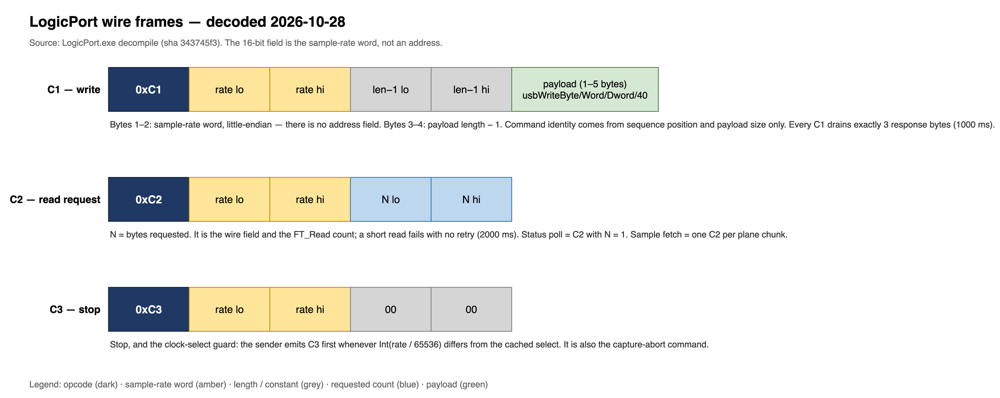
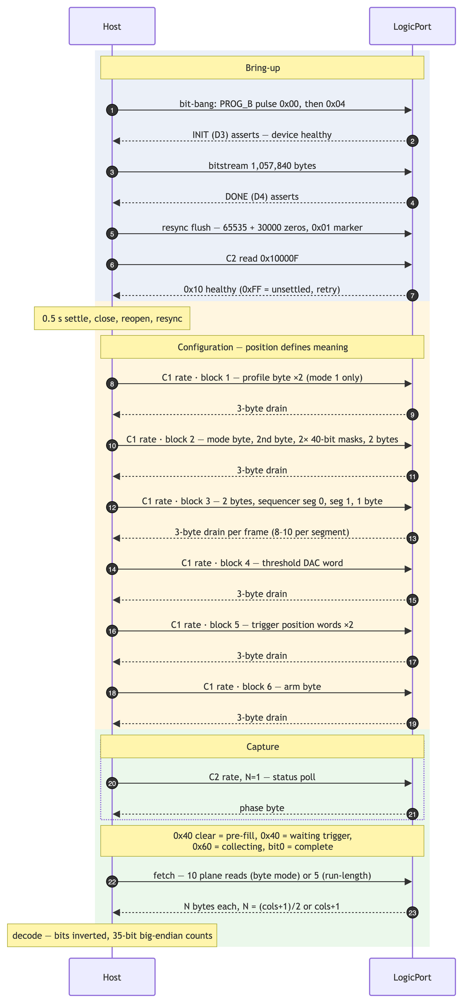
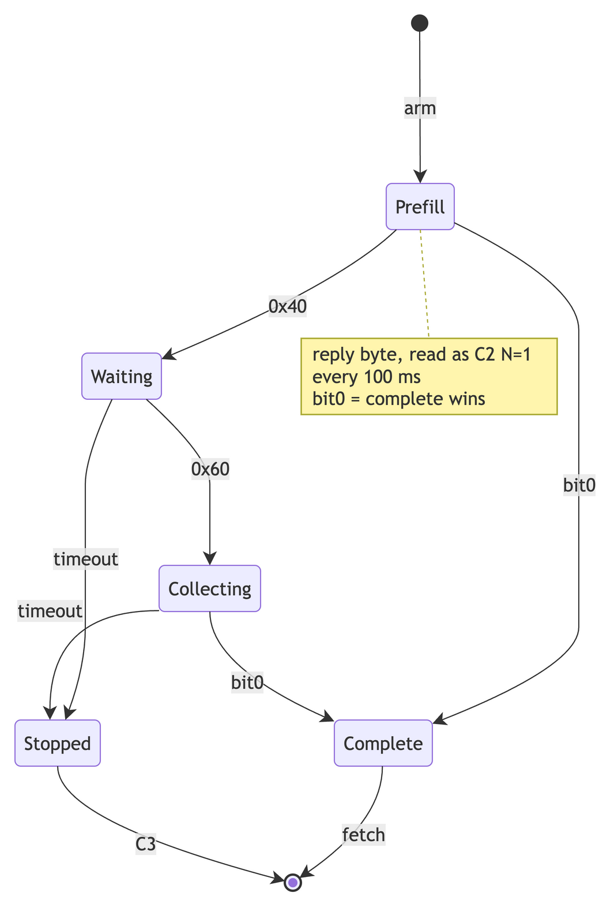

# LogicPort wire decode — addenda 5 and 6 (2026-10-27/28)

Copied verbatim from the project record `LogicPort-Protocol.md`, which is
maintained outside this repository. Source binary: `LogicPort.exe`
v3.4.0.2371, SHA-256 `343745f3300c77a7c3c28b370c1ed34416810ec000aa5fd2d79cfe73e3aaa868`.
The tests in `tests/test_wire_plan.py` pin the facts below.

## Diagrams

## Session findings addendum 5, 2026-10-27 late (the frame has no address)

This addendum corrects the addressing model. The vendor application was
decompiled (`extracted/files/LogicPort.exe`, see `docs/RE-Toolchain.md`),
including the four `usbWrite` wrappers and their common sender
`FUN_004c6fad`.

### The C1 frame

| Byte | Value |
| --- | --- |
| 0 | `0xC1`, literal |
| 1 | rate low byte (`rate & 0xFF`) |
| 2 | rate high byte (`(rate >> 8) & 0xFF`) |
| 3 | `(payload_len - 1) & 0xFF` |
| 4 | `((payload_len - 1) >> 8) & 0xFF` |
| 5.. | payload |

Then `FT_Write` of the five header bytes, `FT_Write` of the payload,
a 1000 ms wait for a response, and a read into the response buffer.

**There is no page, no register offset, and no per-cell address
anywhere in the frame.** The first wrapper argument is the rate
variable, not a register cell. Register and command selection are
implicit: the only variables on the wire are the rate word, the payload
size, and the payload contents. The device expects commands in a fixed
sequence, and the meaning of a payload comes from its position in that
sequence.

### Consequences for the record

- The clock-word and address-field conflict named in the open questions
  is resolved: the field is the clock word. The "address field" reading
  in section 5b is wrong.
- The `C3` command is a clock-select, sent when the rate's high word
  changes. It is not a page select. The page cache in the tools is a
  misreading of the vendor's clock cache.
- Every configuration write in this project's tools put page bytes
  where the device reads the rate. The device acknowledged them and
  changed no state, which matches the observed `FF` status and empty
  planes.
- The serialization the earlier lane attributed to the sequencer
  function does not exist. That function performs no wire writes, and
  no function writes absolute block addresses.

### Open

- The `C2` read request builder (not among the four write wrappers).
- The expected response length per command, which the caller sets in
  `DAT_00597798`.
- The exact command sequence and payload semantics for each step.

### Vendor application structure (decompiled)

The command layer is one dispatcher plus four payload packers.

`FUN_004c6fad` is the only sender. Every wrapper funnels into it with a
payload, and it builds the frame in the table above. The four wrappers
differ only in payload width and byte order:

| Wrapper | Payload | Order |
| --- | --- | --- |
| `FUN_004ca679` | 1 byte | value |
| `FUN_004ca84e` | 2 bytes | little-endian |
| `FUN_004caab4` | 4 bytes | little-endian |
| `FUN_004cad4a` | 5 bytes (40 bit) | little-endian |

`FUN_004f2179` is the dispatcher. It sends nothing unless a dirty flag
is set, and each flag selects a group of sends distinguished by payload
width alone:

| Dirty flag | Sends |
| --- | --- |
| `DAT_005963c8` | two 1-byte writes (clock and rate cells) |
| `DAT_005963ca` | three 1-byte writes and two 5-byte writes (two 33-bit tallies) |
| `DAT_005963cc` | two 1-byte writes, then `FUN_004f2dd4(0)` and `(1)`, then one 1-byte write |
| `DAT_005963ce` | one 2-byte write: the threshold DAC |
| `DAT_005963d0` | two 2-byte writes: trigger and channel configuration |
| `DAT_005963d2` | one 1-byte write: the arm byte |

Notes from the same decompilation:

- `FUN_004f2dd4`, called inside the third flag's block, **does send**.
  A first pass concluded it performed no wire writes; that pass looked
  for stores to absolute addresses, which do not exist anywhere in this
  binary. In fact the function sends through the wrappers: about two to
  three 5-byte frames, two 4-byte frames and about three 1-byte frames
  per segment, roughly eight to ten `C1` frames for each of the two
  segments. That matches the lane record's "about fifteen writes"
  within counting tolerance. The payloads come from the 128-byte segment
  records at `DAT_005963f0`, which is why no literal appears at a store.
- The clock select is rate-driven: `clkSel = Int(rate / 65536.0)`,
  cached at `0x5977e8`. When it changes, `FUN_004c74b0` sends the `0xC3`
  first. The cached low word at `0x5977e0` is refreshed from the
  response after every exchange.
- Threshold conversion: `code = Int((4.559 - volts) / 5.875 * 1023)`,
  masked to `0x3FF`, then combined with a shifted term. Worked example:
  2.0 V yields `0x01BD`, so the wire is `C1 <rate lo> <rate hi> 01 00
  BD 01`.
- Response handling: every `C1` drains exactly three bytes.
  `DAT_00597798` is a constant written once at device open
  (`MOV [0x597798], 3` at `0x4c5adf`); all seventeen references to it
  are reads. The read helpers `FUN_004cb0c5`, `FUN_004cb2c8` and
  `FUN_004cb534` read from that three-byte buffer.

### The C2 read request

`FUN_004c6aa3` is the only builder of a `0xC2` frame in the binary. It
is a structural twin of the `C1` sender:

| Byte | Value |
| --- | --- |
| 0 | `0xC2`, literal at `0x4c6bbf` |
| 1 | rate low byte |
| 2 | rate high byte |
| 3 | `N & 0xFF` |
| 4 | `(N >> 8) & 0xFF` |

`N` is the requested byte count. It goes on the wire and is also the
read count, with `bytes_read >= N` enforced. The timeout is 2000 ms,
against 1000 ms for `C1`. The same clock-select gate applies. There is
no register-read path distinct from a buffer read: one builder, one
frame shape, and the only per-call variable is `N`.

### The dispatcher send order

`FUN_004f2179` sends in this order, block by block:

1. Flag `0x5963c8`, only when the mode is 1: one profile byte sent
   twice.
2. Flag `0x5963ca`: the mode byte, a second byte, then the two 40-bit
   channel-mask tallies when `0x5963f4` is nonzero, then two more bytes.
   When `0x5963f4` is zero the two mask frames are not sent.
3. Flag `0x5963cc`: two bytes, then `FUN_004f2dd4(0)` and `(1)` — the
   two sequencer segments, eight to ten frames each — then one byte.
4. Flag `0x5963ce`: the threshold DAC word.
5. Flag `0x5963d0`: the two trigger-position words.
6. Flag `0x5963d2`: the arm byte.

### Chain rule

Every frame, `C1` and `C2` alike, carries the current rate word. Every
`C1` drains exactly three bytes. A command is identified only by its
position in the sequence and its payload size. A chain that changes the
order, or that omits the sequencer segments, does not reproduce the
vendor's behaviour.

## Session findings addendum 6, 2026-10-28 (the sample-read path)

Decompiled from `extracted/files/LogicPort.exe`. This is the operational
specification a reimplementation must follow after configuration.

### 1. Capture completion poll

The capture timer is `FUN_00504778`, one tick every 100 ms (constant
`0x402c80` = 100.0). It runs only when `DAT_00596730` is not 4 (4 means
idle).

Each tick performs a **one-byte read**: `FUN_004cb0c5(&DAT_00596b28,
&byte)`, which is a `C2` with `N = 1`. Status decode:

| Reply byte | Phase |
| --- | --- |
| bit0 clear, `0x40` clear | 5, pre-fill |
| `0x40` set, `0x20` clear | 6, waiting for trigger |
| `0x60` set | 7, triggered and collecting |
| bit0 set | complete, go to fetch |

The phase variable is `DAT_00597460`.

Timeouts: in phase 5, when `DAT_005963f4` is nonzero and elapsed exceeds
`DAT_00596ebc`, a stop command is sent from slot `DAT_00596b08`. In
phase 7, elapsed beyond `DAT_00596eb8` sends the stop at
`DAT_00596b10`. Both then call `FUN_00520527`. Entering phase 6 while
`DAT_00596730` is 8 arms `DAT_005963d4 = -1`, which makes the next tick
re-poll and send a stop from slot `DAT_00596b08`, `DAT_00596b18` or
`DAT_00596b10` depending on the flags. The timeout values are
configuration-owned doubles; their runtime defaults are unknown.

### 2. Sample fetch

On status bit0, the timer calls one of two readers: `FUN_004ed082` for
two-byte elements (uncompressed) or `FUN_004ef26e` for four-byte
elements (run-length). After the fetch the state returns to 4 and two
one-byte sends follow: `FUN_004ca679(&DAT_00596ae8)` when the mode is
not 2, and `FUN_004ca679(&DAT_00596ae0)` always.

**Byte mode.** Three scalar reads first: two cursors through
`FUN_004cb534` (slots `0x596be8` and `0x596bf8`, reduced modulo
`0x400`), and an offset through `FUN_004cb0c5` (slot `0x596b48`). Then
ten plane reads via `FUN_004cd218(address, count, destination)`. The
even-column set reads at `posA + DAT_00596c08 / c10 / c18 / c20 / c48`;
the odd-column set at `posB + DAT_00596c28 / c30 / c38 / c40`, plus
`c48` again at `posB`. Each count is `(cols + 1) / 2` bytes, where
`cols = 0x7FF - offset` with a floor of 1, validated between 1 and
65536. Each plane read is one `C2` of that `N` with the 2000 ms
timeout.

**Word and run-length mode.** Offset becomes `(offset + 1) & 0x7FF` and
`cols = 0x7FF - offset`. Five plane reads at `pos + c08 / c10 / c18 /
c20 / c48`, each of `cols + 1` bytes. The `c48` flag byte at the
trigger position is read first, and one column is trimmed when its bit 3
is set. Replies land in buffer `DAT_0059776c`; the extraction base
offset lives in `DAT_00597798` and should be 0 for `C2` payload, to be
settled by a runtime capture.

### 3. Column format

**Byte mode.** Byte *k* of a plane carries columns 2*k* and 2*k*+1.
Even-column bytes map to `c08 → ch0-7`, `c10 → ch8-15`, `c18 → ch16-23`,
`c20 → ch24-31`; odd-column bytes map to `c28 / c30 / c38 / c40` the
same way. The `c48` flag byte carries ch32 and ch33 in bits 1 and 2 for
even columns, bits 5 and 6 for odd columns. **Every stored bit is the
complement of the raw level** (a low pin stores as 1).

**Word and run-length mode.** Per column, flag bit 3 clear means a
digital column: bits 1 and 2 carry ch32 and ch33, and the four data
planes carry ch0-31 with bit *n* of each byte mapping to a channel,
inverted. Flag bit 3 set means a run-length column: the count is 35-bit
big-endian, assembled as `((flag & 7) << 32) | c20 | c18 | c10 | c08`.
The previous digital state is held and copied forward, and the count is
accumulated. The prior record's "flag bit 3, 35-bit big-endian counts,
raw inverted" is confirmed.

### 4. Timings on the read path

| Timing | Value | Where |
| --- | --- | --- |
| Capture timer cadence | 100 ms | `0x402c80` = 100.0 |
| `C2` read timeout | 2000 ms | `FUN_004c6aa3` |
| `C1` drain timeout | 1000 ms | `FUN_004c74b0` |
| Trigger-wait timeout, phase 5 | config double | `DAT_00596ebc` |
| Collect timeout, phase 7 | config double | `DAT_00596eb8` |
| Stop command delay | one tick, 100 ms | `DAT_005963d4` |

There are no retry loops on the read path. A short read fails and the
caller bails.

### Confidence notes

- The byte-mode offset transform reads slot `0x596b48` as one byte and
  applies arithmetic of the shape `(o + 1 - 0x400)`; this is medium
  confidence because of decompiler varargs.
- The word-mode plane count of `cols + 1` is inferred from the unpack
  indexing, in which every column owns a byte in every plane.
